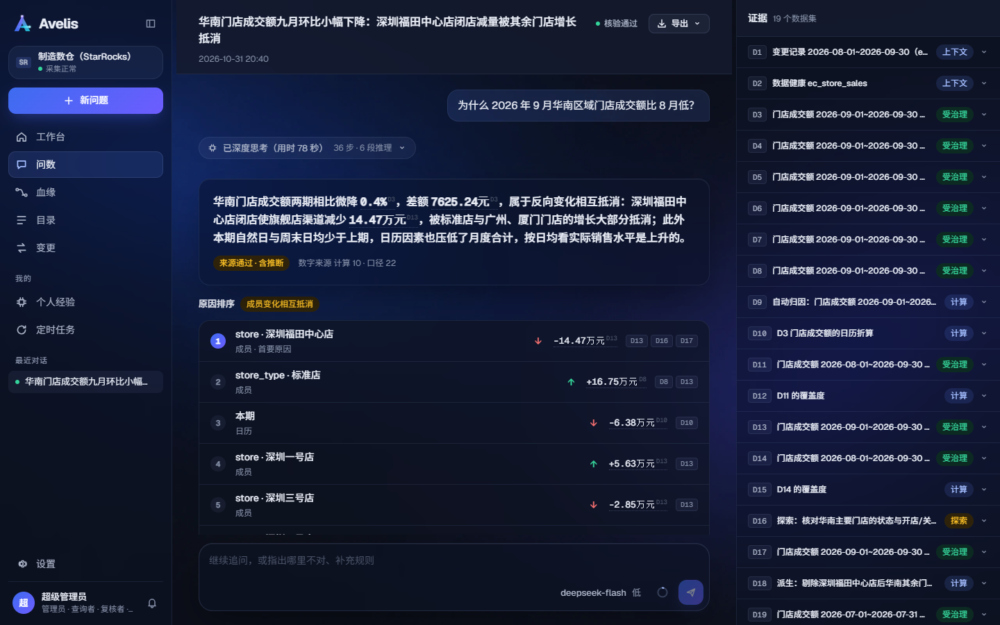
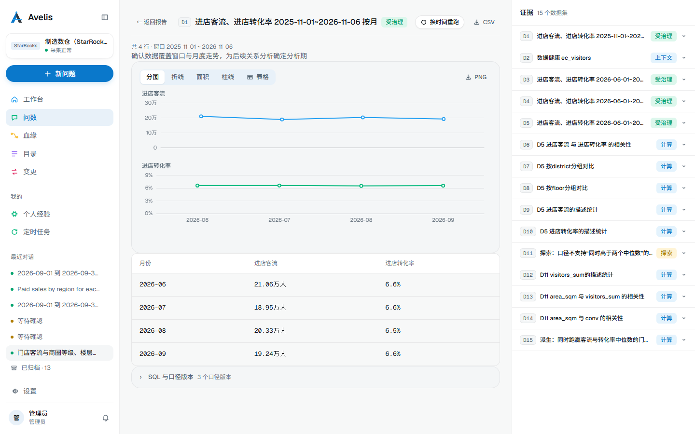
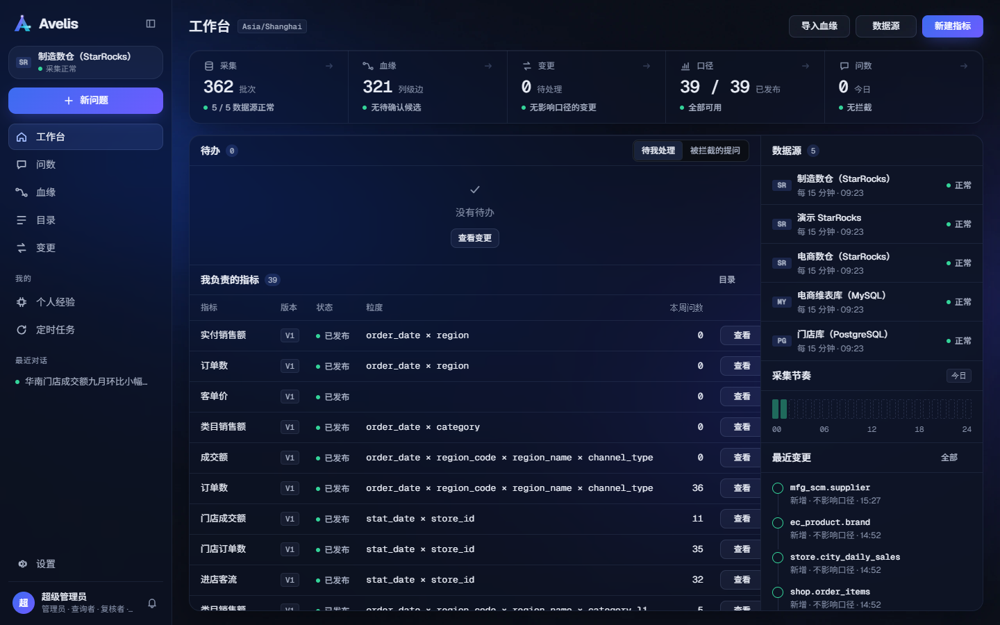
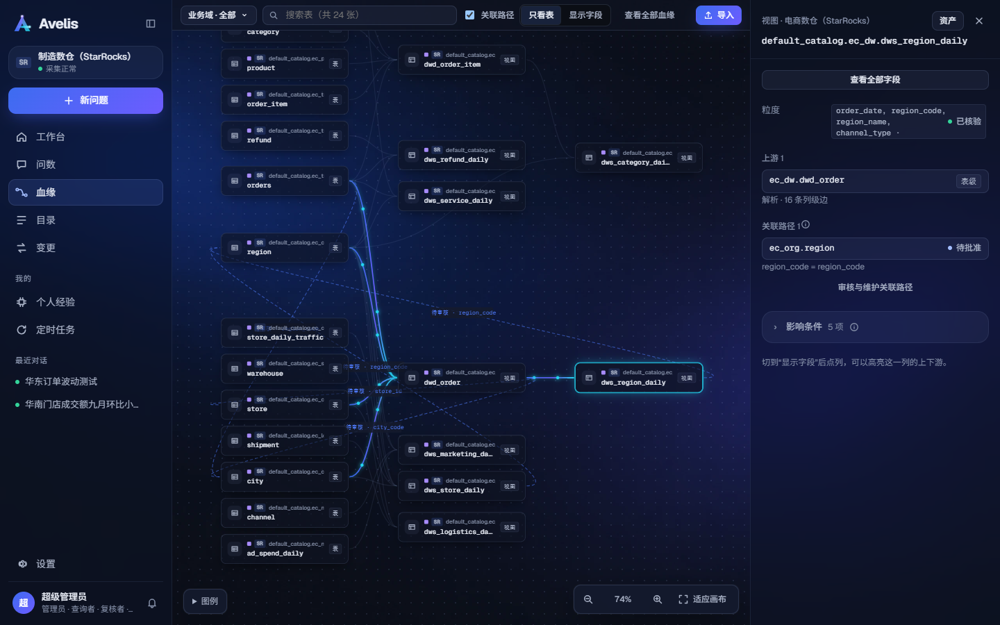
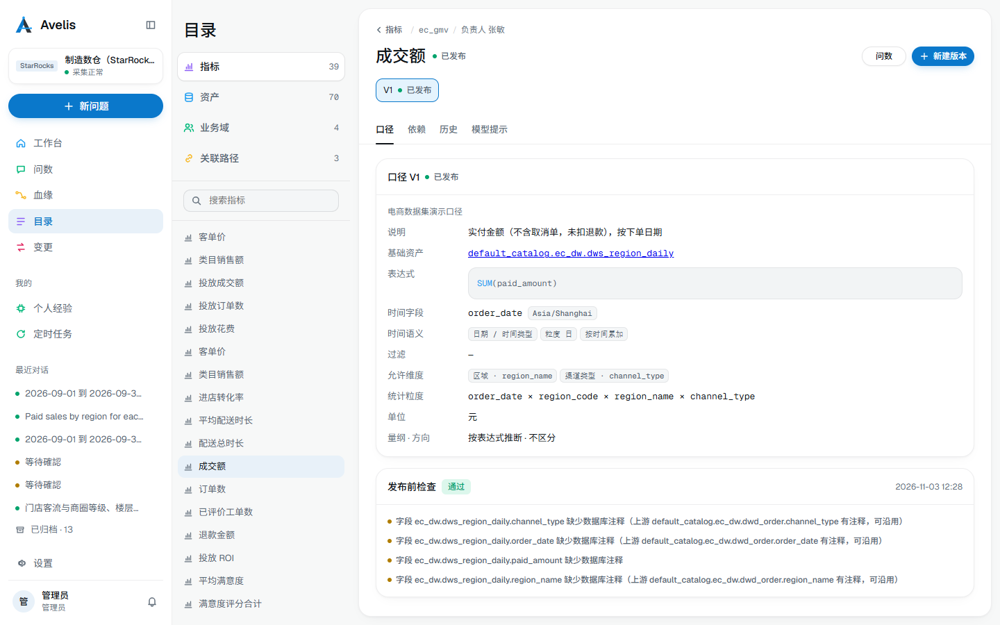
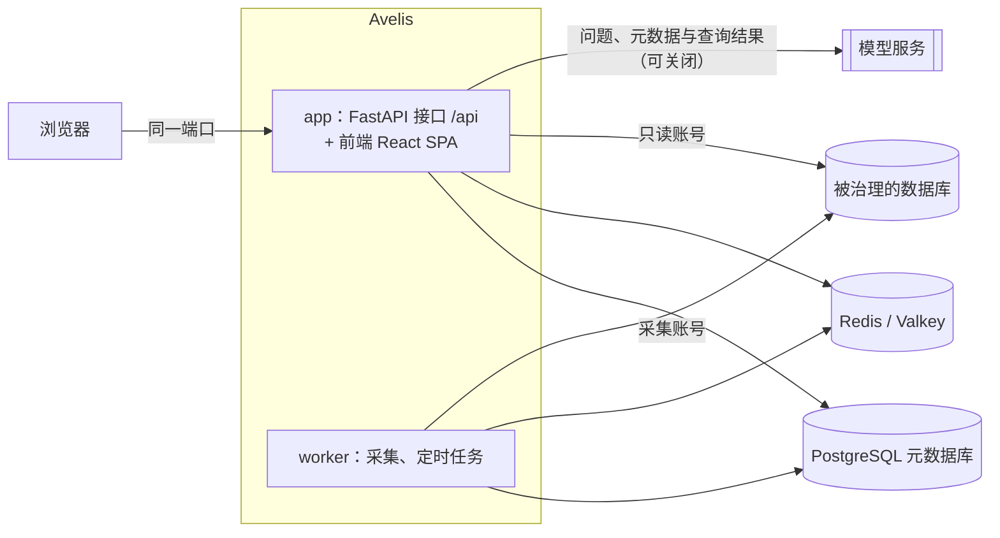

<div align="center">


# Avelis

[English](README.en.md) | 简体中文 | [繁體中文](README.zh-TW.md)

**有依据的智能问数与分析，建立在血缘、口径治理与变更管理之上。**

[](https://github.com/shenhui027-arch/avelis/actions/workflows/ci.yml)
[](LICENSE)
[](backend/pyproject.toml)
[](frontend/package.json)
[](docs/architecture.md)
[](#%E6%94%AF%E6%8C%81%E7%9A%84%E6%95%B0%E6%8D%AE%E5%BA%93)
[](docs/deployment.md)
[](https://github.com/shenhui027-arch/avelis/releases/tag/v1.0.5)

[功能亮点](#功能亮点) · [最近更新](#最近更新) · [截图](#截图) · [支持的数据库](#支持的数据库) · [快速开始](#快速开始) · [文档](#文档) · [路线图](#路线图) · [参与贡献](CONTRIBUTING.md) · [安全](SECURITY.md) · [更新日志](CHANGELOG.md)

</div>

Avelis 用自然语言回答关于业务数据的问题，并说清每个数从哪来：每个答案都带来源表、口径、版本和权限依据。上游表或视图变化后，Avelis 知道哪些口径和答案受影响，并由后端阻止受影响的口径继续被使用，直到有人复核。



> [!NOTE]
> Avelis v1.0.5 已发布，变更见[更新日志](CHANGELOG.md)。界面与文档都提供简体中文、繁体中文与英文。

## 写在前面

Avelis 以 [Apache License 2.0](LICENSE) 开源。你可以放心地把它用在商业项目里，也可以随意修改、二次开发，不用问我，也不用付费，只需按协议保留版权和许可声明。

如果它真的帮到了你，我不需要任何回报。要是你想表达一点谢意，可以在支付宝公益里，为山区和困难家庭的孩子捐一份营养午餐。

AI 让我们这些开发者先尝到了技术进步的甜头。我希望这份红利能换一种方式，传到那些还接触不到 AI 的普通孩子身边。

## 功能亮点

- **血缘来自数据库本身**：用只读账号采集元数据，按物理 ID 识别同一对象；解析视图、外部表与导入的 SQL / Python / Shell 代码，得到表级与字段级血缘；解析不了的片段由模型提出候选，人工确认。
- **口径治理**：指标与版本状态机、发布检查、复核与跨域批准；关联路径与粒度校验，防止关联放大。
- **变更管理**：上游结构变化 → 影响分析 → 复核；变更归因到执行它的数据库用户；历史只追加并封入哈希链，可检索、可导出。
- **有依据的问数**：LangGraph 智能体理解问题并多轮追问；模型只提交结构化意图，SQL 由已发布口径确定性生成、校验，执行前核对来源结构，再用只读账号执行。
- **分析智能体**：多步分析“为什么变了、什么关系、该怎么做”；取数只走受治理查询，报告中的数字逐个核验，结论分事实、计算、推断、建议；报告可导出 PDF / HTML / Markdown，分析可保存为定时任务。
- **对话确认与经验学习**：模型发现的疑问与用户确认，沉淀为受治理的经验，供后续问数与分析使用。
- **模型可替换**：在页面配置 DeepSeek、OpenAI、Anthropic、通义千问或任意 OpenAI 兼容接口，按用途指定模型；未配置时使用规则匹配的演示模型，并在答案中标明。

## 最近更新

| 版本 | 新增 |
|---|---|
| **v1.0.5** | 筛选取值对齐：用户说的“华东区”这类取值，确定性地对到维度成员或业务维表（别名由业务方在自己的维表里维护、经关联路径登记），对不上时追问候选、可直接点选；资产搜索支持组合关键词与加载更多；修复并发投递在轮尾误计重试 |
| **v1.0.4** | 用对话改图：续问里说“画成饼图”“标出最高点”“突出华东”即可改图，不重新取数；图上标注极值点、平均线与高亮，导出同步；Webhook 并发投递，发件箱按保留期清理；资产选择与目录检索按需查询，大目录不再整表加载 |
| **v1.0.3** | 图表能力升级：问数回答自动出图（趋势、排名、构成、对比、指标卡、分图），可切换候选图与表格、下载 PNG；分析报告正文插图，PDF / HTML 导出按同一份图表规格绘图；数值按量纲显示（百分比、万 / 亿、单位）；模型可通过 chart 工具选图并给出结论式图题 |
| **v1.0.2** | MCP 服务：Claude、Cursor 等 AI 工具经 OAuth 授权后，按受治理的口径与血缘查数；治理事件与 Webhook：口径发布、采集失败、结构变化等 14 种事件推送到订阅地址；口径与 Apache Ossie 语义模型双向互通；口径语义提示（适用说明、同义词、示例问法）；部署开箱即用，默认管理员 admin / 123456，登录页可直接改密 |
| **v1.0.1** | MySQL 完整引擎（视图列级血缘、只读问数）；MySQL、SQL Server、Oracle、StarRocks 的 DDL 变更归因到数据库用户 |
| **v1.0.0** | 首个公开版本：元数据采集与列级血缘、口径治理与变更管理、有依据的智能问数、分析智能体 |

完整变更见[更新日志](CHANGELOG.md)，下载见 [Releases](https://github.com/shenhui027-arch/avelis/releases)。

## 截图

| 数据集主视图 | 工作台 |
|---|---|
|  |  |
| **血缘** | **目录** |
|  |  |

更多页面（问数首页、报告的“还没查清”、导出、个人经验、设置、浅色主题）见[界面导览](docs/product-tour.md)。

## 支持的数据库

每种数据库是一个引擎适配器。版本是本地演示环境中实际测试过的版本。

| 数据库 | 测试版本 | 采集元数据 | 视图血缘 | 问数查询 | 执行前核对 | 变更归因到用户 |
|---|---|:---:|:---:|:---:|:---:|:---:|
| StarRocks | 3.5.14 + AuditLoader 4.2.2 | ✓ | ✓ | ✓ | ✓ | [✓（2026-11-01 实机验证，需绑定审计表）](docs/engines/starrocks.md#ddl-变更归因auditloader) |
| PostgreSQL | 18 | ✓ | ✓ | ✓ | ✓ | ✓ |
| ClickHouse | 26.8 | ✓ | ✓ | ✓ | ✓ | ✓ |
| SQL Server | 2022 | ✓ | ✓ | ✓ | ✓ | ✓（2026-11-01 实机验证，需启用默认跟踪） |
| Oracle | 23ai Free | ✓ | ✓ | ✓ | ✓ | ✓（2026-11-01 实机验证，需启用统一审计策略） |
| Apache Doris | 4.1 | ✓ | ✓ | ✓ | ✓ | ✓ |
| Apache Hive | 4.1 | ✓ | ✓ | | | |
| MySQL | 8.4.10 | ✓ | ✓ | ✓ | ✓ | ✓（2026-11-01 实机验证，需绑定审计表） |

StarRocks 还能把外部表与 JDBC Catalog 追溯到背后的 MySQL 表。MySQL 支持视图列级血缘、只读问数与执行前核对；变更归因需绑定 DDL 审计表，例如已开启表输出的 `mysql.general_log`。实测该日志也记录执行失败的 DDL，只作候选证据，需与采集到的结构变化相互印证。MySQL 与 StarRocks 未绑定审计表时，归因状态均为 `unsupported`，原因明确提示“未绑定审计表”。

2026-11-01 的 DDL 实机验证仍有边界：SQL Server 演示实例时区偏移为 0，本地时间换 UTC 与跨夏令时未实机验证；Oracle 使用自建统一审计策略（CREATE / ALTER / DROP TABLE、CREATE / DROP VIEW、COMMENT、RENAME、TRUNCATE TABLE）与 `AUDIT_VIEWER`，无记录且无策略的 `not_enabled` 分支未实机验证；StarRocks FE 时区为 UTC，非 UTC 换算未实机验证，AuditLoader 刚安装后的几十秒内可能未记录语句，此时归因为未匹配。只接入 [SQLGlot](https://github.com/tobymao/sqlglot) 支持的引擎，详情见[引擎核验记录](docs/engines/README.md)与 [ADR 0004](docs/decisions/0004-engine-adapters.md)。

## 快速开始

前置条件：Docker Engine 24+ 与 Compose v2.24+（或 Docker Desktop）。

```bash
git clone https://github.com/shenhui027-arch/avelis.git
cd avelis/deploy/docker
cp avelis.example.toml avelis.toml
```

编辑 `avelis.toml`，填写三个必填项：`[security] secret`、`[database] password`、`[redis] password`。初始管理员口令可留空。然后启动：

```bash
docker compose up -d --build
docker compose ps
```

等 `app` 显示 `healthy` 后，浏览器打开 `http://<服务器 IP>:8080`。初始口令未配置或留空时，用默认 `admin` / `123456` 登录，不强制改密，请登录后在界面修改口令；显式配置了初始口令时，用该口令登录并按提示改密。

这套编排包含应用（接口 + 前端）、worker、PostgreSQL 与 Redis（Valkey），数据保存在 Docker 数据卷。接下来在 **设置 → 数据源** 添加数据源，在 **设置 → 模型配置** 配置模型。使用外部数据库、反向代理与 HTTPS、不用 Docker 部署、升级与备份，见[部署指南](docs/deployment.md)。

## 架构



- **后端** `backend/`：Python 3.12、FastAPI、SQLAlchemy + Alembic、SQLGlot、LangGraph。
- **前端** `frontend/`：React、Vite、TypeScript，只通过 `/api` 访问后端，类型由 OpenAPI 生成。
- **存储**：元数据库只支持 PostgreSQL；Redis 用于任务唤醒、缓存、锁与令牌吊销。
- **部署**：生产模式下后端同时托管构建好的前端，一个端口即可访问；worker 用同一镜像的独立进程运行。

详见[架构与治理说明](docs/architecture.md)与[架构决策记录](docs/decisions/)。

## 配置

部署使用一份带中文注释的 TOML 配置文件 [`deploy/docker/avelis.example.toml`](deploy/docker/avelis.example.toml)（复制为 `avelis.toml`）。必填项：

| 配置 | 说明 |
|---|---|
| `[security] secret` | 主密钥（至少 16 个字符），加密数据源口令与模型密钥、签发登录令牌；上线后不要更换 |
| `[database] password` | PostgreSQL 元数据库口令；使用外部库时同时填 host、port、name、user |
| `[redis] password` | Redis 口令 |

`[bootstrap] initial_admin_password` 可选，留空使用默认口令 `123456`，不校验强度、不强制改密，请登录后在界面修改。显式填写时须为 12–128 个字符、不包含用户名、至少 4 种不同字符，首次登录强制改密。用户名默认 `admin`，可通过 `initial_admin_username` 修改；已有启用的管理员时跳过，不修改已有账号。

自动迁移与首个管理员初始化默认开启，即使未写 `[bootstrap]` 段也会执行。MCP 同样默认开启，可直接使用 **设置 → MCP 接入**；未配置 `AVELIS_PUBLIC_URL` 时按本次请求的 scheme、Host 与 ASGI `root_path` 推导对外地址。反向代理后请正确设置 `AVELIS_FORWARDED_ALLOW_IPS` 并保留 Host，或直接配置 `AVELIS_PUBLIC_URL`；不需要 MCP 时可设 `AVELIS_MCP_ENABLED=false`。分析的元数据图证据发现与证据解释也默认开启（仍属实验特性），没有模型或元数据图时跳过额外证据；可分别用 `AVELIS_ANALYSIS_RETRIEVAL=false`、`AVELIS_ANALYSIS_INVESTIGATION=false` 关闭。

优先级：环境变量 `AVELIS_*` > `.env` 文件 > 配置文件 > 内置默认值；口令也可以从文件读取（`password_file` / `AVELIS_*_FILE`）。启动时校验配置，出错会指出哪一项、怎么改。全部配置项见[配置参考](docs/configuration.md)。

## 开发

```bash
# 后端：http://127.0.0.1:8000，接口文档 /api/docs
cd backend
uv sync
uv run python -m avelis.bootstrap migrate
uv run uvicorn avelis.api.app:app --port 8000
uv run python -m avelis.jobs          # worker，另开一个终端

# 前端：http://127.0.0.1:5173，/api 代理到 8000
cd frontend
pnpm install
pnpm dev
```

本地演示环境（StarRocks、MySQL、PostgreSQL、Valkey 与合成数据）、演示账号、单元测试与一条命令复现验收，见[开发指南](docs/development.md)。

## 文档

| 读者 | 文档 |
|---|---|
| 用户 | [界面导览](docs/product-tour.md) |
| 运维 | [部署指南](docs/deployment.md) · [配置参考](docs/configuration.md) |
| 开发者 | [开发指南](docs/development.md) · [架构与治理说明](docs/architecture.md) · [文档规范](docs/documentation-guide.md) |
| 设计决策 | [架构决策记录](docs/decisions/) |

完整索引见 [docs/README.md](docs/README.md)。

## 路线图

计划中的方向，不承诺日期：

- 更多引擎的外部 Catalog 与物化视图。
- 问数表达能力：派生指标嵌套、按周 / 月的时间粒度、占比。

版本变化见[更新日志](CHANGELOG.md)。

## 参与贡献

欢迎参与。请先阅读[贡献指南](CONTRIBUTING.md)并遵守[行为准则](CODE_OF_CONDUCT.md)。安全漏洞请按[安全策略](SECURITY.md)私下报告，不要开公开 issue。

## 许可

Avelis 采用 [Apache License 2.0](LICENSE) 开源许可。
