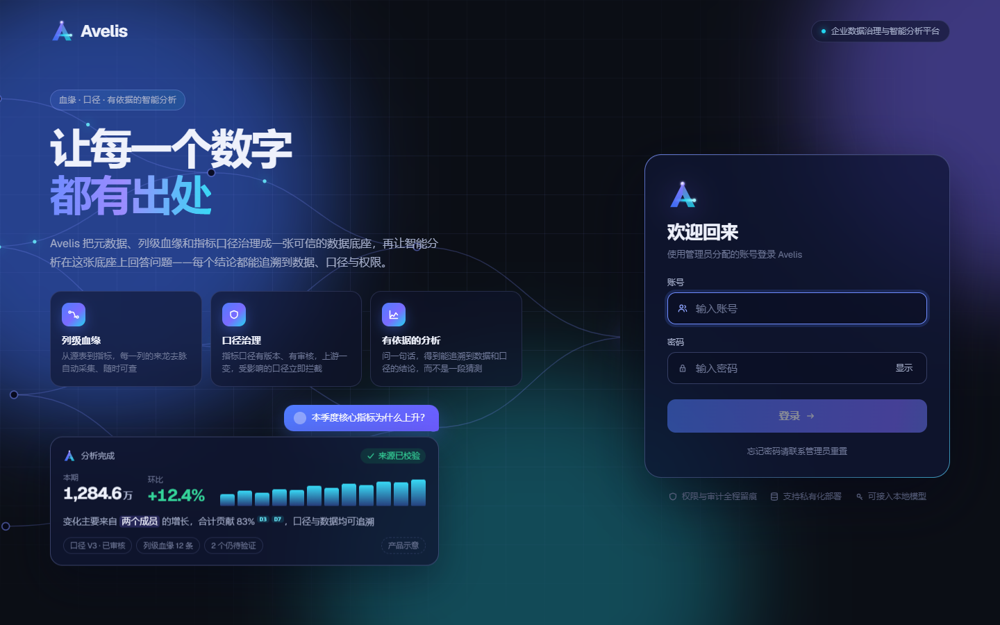
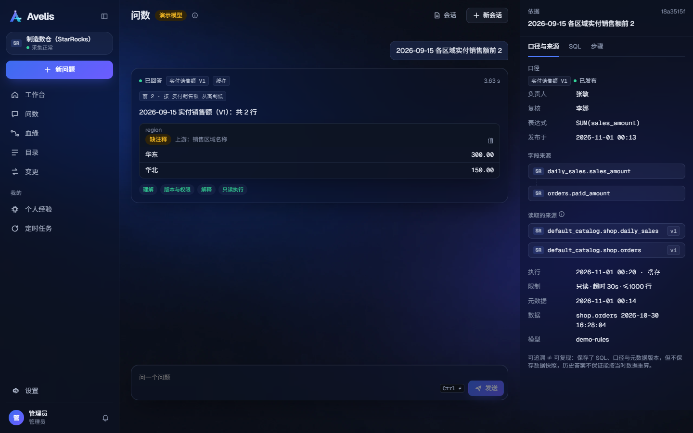
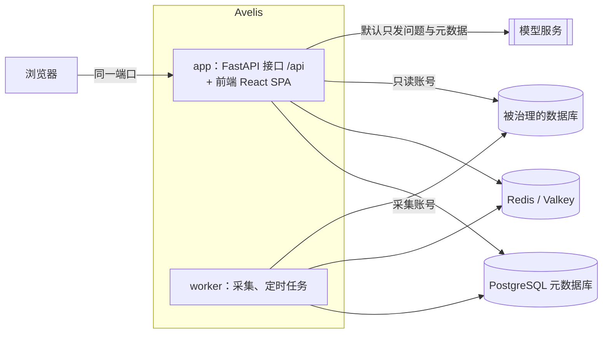

# Avelis

**有依据的智能问数与数据治理底座。** Avelis 建立在数据库血缘、业务口径和变更管理之上：每个答案都带来源、口径、版本和权限依据；上游结构变化后，系统知道哪些口径和答案需要重新确认，并由后端阻止受影响的口径继续被使用。



## 功能

- **采集与血缘**：只读采集数据库元数据，按物理 ID 识别同一对象；解析视图、外部表与导入的 SQL / Python / Shell 代码，得到表级与字段级血缘；解析不了的片段由模型提出候选，人工确认。
- **口径治理**：指标与版本状态机、发布检查、复核与跨域批准；关联路径与粒度校验，防止关联放大。
- **变更管理**：上游结构变化 → 影响分析 → 复核；变更归因到数据库用户；历史只追加并封入哈希链，可核验、检索与导出（变更留底）。
- **智能问数**：LangGraph 智能体理解问题并多轮追问；模型只提交结构化意图，SQL 由已发布口径确定性生成、校验并用只读账号执行；执行前核对来源结构。
- **分析智能体**：多步分析“为什么变了、什么关系、该怎么做”；取数只走受治理查询，报告中的数字逐个核验，结论分事实、计算、推断、建议；可导出 PDF / Markdown / CSV，可保存为定时任务。
- **对话确认与经验学习**：模型发现的疑问与用户确认，沉淀为受治理的经验，供后续问数与分析使用。
- **多数据库**：StarRocks、PostgreSQL、ClickHouse、SQL Server、Oracle、Doris（采集、视图血缘、问数、执行前核对），MySQL（采集，作为外部表的追溯目标）。每种数据库是一个引擎适配器。
- **安全与权限**：资产与口径按业务域授权；登录限流、首次登录改密、会话可吊销；数据源口令与模型密钥加密存储；数据外发给模型默认关闭；所有治理动作写审计。
- **模型可替换**：在页面配置 DeepSeek、OpenAI、Anthropic、通义千问或任意 OpenAI 兼容接口，按用途指定模型；未配置时使用规则匹配的演示模型。

| 工作台 | 智能问数 |
|---|---|
|  |  |
| **血缘** | **资产目录** |
|  |  |

## 架构



- 后端 `backend/`：Python 3.12、FastAPI（REST + OpenAPI）、SQLAlchemy + Alembic、SQLGlot、LangGraph。
- 前端 `frontend/`：React + Vite + TypeScript，只通过 `/api` 访问后端，类型由 OpenAPI 生成。
- 元数据库只支持 PostgreSQL；Redis 协议服务用于任务唤醒、缓存、锁与令牌吊销。
- 生产模式下后端同时托管构建好的前端，**一个端口**即可访问；worker 是独立进程。

详见 [架构与治理说明](docs/architecture.md) 与 [架构决策记录](docs/decisions/)。

## 快速开始（Docker Compose）

前置条件：Docker Engine 24+ 与 Compose v2.24+（或 Docker Desktop）。

```bash
git clone https://github.com/shenhui027-arch/avelis.git
cd avelis/deploy/docker
cp avelis.example.toml avelis.toml
# 编辑 avelis.toml：填写 [security] secret、[database] password、[redis] password、[bootstrap] initial_admin_password
docker compose up -d --build
```

等 `docker compose ps` 显示 `app` 为 `healthy` 后，浏览器打开 `http://<服务器 IP>:8080`，用 `admin` 和初始密码登录（首次登录需修改密码）。

这套编排包含应用（API + 前端）、worker、PostgreSQL 与 Redis（Valkey），数据保存在 Docker 数据卷。使用外部数据库、反向代理与 HTTPS、不用 Docker 部署、升级与备份，见 [部署指南](docs/deployment.md)。

## 配置

部署时只需要改一份带中文注释的明文配置文件 [deploy/docker/avelis.example.toml](deploy/docker/avelis.example.toml)（复制为 `avelis.toml`）。必填项：

| 配置 | 说明 |
|---|---|
| `[security] secret` | 主密钥（≥ 16 个字符），加密数据源口令与模型密钥、签发登录令牌；上线后不要更换 |
| `[database] password` | PostgreSQL 元数据库口令（外部库时同时填 host、port、name、user） |
| `[redis] password` | Redis 口令 |
| `[bootstrap] initial_admin_password` | 首个管理员的初始密码（首次启动时） |

优先级：环境变量 `AVELIS_*` > `.env` 文件 > 配置文件 > 内置默认值；口令也可以用文件引用（`password_file` / `AVELIS_*_FILE`）。启动时校验配置，缺项或格式错误会用中文指出哪一项、怎么改。本地开发沿用仓库根目录的 `.env`（模板 [.env.example](.env.example)）。端口、超时、行数上限、缓存、分析预算、登录时长等全部配置项见 [配置参考](docs/configuration.md)。

## 开发

```bash
# 后端（http://127.0.0.1:8000，接口文档 /api/docs）
cd backend
uv sync
uv run python -m avelis.bootstrap migrate
uv run uvicorn avelis.api.app:app --port 8000
uv run python -m avelis.jobs              # worker，另开一个终端

# 前端（http://127.0.0.1:5173，/api 代理到 8000）
cd frontend
pnpm install
pnpm dev
```

本地演示环境（StarRocks、MySQL、PostgreSQL、Valkey 与合成数据）、演示账号、单元测试与一条命令复现验收，见 [开发指南](docs/development.md)。

## 目录结构

```
backend/                后端（FastAPI）
  src/avelis/           采集、血缘、治理、问数、分析、导入、历史、引擎适配器、接口
  tests/                单元测试与验收测试
frontend/               前端（React + Vite）：工作台、血缘、目录、口径、变更、问数、分析、设置
deploy/docker/          生产部署编排（Compose 项目 avelis）
deploy/demo/            本地演示环境（Compose 项目 avelis-demo）：数据库容器、初始化脚本、合成数据
design/                 设计系统令牌与品牌素材
docs/                   部署、配置、开发、架构文档与架构决策记录
scripts/                演示环境、验收与评测脚本
experiments/            分析智能体实验数据
Dockerfile              应用镜像（前端构建 → 后端运行，非 root）
```

文档索引见 [docs/README.md](docs/README.md)。

## 许可

仓库目前尚未附带开源许可证文件（LICENSE）。在添加许可证之前，代码版权归作者所有，未经许可不得复制、分发或用于商业用途。
