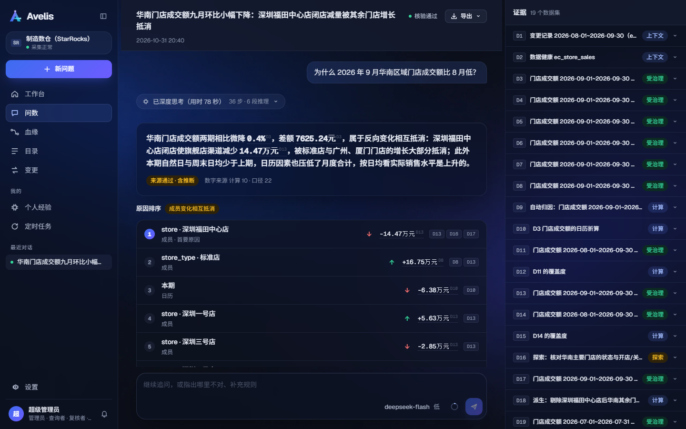
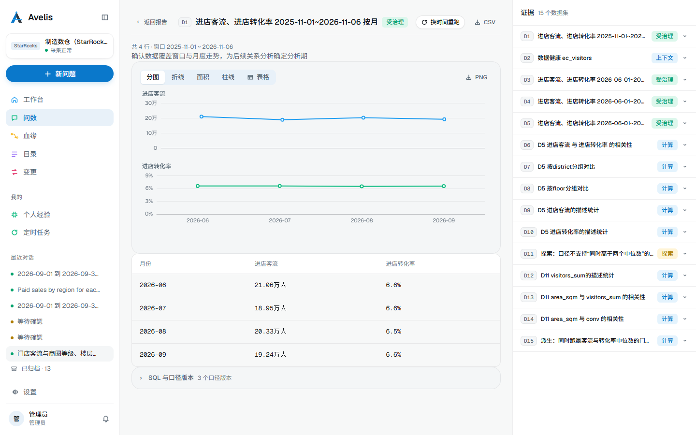
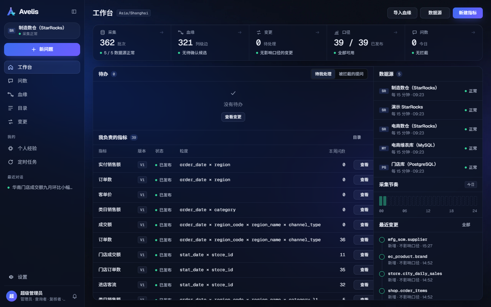
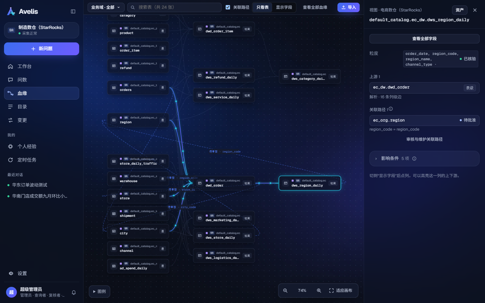
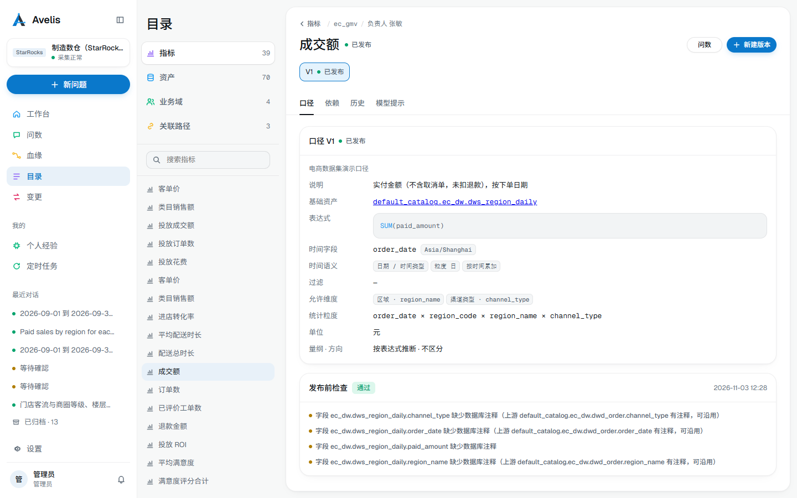
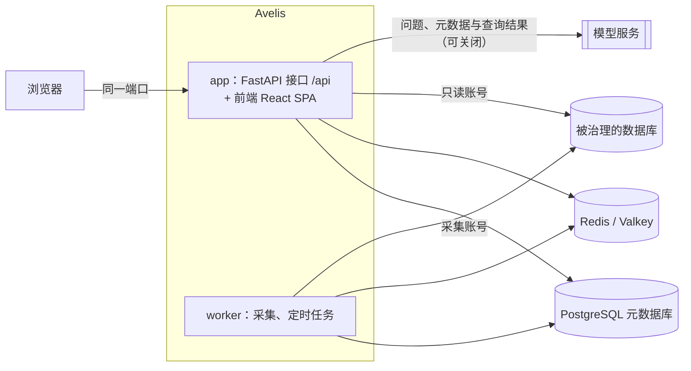

<div align="center">


# Avelis

**有依据的智能问数与分析，建立在血缘、口径治理与变更管理之上。**

[](LICENSE)
[](backend/pyproject.toml)
[](frontend/package.json)

[English](README.md) | 简体中文

</div>

Avelis 用自然语言回答关于业务数据的问题，并说清每个数从哪来：每个答案都带来源表、口径、版本和权限依据。上游表或视图变化后，Avelis 知道哪些口径和答案受影响，并由后端阻止受影响的口径继续被使用，直到有人复核。



> [!NOTE]
> Avelis 处于 v0.1，尚未发布正式版本。界面与大部分文档为简体中文。

## 功能亮点

- **血缘来自数据库本身**：用只读账号采集元数据，按物理 ID 识别同一对象；解析视图、外部表与导入的 SQL / Python / Shell 代码，得到表级与字段级血缘；解析不了的片段由模型提出候选，人工确认。
- **口径治理**：指标与版本状态机、发布检查、复核与跨域批准；关联路径与粒度校验，防止关联放大。
- **变更管理**：上游结构变化 → 影响分析 → 复核；变更归因到执行它的数据库用户；历史只追加并封入哈希链，可检索、可导出。
- **有依据的问数**：LangGraph 智能体理解问题并多轮追问；模型只提交结构化意图，SQL 由已发布口径确定性生成、校验，执行前核对来源结构，再用只读账号执行。
- **分析智能体**：多步分析“为什么变了、什么关系、该怎么做”；取数只走受治理查询，报告中的数字逐个核验，结论分事实、计算、推断、建议；报告可导出 PDF / HTML / Markdown，分析可保存为定时任务。
- **对话确认与经验学习**：模型发现的疑问与用户确认，沉淀为受治理的经验，供后续问数与分析使用。
- **模型可替换**：在页面配置 DeepSeek、OpenAI、Anthropic、通义千问或任意 OpenAI 兼容接口，按用途指定模型；未配置时使用规则匹配的演示模型，并在答案中标明。

## 截图

| 数据集主视图 | 工作台 |
|---|---|
|  |  |
| **血缘** | **目录** |
|  |  |

更多页面（问数首页、报告的“还没查清”、导出、个人经验、设置、浅色主题）见[界面导览](docs/product-tour.md)。

## 支持的数据库

每种数据库是一个引擎适配器。版本是本地演示环境中实际测试过的版本。

| 数据库 | 测试版本 | 采集元数据 | 视图血缘 | 问数查询 | 执行前核对 | 变更归因到用户 |
|---|---|:---:|:---:|:---:|:---:|:---:|
| StarRocks | 3.5.14 | ✓ | ✓ | ✓ | ✓ | |
| PostgreSQL | 18 | ✓ | ✓ | ✓ | ✓ | ✓ |
| ClickHouse | 26.8 | ✓ | ✓ | ✓ | ✓ | ✓ |
| SQL Server | 2022 | ✓ | ✓ | ✓ | ✓ | |
| Oracle | 23ai Free | ✓ | ✓ | ✓ | ✓ | |
| Apache Doris | 4.1 | ✓ | ✓ | ✓ | ✓ | ✓ |
| MySQL | 8.4 | ✓ | | | | |

StarRocks 还能把外部表与 JDBC Catalog 追溯到背后的 MySQL 表；MySQL 目前作为这些外部表的追溯目标采集。只接入 [SQLGlot](https://github.com/tobymao/sqlglot) 支持的引擎，见 [ADR 0004](docs/decisions/0004-engine-adapters.md)。

## 快速开始

前置条件：Docker Engine 24+ 与 Compose v2.24+（或 Docker Desktop）。

```bash
git clone https://github.com/shenhui027-arch/avelis.git
cd avelis/deploy/docker
cp avelis.example.toml avelis.toml
```

编辑 `avelis.toml`，填写四个必填项：`[security] secret`、`[database] password`、`[redis] password`、`[bootstrap] initial_admin_password`。然后启动：

```bash
docker compose up -d --build
docker compose ps
```

等 `app` 显示 `healthy` 后，浏览器打开 `http://<服务器 IP>:8080`，用 `admin` 和初始密码登录；首次登录需要修改密码。

这套编排包含应用（接口 + 前端）、worker、PostgreSQL 与 Redis（Valkey），数据保存在 Docker 数据卷。接下来在 **设置 → 数据源** 添加数据源，在 **设置 → 模型配置** 配置模型。使用外部数据库、反向代理与 HTTPS、不用 Docker 部署、升级与备份，见[部署指南](docs/deployment.md)。

## 架构



- **后端** `backend/`：Python 3.12、FastAPI、SQLAlchemy + Alembic、SQLGlot、LangGraph。
- **前端** `frontend/`：React、Vite、TypeScript，只通过 `/api` 访问后端，类型由 OpenAPI 生成。
- **存储**：元数据库只支持 PostgreSQL；Redis 用于任务唤醒、缓存、锁与令牌吊销。
- **部署**：生产模式下后端同时托管构建好的前端，一个端口即可访问；worker 用同一镜像的独立进程运行。

详见[架构与治理说明](docs/architecture.md)与[架构决策记录](docs/decisions/)。

## 配置

部署只需要一份带中文注释的 TOML 配置文件 [`deploy/docker/avelis.example.toml`](deploy/docker/avelis.example.toml)（复制为 `avelis.toml`）。必填项：

| 配置 | 说明 |
|---|---|
| `[security] secret` | 主密钥（至少 16 个字符），加密数据源口令与模型密钥、签发登录令牌；上线后不要更换 |
| `[database] password` | PostgreSQL 元数据库口令；使用外部库时同时填 host、port、name、user |
| `[redis] password` | Redis 口令 |
| `[bootstrap] initial_admin_password` | 首个管理员的初始密码 |

优先级：环境变量 `AVELIS_*` > `.env` 文件 > 配置文件 > 内置默认值；口令也可以从文件读取（`password_file` / `AVELIS_*_FILE`）。启动时校验配置，出错会指出哪一项、怎么改。全部配置项见[配置参考](docs/configuration.md)。

## 开发

```bash
# 后端：http://127.0.0.1:8000，接口文档 /api/docs
cd backend
uv sync
uv run python -m avelis.bootstrap migrate
uv run uvicorn avelis.api.app:app --port 8000
uv run python -m avelis.jobs          # worker，另开一个终端

# 前端：http://127.0.0.1:5173，/api 代理到 8000
cd frontend
pnpm install
pnpm dev
```

本地演示环境（StarRocks、MySQL、PostgreSQL、Valkey 与合成数据）、演示账号、单元测试与一条命令复现验收，见[开发指南](docs/development.md)。

## 文档

| 读者 | 文档 |
|---|---|
| 用户 | [界面导览](docs/product-tour.md) |
| 运维 | [部署指南](docs/deployment.md) · [配置参考](docs/configuration.md) |
| 开发者 | [开发指南](docs/development.md) · [架构与治理说明](docs/architecture.md) · [文档规范](docs/documentation-guide.md) |
| 设计决策 | [架构决策记录](docs/decisions/) |

完整索引见 [docs/README.md](docs/README.md)。

## 路线图

计划中的方向，不承诺日期：

- Hive 引擎（元数据与视图血缘），开发中。
- 更多引擎的外部 Catalog 与物化视图。
- StarRocks、SQL Server、Oracle 的变更归因。
- 问数表达能力：派生指标嵌套、按周 / 月的时间粒度、占比。

版本变化见[更新日志](CHANGELOG.md)。

## 参与贡献

欢迎参与。请先阅读[贡献指南](CONTRIBUTING.md)并遵守[行为准则](CODE_OF_CONDUCT.md)。安全漏洞请按[安全策略](SECURITY.md)私下报告，不要开公开 issue。

## 许可

Avelis 采用 [Apache License 2.0](LICENSE) 开源许可。
