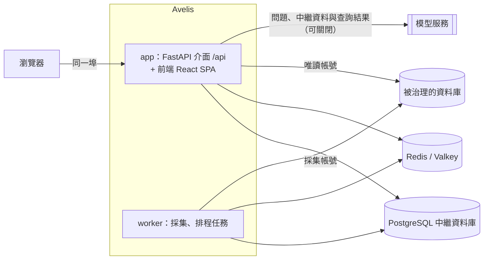

<div align="center">


# Avelis

**有依據的智慧問數與分析，建立在血緣、口徑治理與變更管理之上。**

[](https://github.com/shenhui027-arch/avelis/actions/workflows/ci.yml)
[](LICENSE)
[](backend/pyproject.toml)
[](frontend/package.json)

[English](README.md) | [简体中文](README.zh-CN.md) | 繁體中文

</div>

Avelis 用自然語言回答關於業務資料的問題，並說清每個數從哪來：每個答案都帶來源表、口徑、版本和權限依據。上游表或檢視表變化後，Avelis 知道哪些口徑和答案受影響，並由後端阻止受影響的口徑繼續被使用，直到有人複核。


> [!NOTE]
> Avelis 處於 v0.1，尚未發布正式版本。介面目前為簡體中文，英文與繁體中文在計劃中；文件提供簡體中文、繁體中文與英文。

## 功能亮點

- **血緣來自資料庫本身**：用唯讀帳號採集中繼資料，按物理 ID 識別同一物件；解析檢視表、外部表與匯入的 SQL / Python / Shell 程式碼，得到表級與欄位級血緣；解析不了的片段由模型提出候選，人工確認。
- **口徑治理**：指標與版本狀態機、發布檢查、複核與跨域批准；關聯路徑與粒度校驗，防止關聯放大。
- **變更管理**：上游結構變化 → 影響分析 → 複核；變更歸因到執行它的資料庫使用者；歷史只追加並封入雜湊鏈，可檢索、可匯出。
- **有依據的問數**：LangGraph 代理理解問題並多輪追問；模型只提交結構化意圖，SQL 由已發布口徑確定性生成、校驗，執行前核對來源結構，再用唯讀帳號執行。
- **分析代理**：多步分析「為什麼變了、什麼關係、該怎麼做」；取數只走受治理查詢，報告中的數字逐個核驗，結論分事實、計算、推斷、建議；報告可匯出 PDF / HTML / Markdown，分析可儲存為排程任務。
- **對話確認與經驗學習**：模型發現的疑問與使用者確認，沉澱為受治理的經驗，供後續問數與分析使用。
- **模型可替換**：在頁面設定 DeepSeek、OpenAI、Anthropic、通義千問或任意 OpenAI 相容介面，按用途指定模型；未設定時使用規則匹配的示範模型，並在答案中標明。

## 截圖

| 資料集主檢視表 | 工作臺 |
|---|---|
|  |  |
| **血緣** | **目錄** |
|  |  |

更多頁面（問數首頁、報告的「還沒查清」、匯出、個人經驗、設定、淺色主題）見[介面導覽](docs/product-tour.zh-TW.md)。

## 支援的資料庫

每種資料庫是一個引擎配接器。版本是本地示範環境中實際測試過的版本。

| 資料庫 | 測試版本 | 採集中繼資料 | 檢視表血緣 | 問數查詢 | 執行前核對 | 變更歸因到使用者 |
|---|---|:---:|:---:|:---:|:---:|:---:|
| StarRocks | 3.5.14 | ✓ | ✓ | ✓ | ✓ | |
| PostgreSQL | 18 | ✓ | ✓ | ✓ | ✓ | ✓ |
| ClickHouse | 26.8 | ✓ | ✓ | ✓ | ✓ | ✓ |
| SQL Server | 2022 | ✓ | ✓ | ✓ | ✓ | |
| Oracle | 23ai Free | ✓ | ✓ | ✓ | ✓ | |
| Apache Doris | 4.1 | ✓ | ✓ | ✓ | ✓ | ✓ |
| MySQL | 8.4 | ✓ | | | | |

StarRocks 還能把外部表與 JDBC Catalog 追溯到背後的 MySQL 表；MySQL 目前作為這些外部表的追溯目標採集。只接入 [SQLGlot](https://github.com/tobymao/sqlglot) 支援的引擎，見 [ADR 0004](docs/decisions/0004-engine-adapters.md)（簡體中文）。

## 快速開始

前置條件：Docker Engine 24+ 與 Compose v2.24+（或 Docker Desktop）。

```bash
git clone https://github.com/shenhui027-arch/avelis.git
cd avelis/deploy/docker
cp avelis.example.toml avelis.toml
```

編輯 `avelis.toml`，填寫四個必填項：`[security] secret`、`[database] password`、`[redis] password`、`[bootstrap] initial_admin_password`。然後啟動：

```bash
docker compose up -d --build
docker compose ps
```

等 `app` 顯示 `healthy` 後，瀏覽器開啟 `http://<伺服器 IP>:8080`，用 `admin` 和初始密碼登入；首次登入需要修改密碼。

這套編排包含應用（介面 + 前端）、worker、PostgreSQL 與 Redis（Valkey），資料儲存在 Docker 資料卷。接下來在 **設定 → 資料來源** 新增資料來源，在 **設定 → 模型設定** 設定模型。使用外部資料庫、反向代理與 HTTPS、不用 Docker 部署、升級與備份，見[部署指南](docs/deployment.zh-TW.md)。

## 架構



- **後端** `backend/`：Python 3.12、FastAPI、SQLAlchemy + Alembic、SQLGlot、LangGraph。
- **前端** `frontend/`：React、Vite、TypeScript，只透過 `/api` 存取後端，型別由 OpenAPI 生成。
- **儲存**：中繼資料庫只支援 PostgreSQL；Redis 用於任務喚醒、快取、鎖與權杖吊銷。
- **部署**：生產模式下後端同時託管建置好的前端，一個埠即可存取；worker 用同一映像的獨立程序執行。

詳見[架構與治理說明](docs/architecture.zh-TW.md)與[架構決策記錄](docs/decisions/)（簡體中文）。

## 設定

部署只需要一份帶中文註釋的 TOML 設定檔 [`deploy/docker/avelis.example.toml`](deploy/docker/avelis.example.toml)（複製為 `avelis.toml`）。必填項：

| 設定 | 說明 |
|---|---|
| `[security] secret` | 主金鑰（至少 16 個字元），加密資料來源密碼與模型金鑰、簽發登入權杖；上線後不要更換 |
| `[database] password` | PostgreSQL 中繼資料庫密碼；使用外部庫時同時填 host、port、name、user |
| `[redis] password` | Redis 密碼 |
| `[bootstrap] initial_admin_password` | 首個管理員的初始密碼 |

優先順序：環境變數 `AVELIS_*` > `.env` 檔案 > 設定檔 > 內建預設值；密碼也可以從檔案讀取（`password_file` / `AVELIS_*_FILE`）。啟動時校驗設定，出錯會指出哪一項、怎麼改。全部設定項見[設定參考](docs/configuration.zh-TW.md)。

## 開發

```bash
# 後端：http://127.0.0.1:8000，介面文件 /api/docs
cd backend
uv sync
uv run python -m avelis.bootstrap migrate
uv run uvicorn avelis.api.app:app --port 8000
uv run python -m avelis.jobs          # worker，另開一個終端

# 前端：http://127.0.0.1:5173，/api 代理到 8000
cd frontend
pnpm install
pnpm dev
```

本地示範環境（StarRocks、MySQL、PostgreSQL、Valkey 與合成資料）、示範帳號、單元測試與一條命令復現驗收，見[開發指南](docs/development.zh-TW.md)。

## 文件

| 讀者 | 文件 |
|---|---|
| 使用者 | [介面導覽](docs/product-tour.zh-TW.md) |
| 維運 | [部署指南](docs/deployment.zh-TW.md) · [設定參考](docs/configuration.zh-TW.md) |
| 開發者 | [開發指南](docs/development.zh-TW.md) · [架構與治理說明](docs/architecture.zh-TW.md) · [文件規範](docs/documentation-guide.zh-TW.md) |
| 設計決策 | [架構決策記錄](docs/decisions/)（簡體中文） |

完整索引見 [docs/README.md](docs/README.zh-TW.md)。

## 路線圖

計劃中的方向，不承諾日期：

- 介面支援英文與繁體中文。
- Hive 引擎（中繼資料與檢視表血緣），開發中。
- 更多引擎的外部 Catalog 與物化檢視表。
- StarRocks、SQL Server、Oracle 的變更歸因。
- 問數表達能力：衍生指標巢狀、按週 / 月的時間粒度、佔比。

版本變化見[更新日誌](CHANGELOG.md)。

## 參與貢獻

歡迎參與。請先閱讀[貢獻指南](CONTRIBUTING.md)並遵守[行為準則](CODE_OF_CONDUCT.md)。安全漏洞請按[安全策略](SECURITY.md)私下報告，不要開公開 issue。

## 授權

Avelis 採用 [Apache License 2.0](LICENSE) 開源授權。
