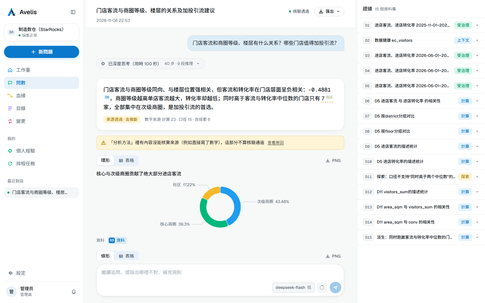
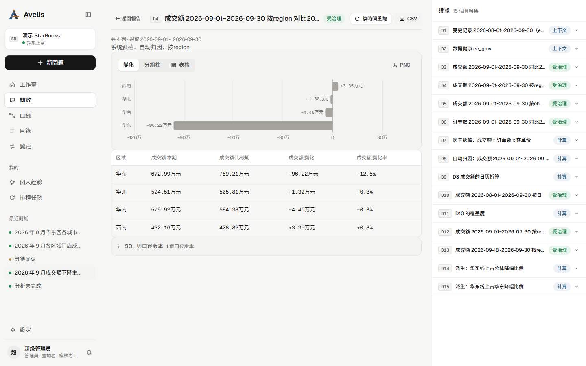
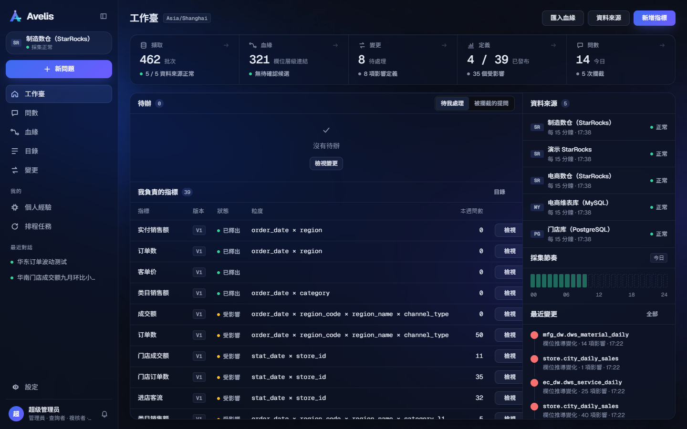
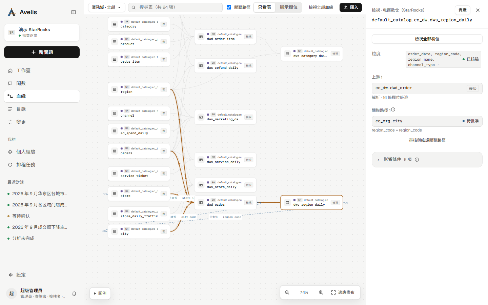
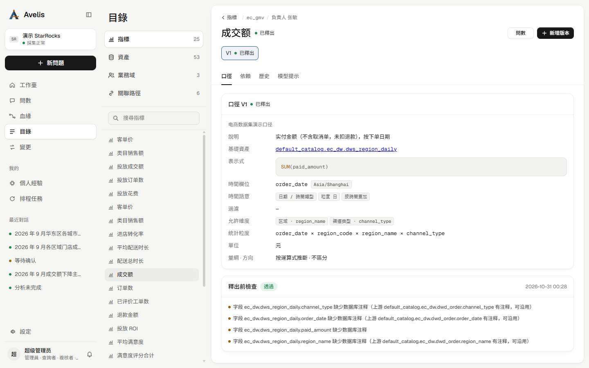
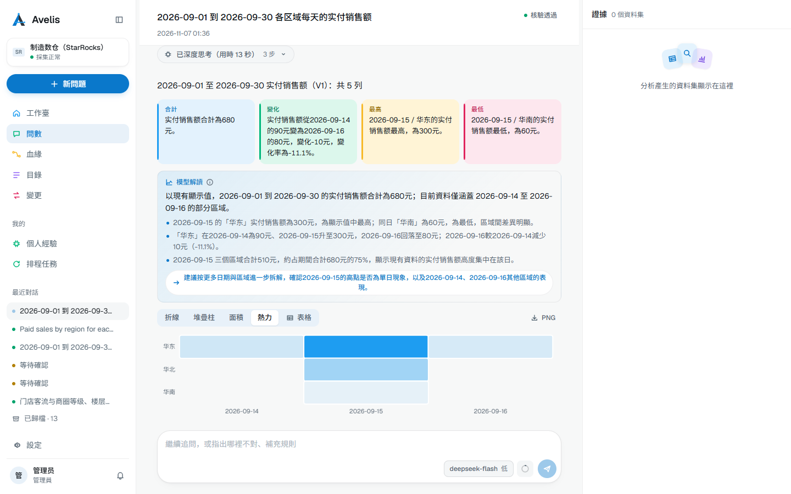
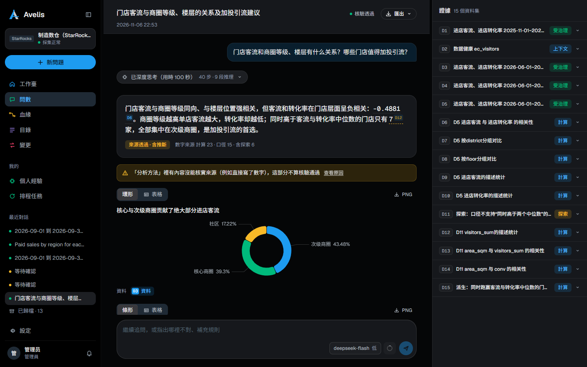
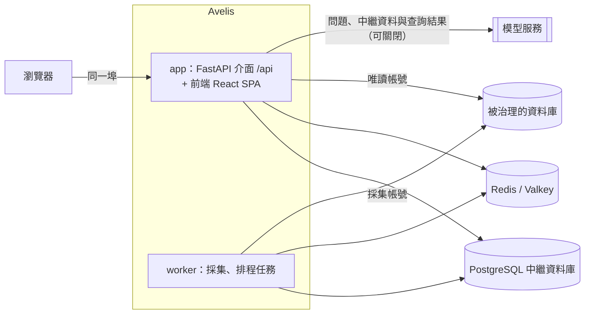

<div align="center">


# Avelis

[English](README.en.md) | [简体中文](README.md) | 繁體中文

**有依據的智慧問數與分析，建立在血緣、口徑治理與變更管理之上。**

[](https://github.com/shenhui027-arch/avelis/actions/workflows/ci.yml)
[](LICENSE)
[](backend/pyproject.toml)
[](frontend/package.json)
[](docs/architecture.zh-TW.md)
[](#%E6%94%AF%E6%8F%B4%E7%9A%84%E8%B3%87%E6%96%99%E5%BA%AB)
[](docs/deployment.zh-TW.md)
[](https://github.com/shenhui027-arch/avelis/releases/tag/v1.0.7)

[功能亮點](#功能亮點) · [最近更新](#最近更新) · [截圖](#截圖) · [支援的資料庫](#支援的資料庫) · [快速開始](#快速開始) · [文件](#文件) · [路線圖](#路線圖) · [參與貢獻](CONTRIBUTING.md) · [安全](SECURITY.md) · [更新日誌](CHANGELOG.md)

</div>

Avelis 用自然語言回答關於業務資料的問題，並說清每個數從哪來：每個答案都帶來源表、口徑、版本和權限依據。上游表或檢視表變化後，Avelis 知道哪些口徑和答案受影響，並由後端阻止受影響的口徑繼續被使用，直到有人複核。



> [!NOTE]
> Avelis v1.0.7 已發布，變更見[更新日誌](CHANGELOG.md)。介面與文件都提供簡體中文、繁體中文與英文。

## 寫在前面

Avelis 以 [Apache License 2.0](LICENSE) 開源。你可以放心地把它用在商業專案裡，也可以隨意修改、二次開發，不用問我，也不用付費，只需按授權保留版權和授權聲明。

如果它真的幫到了你，我不需要任何回報。要是你想表達一點謝意，可以在支付寶公益裡，為山區和困難家庭的孩子捐一份營養午餐。

AI 讓我們這些開發者先嚐到了技術進步的甜頭。我希望這份紅利能換一種方式，傳到那些還接觸不到 AI 的普通孩子身邊。

## 功能亮點

- **血緣來自資料庫本身**：用唯讀帳號採集中繼資料，按物理 ID 識別同一物件；解析檢視表、外部表與匯入的 SQL / Python / Shell 程式碼，得到表級與欄位級血緣；解析不了的片段由模型提出候選，人工確認。
- **口徑治理**：指標與版本狀態機、發布檢查、複核與跨域批准；關聯路徑與粒度校驗，防止關聯放大。
- **變更管理**：上游結構變化 → 影響分析 → 複核；變更歸因到執行它的資料庫使用者；歷史只追加並封入雜湊鏈，可檢索、可匯出。
- **有依據的問數**：LangGraph 代理理解問題並多輪追問；模型只提交結構化意圖，SQL 由已發布口徑確定性生成、校驗，執行前核對來源結構，再用唯讀帳號執行。回答附帶不依賴模型的要點（合計、變化、最高最低、集中度）與模型解讀，自動出圖並可切換 14 種圖（含面積、柱線雙軸、帕累托、瀑布、熱力、散點）；問「為什麼」時同一入口轉為多步分析。
- **分析代理**：多步分析「為什麼變了、什麼關係、該怎麼做」；取數只走受治理查詢，報告中的數字逐個核驗，結論分事實、計算、推斷、建議；報告可匯出 PDF / HTML / Markdown，分析可儲存為排程任務。
- **對話確認與經驗學習**：模型發現的疑問與使用者確認，沉澱為受治理的經驗，供後續問數與分析使用。
- **模型可替換**：在頁面設定 DeepSeek、OpenAI、Anthropic、通義千問或任意 OpenAI 相容介面，按用途指定模型；未設定時使用規則匹配的示範模型，並在答案中標明。

## 最近更新

| 版本 | 新增 |
|---|---|
| **未發布** | 問數回答更豐富：確定性要點卡、模型的結論與逐條觀察（追問一鍵發出），側邊欄「問數」統一為一個入口；新增面積、柱線雙軸、帕累托、瀑布、熱力、散點六種圖，匯出同步；設計系統 v5 晴藍（模組色貫穿全站）與產品拼貼式登入頁 |
| **v1.0.7** | 登入頁修正：頁首與主體收進置中的內容寬度，寬螢幕上標題、產品示意與登入卡成為一組，不再被拉到螢幕兩端 |
| **v1.0.6** | 介面重新設計：柔光工作台（淺色為主、深色同等），去掉漸層、輝光與冗餘說明文字，補充說明收進 ⓘ 提示；引入 Motion，選取塊滑動、頁面切換與浮層開合有過渡；問數首頁與工作台重新排版；字型隨映像打包，執行期不再下載 |
| **v1.0.5** | 篩選取值對齊：使用者說的「華東區」這類取值，確定性地對到維度成員或業務維度表（別名由業務方在自己的維度表裡維護、經關聯路徑登記），對不上時追問候選、可直接點選；資產搜尋支援組合關鍵字與載入更多；修正並行投遞在輪尾誤計重試 |
| **v1.0.4** | 用對話改圖：續問裡說「畫成圓餅圖」「標出最高點」「突出華東」即可改圖，不重新取數；圖上標註極值點、平均線與醒目顯示，匯出同步；Webhook 並行投遞，發件匣依保留期清理；資產選擇與目錄檢索依需查詢，大型目錄不再整表載入 |
| **v1.0.3** | 圖表能力升級：問數回答自動出圖（趨勢、排名、構成、對比、指標卡、分圖），可切換候選圖與表格、下載 PNG；分析報告正文插圖，PDF / HTML 匯出依同一份圖表規格繪圖；數值依量綱顯示（百分比、萬 / 億、單位）；模型可透過 chart 工具選圖並給出結論式圖題 |
| **v1.0.2** | MCP 服務：Claude、Cursor 等 AI 工具經 OAuth 授權後，依受治理的口徑與血緣查數；治理事件與 Webhook：口徑發布、採集失敗、結構變化等 14 種事件推送到訂閱位址；口徑與 Apache Ossie 語意模型雙向互通；口徑語意提示（適用說明、同義詞、範例問法）；部署開箱即用，預設管理員 admin / 123456，登入頁可直接改密碼 |
| **v1.0.1** | MySQL 完整引擎（檢視表欄位級血緣、唯讀問數）；MySQL、SQL Server、Oracle、StarRocks 的 DDL 變更歸因到資料庫使用者 |
| **v1.0.0** | 首個公開版本：中繼資料採集與欄位級血緣、口徑治理與變更管理、有依據的智慧問數、分析智慧體 |

完整變更見[更新日誌](CHANGELOG.md)，下載見 [Releases](https://github.com/shenhui027-arch/avelis/releases)。

## 截圖

| 資料集主檢視表 | 工作台 |
|---|---|
|  |  |
| **血緣** | **目錄** |
|  |  |
| **問數回答** | **深色主題** |
|  |  |

更多頁面（問數首頁、報告的「還沒查清」、匯出、個人經驗、設定、登入頁）見[介面導覽](docs/product-tour.zh-TW.md)。

## 支援的資料庫

每種資料庫是一個引擎配接器。版本是本地示範環境中實際測試過的版本。

| 資料庫 | 測試版本 | 採集中繼資料 | 檢視表血緣 | 問數查詢 | 執行前核對 | 變更歸因到使用者 |
|---|---|:---:|:---:|:---:|:---:|:---:|
| StarRocks | 3.5.14 + AuditLoader 4.2.2 | ✓ | ✓ | ✓ | ✓ | [✓（2026-11-01 實機驗證，須綁定稽核表）](docs/engines/starrocks.md#ddl-变更归因auditloader) |
| PostgreSQL | 18 | ✓ | ✓ | ✓ | ✓ | ✓ |
| ClickHouse | 26.8 | ✓ | ✓ | ✓ | ✓ | ✓ |
| SQL Server | 2022 | ✓ | ✓ | ✓ | ✓ | ✓（2026-11-01 實機驗證，需啟用預設追蹤） |
| Oracle | 23ai Free | ✓ | ✓ | ✓ | ✓ | ✓（2026-11-01 實機驗證，需啟用統一稽核原則） |
| Apache Doris | 4.1 | ✓ | ✓ | ✓ | ✓ | ✓ |
| Apache Hive | 4.1 | ✓ | ✓ | | | |
| MySQL | 8.4.10 | ✓ | ✓ | ✓ | ✓ | ✓（2026-11-01 實機驗證，需綁定稽核表） |

StarRocks 還能把外部表與 JDBC Catalog 追溯到背後的 MySQL 表。MySQL 支援檢視表欄位級血緣、唯讀問數與執行前核對；變更歸因需綁定 DDL 稽核表，例如已開啟表輸出的 `mysql.general_log`。實測該日誌也記錄執行失敗的 DDL，紀錄僅作候選證據，需與採集到的結構變化相互印證。MySQL 與 StarRocks 未綁定稽核表時，歸因狀態均為 `unsupported`，原因明確提示「未綁定稽核表」。

2026-11-01 的 DDL 實機驗證仍有邊界：SQL Server 示範實例時區偏移為 0，本地時間轉換 UTC 與跨日光節約時間未實機驗證；Oracle 使用自建統一稽核原則（CREATE / ALTER / DROP TABLE、CREATE / DROP VIEW、COMMENT、RENAME、TRUNCATE TABLE）與 `AUDIT_VIEWER`，無紀錄且無原則的 `not_enabled` 分支未實機驗證；StarRocks FE 時區為 UTC，非 UTC 換算未實機驗證，AuditLoader 剛安裝後的幾十秒內可能未記錄陳述式，此時歸因為未匹配。只接入 [SQLGlot](https://github.com/tobymao/sqlglot) 支援的引擎，詳情見[引擎核驗紀錄](docs/engines/README.md)與 [ADR 0004](docs/decisions/0004-engine-adapters.md)（簡體中文）。

## 快速開始

前置條件：Docker Engine 24+ 與 Compose v2.24+（或 Docker Desktop）。

```bash
git clone https://github.com/shenhui027-arch/avelis.git
cd avelis/deploy/docker
cp avelis.example.toml avelis.toml
```

編輯 `avelis.toml`，填寫三個必填項：`[security] secret`、`[database] password`、`[redis] password`。初始管理員密碼可留空。然後啟動：

```bash
docker compose up -d --build
docker compose ps
```

等 `app` 顯示 `healthy` 後，瀏覽器開啟 `http://<伺服器 IP>:8080`。初始密碼未設定或留空時，用預設 `admin` / `123456` 登入，不強制改密，請登入後在介面修改密碼；明確設定了初始密碼時，用該密碼登入並按提示改密。

這套編排包含應用（介面 + 前端）、worker、PostgreSQL 與 Redis（Valkey），資料儲存在 Docker 資料卷。接下來在 **設定 → 資料來源** 新增資料來源，在 **設定 → 模型設定** 設定模型。使用外部資料庫、反向代理與 HTTPS、不用 Docker 部署、升級與備份，見[部署指南](docs/deployment.zh-TW.md)。

## 架構



- **後端** `backend/`：Python 3.12、FastAPI、SQLAlchemy + Alembic、SQLGlot、LangGraph。
- **前端** `frontend/`：React、Vite、TypeScript，只透過 `/api` 存取後端，型別由 OpenAPI 生成。
- **儲存**：中繼資料庫只支援 PostgreSQL；Redis 用於任務喚醒、快取、鎖與權杖吊銷。
- **部署**：生產模式下後端同時託管建置好的前端，一個埠即可存取；worker 用同一映像的獨立程序執行。

詳見[架構與治理說明](docs/architecture.zh-TW.md)與[架構決策記錄](docs/decisions/)（簡體中文）。

## 設定

部署使用一份帶中文註釋的 TOML 設定檔 [`deploy/docker/avelis.example.toml`](deploy/docker/avelis.example.toml)（複製為 `avelis.toml`）。必填項：

| 設定 | 說明 |
|---|---|
| `[security] secret` | 主金鑰（至少 16 個字元），加密資料來源密碼與模型金鑰、簽發登入權杖；上線後不要更換 |
| `[database] password` | PostgreSQL 中繼資料庫密碼；使用外部庫時同時填 host、port、name、user |
| `[redis] password` | Redis 密碼 |

`[bootstrap] initial_admin_password` 選填，留空使用預設密碼 `123456`，不校驗強度、不強制改密，請登入後在介面修改。明確填寫時須為 12–128 個字元、不包含使用者名稱、至少 4 種不同字元，首次登入強制改密。使用者名稱預設為 `admin`，可透過 `initial_admin_username` 修改；已有啟用的管理員時跳過，不修改已有帳號。

自動遷移與首個管理員初始化預設開啟，即使未寫 `[bootstrap]` 區段也會執行。MCP 同樣預設開啟，可直接使用 **設定 → MCP 接入**；未設定 `AVELIS_PUBLIC_URL` 時依本次請求的 scheme、Host 與 ASGI `root_path` 推導對外地址。反向代理後請正確設定 `AVELIS_FORWARDED_ALLOW_IPS` 並保留 Host，或直接設定 `AVELIS_PUBLIC_URL`；不需要 MCP 時可設 `AVELIS_MCP_ENABLED=false`。分析的中繼資料圖證據發現與證據解釋也預設開啟（仍屬實驗特性），沒有模型或中繼資料圖時跳過額外證據；可分別用 `AVELIS_ANALYSIS_RETRIEVAL=false`、`AVELIS_ANALYSIS_INVESTIGATION=false` 關閉。

優先順序：環境變數 `AVELIS_*` > `.env` 檔案 > 設定檔 > 內建預設值；密碼也可以從檔案讀取（`password_file` / `AVELIS_*_FILE`）。啟動時校驗設定，出錯會指出哪一項、怎麼改。全部設定項見[設定參考](docs/configuration.zh-TW.md)。

## 開發

```bash
# 後端：http://127.0.0.1:8000，介面文件 /api/docs
cd backend
uv sync
uv run python -m avelis.bootstrap migrate
uv run uvicorn avelis.api.app:app --port 8000
uv run python -m avelis.jobs          # worker，另開一個終端

# 前端：http://127.0.0.1:5173，/api 代理到 8000
cd frontend
pnpm install
pnpm dev
```

本地示範環境（StarRocks、MySQL、PostgreSQL、Valkey 與合成資料）、示範帳號、單元測試與一條命令復現驗收，見[開發指南](docs/development.zh-TW.md)。

## 文件

| 讀者 | 文件 |
|---|---|
| 使用者 | [介面導覽](docs/product-tour.zh-TW.md) |
| 維運 | [部署指南](docs/deployment.zh-TW.md) · [設定參考](docs/configuration.zh-TW.md) |
| 開發者 | [開發指南](docs/development.zh-TW.md) · [架構與治理說明](docs/architecture.zh-TW.md) · [文件規範](docs/documentation-guide.zh-TW.md) |
| 設計決策 | [架構決策記錄](docs/decisions/)（簡體中文） |

完整索引見 [docs/README.md](docs/README.zh-TW.md)。

## 路線圖

計劃中的方向，不承諾日期：

- 更多引擎的外部 Catalog 與物化檢視表。
- 問數表達能力：衍生指標巢狀、按週 / 月的時間粒度、佔比。

版本變化見[更新日誌](CHANGELOG.md)。

## 參與貢獻

歡迎參與。請先閱讀[貢獻指南](CONTRIBUTING.md)並遵守[行為準則](CODE_OF_CONDUCT.md)。安全漏洞請按[安全策略](SECURITY.md)私下報告，不要開公開 issue。

## 授權

Avelis 採用 [Apache License 2.0](LICENSE) 開源授權。
