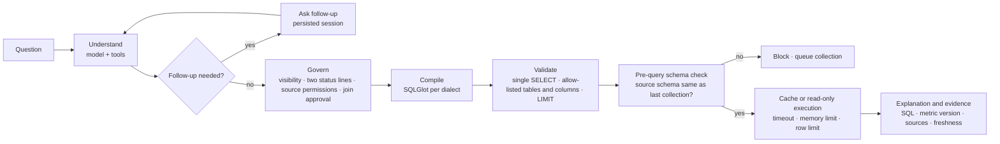
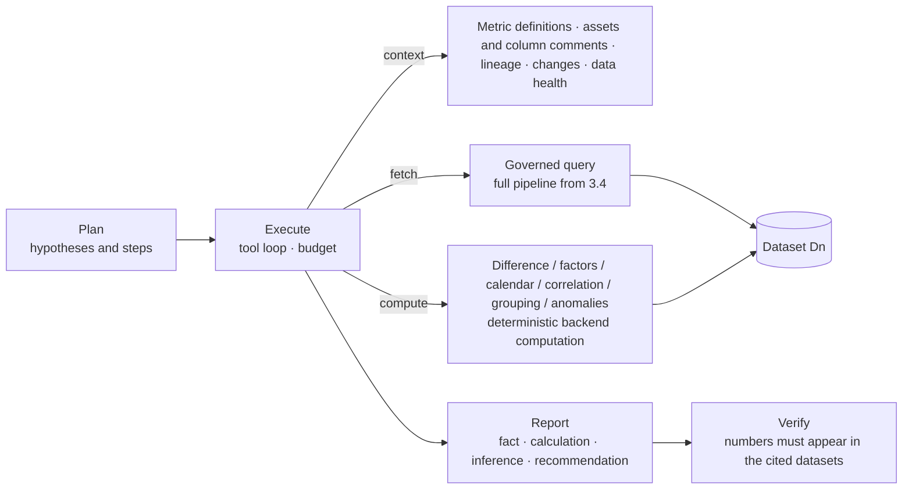
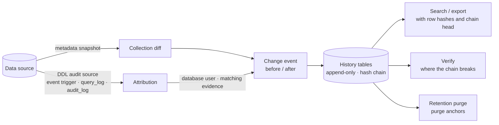

# Avelis Architecture and Governance (v0.1)

English | [简体中文](architecture.md) | [繁體中文](architecture.zh-TW.md)

Avelis is a data Q&A platform built on database lineage, governed metric definitions and change management.

- Every answer must carry its source, metric definition, version and the permission it was checked against.
- When something changes upstream, the system knows which metric definitions and answers need to be confirmed again, and the **backend** blocks the affected metric definitions from being used.

This document describes the components, how data flows between them and where governance rules are enforced. The scope and milestones during development are in the [development plan (archived, Simplified Chinese)](archive/PLAN.md); design decisions are in [decisions/](decisions/) (Simplified Chinese).

## 1. Components

```mermaid
flowchart LR
  subgraph Sources[Collected data sources (read-only)]
    SR[(StarRocks)]
    MY[(MySQL dimension DB)]
  end
  subgraph Backend[Backend FastAPI]
    API[REST API + OpenAPI]
    W[worker: collection jobs, scheduling]
    ENG[engine adapters]
  end
  PG[(PostgreSQL metadata database<br/>incl. agent sessions avelis_agent)]
  RD[(Valkey / Redis<br/>locks, token revocation, cache, wake-ups)]
  LLM[[Model provider<br/>DeepSeek / OpenAI-compatible / Anthropic]]
  UI[Frontend React SPA] -->|/api| API
  API --> PG
  W --> PG
  API --> RD
  W --> RD
  ENG -->|collector account: metadata| SR
  ENG -->|collector account: metadata| MY
  ENG -->|read-only account: validated SELECT| SR
  API --> ENG
  W --> ENG
  API -->|questions, metadata; query results and redacted code by default, can be turned off| LLM
```

| Component | Responsibility | Main code |
|---|---|---|
| Engine adapters | One adapter per database: connector, SQLGlot dialect, asset name levels, capability declaration; core modules never branch on database type | `engines/`, `connectors/` ([ADR 0004](decisions/0004-engine-adapters.md), Simplified Chinese) |
| Collection | Reads metadata snapshots; identifies objects by physical ID; produces asset versions and change events; parses views; recomputes external-table identity links and column fingerprints; attributes changes to database users from the database's DDL audit | `collect/service.py`, `collect/attribution.py` |
| Change history | Append-only history tables (database triggers), sealed into a hash chain at commit, verifiable; change-record search and export; retention purge with purge anchors | `history/` ([ADR 0008](decisions/0008-history-integrity.md), Simplified Chinese) |
| Lineage | SQL parsing and normalized fingerprints; column derivation fingerprints; grain sources, propagation and join cardinality | `lineage/sql.py`, `lineage/fingerprint.py`, `lineage/grain.py` |
| Governance | Metric and version state machine, pre-publish checks; join paths and cross-domain approval; change → impact → review; business-domain permissions | `governance/` |
| Ask | A LangGraph agent understands the question and asks follow-ups; deterministic governance, compilation, validation, read-only execution, caching and evidence | `ask/agent.py`, `ask/service.py`, `ask/compiler.py` |
| Lineage import | Extracts statements from SQL / Python / Shell; parsed edges are written directly; fragments that cannot be parsed become model candidates for a person to handle | `importer/` |
| Model settings | Providers, encrypted keys, per-purpose assignment, data-sharing switches | `modelcfg.py`, `api/model_settings.py` |
| Background jobs | The job table is the source of truth, Redis only wakes workers; scheduled collection; backlog scan; jobs that run too long are marked failed | `jobs.py` |
| Authentication and audit | OAuth2 password flow + PyJWT, pwdlib (Argon2), Fernet-encrypted data source passwords; every governance action is audited | `security.py`, `audit.py` ([ADR 0002](decisions/0002-backend-foundations.md), Simplified Chinese) |

## 2. Four-layer data model

| Layer | Tables | Meaning |
|---|---|---|
| Identity | `datasource`, `endpoint_alias`, `asset`, `asset_column` | “Which thing is it.” Assets are identified by physical ID (StarRocks `TABLE_ID`): a renamed table is the same asset; a table dropped and recreated with the same name is a new asset. A column dropped and recreated with the same name is also a new column |
| Observation | `collection_run`, `asset_version`, `column_version`, `definition` | “What a collection run saw.” Unchanged content produces no new version; view definitions keep the original text and the normalized SQL. Append-only and on the hash chain (3.6) |
| Derivation | `parse_result`, `lineage_edge`, `identity_link`, `column_fingerprint`, `grain` | “Conclusions derived from observations.” Each edge records its origin: `parsed`, `manual`, `import`, `model_confirmed`, and so on. External tables are traced through endpoint aliases and instance identity to the real table in the other database |
| Governance | `metric`, `metric_version`, `join_path`, `confirmation`, `change_set` / `change_event`, `impact`, `review_task`, `audit_event` | “What the business has approved, and who approved it.” Only people or deterministic rules change this layer; the model cannot change it directly |

Ask and import add tables such as `ask_thread`, `answer`, `import_job`, `extracted_statement` and `candidate_edge`. Change history adds `history_chain_head` (chain head), `history_mark` (allowed changes of state columns) and `history_anchor` (purge anchors).

## 3. Key mechanisms

### 3.1 Column derivation fingerprints

Every column has a fingerprint that summarizes how its value is computed:

- **Physical table column**: column identity + type.
- **External / catalog table column**: its own identity + type + the fingerprint of the column it is linked to in the other database.
- **View column**: the column expression + fingerprints of its value sources + every influencing condition in the view (filters, join keys, grouping) and their sources' fingerprints.

As a result:

- formatting-only changes do not change the fingerprint;
- changing an expression, a filter or a join, deleting or recreating an upstream column, or changing a column type in the other database all change it.

A fingerprint has three states: `ok`; `broken` (upstream missing); `unknown` (incomplete evidence, for example a UNION view or an uncollected source).

### 3.2 Two status lines

When a metric version is published, it binds the fingerprint of every column it depends on. Before an Ask query runs, both of these must hold:

1. **Observation line**: the current fingerprints equal those at publish time, and their state is `ok`.
2. **Business line**: the version's state is `published`.

When a fingerprint changes, the version is marked `affected` and a review task is created. A review has three possible outcomes:

- restore the original definition: confirmed by the owner once the observation line is back;
- replace it with a new metric definition: the old version is retired and answers point to the new one;
- deactivate it.

Until the review is done, the backend blocks the query, even if the question is identical to an earlier one and an old answer is in the cache.

### 3.3 Grain and join cardinality

Grain has five sources:

- `observed`: primary or unique keys;
- `parsed`: derived from GROUP BY;
- `declared`: declared by a person, verifiable with a read-only query;
- `linked`: an external table inherits the primary key from the other database;
- `passthrough`: a view passes through the source table's grain.

The cardinality of a join path (N:1, 1:N, N:N) is determined from the grain on both sides. An additive measure joined through 1:N or N:N is inflated, so such a metric cannot be published unless the right side is first aggregated by the join key.

### 3.4 Ask pipeline



- The model can only submit a structured intent through tools and **never writes SQL**. An intent contains:
  - one or more metrics;
  - a time range;
  - dimension filters and grouping;
  - ranking and top N;
  - period-over-period and year-over-year comparison.
- Compound questions (several metrics, comparison periods, derived metrics) expand into “metric × period” sub-queries. Each sub-query goes through the full pipeline; once all pass, the backend aligns them by dimension keys, computes derived formulas and comparison columns, then sorts and takes the top N ([ADR 0005](decisions/0005-ask-expressiveness.md), Simplified Chinese).
- A derived metric (for example average order value = paid sales / order count) locks the versions of its component metrics when submitted; when a component is affected, the derived metric is affected too and goes to review.
- Metrics in the intent must be visible to the current user; dimensions must be ones the metric exposes; values only ever become escaped constants. Forged or injected intents are rejected or neutralized; see scenarios 02 and 03 in the [hardening acceptance record (archived, Simplified Chinese)](archive/acceptance/acceptance-m4.md).
- **Pre-query schema check (stale metadata)**: the database may change between collection runs. So before every execution (including cache hits), Avelis reads the current columns and view definitions of the source objects with the read-only account and compares them with the last collection:
  - only the columns the metric definition actually depends on are checked, followed through lineage down to physical tables; unrelated added or dropped columns do not block;
  - any change in a view definition blocks;
  - on a mismatch the query neither runs nor uses the cache (`metadata_stale`); the answer says what changed, and a collection is queued for that data source;
  - controlled by `AVELIS_ASK_LIVE_CHECK`, on by default; only tables and views in the data source's internal catalog are checked.
- At the very last moment before execution, versions and dependencies are checked again.
- Database errors (timeout 5024, unresolvable object 1064, and so on) are returned as they are, never rewritten as success or an empty result.
- The answer cache key includes the SQL, versions, dependency fingerprints, asset versions, permission scope and table update times.
- Time grouping: an intent may carry `time_grain` (day / month); the first result column is `period`, and SQLGlot generates the date formatting per dialect. It cannot be combined with comparison periods.

### 3.5 Analysis agent



- The model does the multi-step thinking (planning, drilling down, changing direction). Numbers can only come from datasets:
  - data is fetched only through `query_metric`, which reuses the Ask pipeline and leaves an Ask evidence record every time;
  - computation tools take only dataset IDs and column names as input; the model cannot type in numbers.
- Budget (defaults, configurable in the [configuration reference](configuration.en.md#analysis-agent-analysis)): 30 tool calls, 20 query-tool calls, 5 minutes. Beyond that, tools refuse to run; if the model still has not submitted a report, the backend produces an “incomplete” report.
- Verification matches numbers at display precision and understands percentages and the Chinese units 万 / 亿; numbers that cannot be found are marked unverified, never silently removed.
- An analysis runs as the user who started it, with permissions checked on every call. Analyses can be scheduled with cron and are queued by the worker; if the owner loses permission, the schedule pauses itself and sends an in-app notification.
- Reports export to PDF (with embedded CJK fonts, charts and an evidence appendix), Markdown, and datasets to CSV.
- Requires a model that supports tool calling and permission to send query results to the model (allowed by default; connect a locally hosted model if data must stay private). See [ADR 0007](decisions/0007-analysis-agent.md) (Simplified Chinese).

### 3.6 Observation layer and change history

Change history is kept only in the metadata and lineage governance layer; Ask always works on the current structure and never queries with old definitions ([ADR 0008](decisions/0008-history-integrity.md), Simplified Chinese).



- **Complete**: added, dropped and renamed tables, views and columns, and changes of type, definition, grain, external address, table comment and column comment all produce change events.
- **Who changed it**: when an engine declares the `ddl_audit` capability, collection reads the DDL audit between “start of the previous collection − tolerance” and “this snapshot + tolerance” and links it to change events by object name (column-level changes also require the statement to name the column):
  - a change is attributed to a user (`matched`) only when it comes from exactly one database user;
  - several users give `ambiguous`, no record gives `unmatched`, a read failure gives `unavailable`, and an engine without support gives `unsupported`;
  - derived changes (column derivation, missing upstream, identity links) are `not_applicable`.
  - Supported: PostgreSQL (event trigger), ClickHouse (`system.query_log`), Doris (`__internal_schema.audit_log`); not yet: StarRocks, SQL Server, Oracle, MySQL.
- **Append-only**: `asset_version`, `column_version`, `definition`, `lineage_edge`, `change_set`, `change_event`, `audit_event`, `metric_version_transition` and the history tables themselves reject UPDATE / DELETE / TRUNCATE through database triggers. State columns may change only once and only by rule (for example `superseded_at` from empty to set), and each change appends a `history_mark`; “last seen” columns (`last_seen_*`) can only move forward and are not history content.
- **Hash chain**: one global chain, sealed at commit by a constraint trigger: `row_hash = sha256(prev_hash | chain_seq | table name | content digest)`. There is a single chain lock, held only during commit. Verification (`GET /api/history/verify`, `bootstrap verify-history`) reports the first break and every problem.
- **Retention**: `AVELIS_HISTORY_RETENTION_DAYS` (default 1095 days). The worker purges once a day: it verifies first and does not purge an incomplete chain; it never deletes current versions, versions referenced by non-terminal metric definitions, or unhandled change sets. Deletion only goes through a dedicated path with `avelis.history_purge = on` inside the transaction, and leaves a purge anchor on the chain (the sequence gap and the hashes at both ends) so the rest of the chain stays verifiable. Purges are audited.

## 4. Governance rules

| Rule | Default | Where it is enforced |
|---|---|---|
| Asset visibility | By business-domain membership; **assets without a business domain are visible only to administrators and maintainers** (`AVELIS_UNASSIGNED_ASSET_POLICY=deny`) | Asset search, lineage graph, Ask source closure (including tables behind views) |
| Ask permission | Seeing the metric is only the start; every source the query would read must be visible, otherwise the query is refused and no cached answer is returned | `ask/service.py` |
| Self-review | Forbidden: the submitter and the creator cannot approve the same version (visible in `/api/settings`) | `governance/metrics.py` |
| Cross-domain joins | Every business domain involved needs approval from its own owner | `governance/joins.py` |
| Review tasks | Only the task owner can handle them | `governance/changes.py` |
| Credentials | Data source passwords are stored encrypted and never returned by the API; model keys show only the last four characters; passwords never go into logs or model context | `security.py`, `modelcfg.py` |
| Data sharing with the model | Sending query results and code snippets is on by default (analysis needs it) and administrators can turn it off; connect a local model when data must stay private; code snippets are redacted before sending; external tracing (LangSmith) is off | Model settings page |
| Read-only | The collector account reads metadata only; the query account runs only a validated single SELECT, with a timeout and a memory limit | `engines/`, `ask/compiler.py` |
| Audit | Publishing, approval, review, import handling, collection, Ask (including refusals), change-record export, chain verification and retention purges are all audited | `audit_event` |
| Change history | History tables are append-only (triggers); the hash chain is verifiable; kept for 3 years by default; changes are attributed only to a user the database audit identifies uniquely | `history/`, migration `0007` |

## 5. Operation

- **Processes**: the API (`python -m avelis.server`, which also serves the frontend on the same port in production) and the worker (`python -m avelis.jobs`) are separate processes sharing the metadata database and Redis. See the [deployment guide](deployment.en.md) and the [configuration reference](configuration.en.md).
- **Collection**: the worker queues collections at each data source's interval (15 minutes by default). Collections can also be started from the UI or the API.
  - Collections of the same data source are serialized with a Redis lock.
  - Not finding a change does not mean nothing changed: detection can lag by up to one collection interval. The pre-query schema check closes this window for Ask: if a source being queried has changed, the query is blocked at once and a collection is triggered.
- **Jobs**: the job table is the source of truth; Redis only wakes workers.
  - If Redis loses data, the worker scans for jobs queued too long (`AVELIS_WORKER_STALE_SECONDS`).
  - If the worker exits mid-job, the job is marked failed after `AVELIS_WORKER_RUNNING_TIMEOUT_SECONDS`, so a data source's scheduled collection never stops for good.
- **Agent sessions**: stored in the PostgreSQL schema `avelis_agent`, so follow-ups continue after a restart. If the schema is dropped it is recreated automatically, but the follow-up state of earlier sessions is lost.

## 6. Known limits

- Conclusions about StarRocks come only from a local single-node Docker 3.5.14; no production database is connected.
- Engines declare only the capabilities that have been tested against a real instance. MySQL is currently collected for metadata only, as the target of external tables. Only engines with an SQLGlot dialect will be added.
- Traceable is not reproducible: SQL, metric definitions and metadata versions are kept, data snapshots are not.
- Tamper-evidence of the change history means tampering can be **detected**, not prevented: someone with superuser access to the metadata database who knows the algorithm can recompute the whole chain. Verification and export both report the chain head (sequence + hash), which can be recorded outside the database periodically as an external anchor.
- Attribution depends on the database's own audit: if auditing is off, not yet flushed (about 7.5 seconds for ClickHouse, up to 60 seconds for Doris), or the change went through an unaudited path, the change is recorded as “unknown” and is not recomputed later.
- The pre-query schema check does not cover objects in other databases accessed through external tables or catalogs (detected by collecting that data source), nor semantic changes that leave columns and definitions unchanged (for example, upstream data being rewritten).
- Column-level lineage does not cover set operations such as UNION, scalar subquery projections, or LATERAL / UNNEST. These are marked as incomplete evidence, and metrics cannot be published on them.
