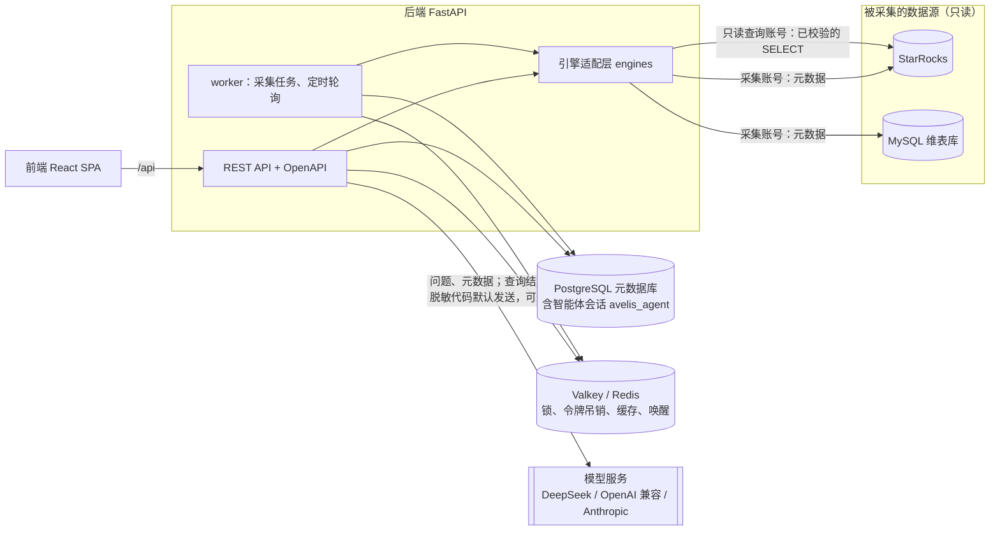
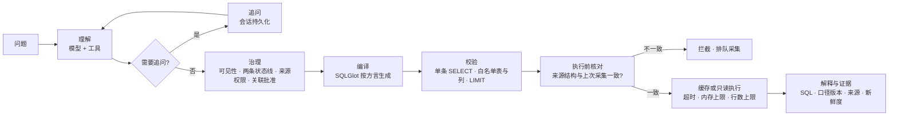
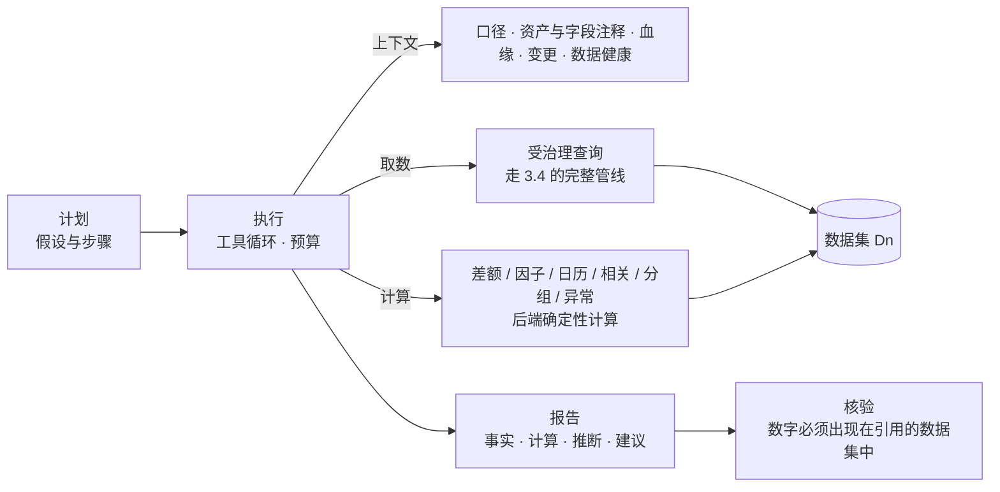
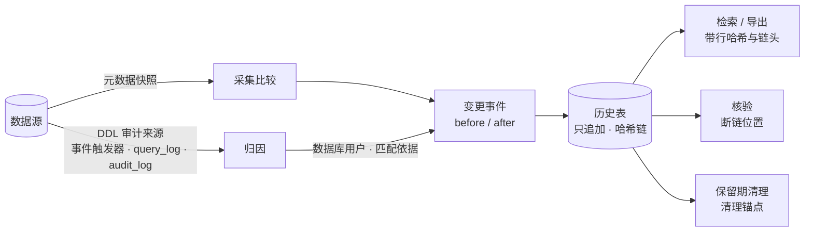

# Avelis 架构与治理说明（v0.1）

Avelis 是建立在数据库血缘、业务口径和变更管理之上的智能问数平台。

- 每个答案都要有来源、口径、版本和权限依据。
- 上游变化后，系统知道哪些口径和答案需要重新确认，并由**后端**阻止受影响的口径继续被使用。

本文说明系统由哪些部分组成、数据怎么流动、治理规则在哪里生效。开发过程中的范围与里程碑见[开发计划（归档）](archive/PLAN.md)；设计决定见 [decisions/](decisions/)。

## 1. 组成

| 部件 | 职责 | 主要代码 |
|---|---|---|
| 引擎适配层 | 每种数据库一个适配器：连接器、SQLGlot 方言、资产名层级、能力声明；核心模块不按数据库类型分支 | `engines/`、`connectors/`（[ADR 0004](decisions/0004-engine-adapters.md)） |
| 采集 | 读元数据快照；按物理 ID 识别同一对象；产生资产版本与变更事件；解析视图；重算外部表身份映射与字段指纹；按数据库的 DDL 审计把变更归因到数据库用户 | `collect/service.py`、`collect/attribution.py` |
| 留底 | 历史表只追加（数据库触发器）、提交时封入哈希链、核验；变更记录检索与导出；保留期清理与清理锚点 | `history/`（[ADR 0008](decisions/0008-history-integrity.md)） |
| 血缘 | SQL 解析与规范化指纹；字段推导指纹；粒度的来源、传播与关联基数 | `lineage/sql.py`、`lineage/fingerprint.py`、`lineage/grain.py` |
| 治理 | 指标与版本状态机、发布检查；关联路径与跨域批准；变更 → 影响 → 复核；业务域权限 | `governance/` |
| 问数 | LangGraph 智能体理解问题、追问；确定性的治理、编译、校验、只读执行、缓存、证据 | `ask/agent.py`、`ask/service.py`、`ask/compiler.py` |
| 导入血缘 | SQL / Python / Shell 中抽取语句；解析出的边直接写入；解析不了的由模型提出候选，人工处理 | `importer/` |
| 模型配置 | 提供方、密钥加密、按用途指定、数据外发开关 | `modelcfg.py`、`api/model_settings.py` |
| 后台任务 | job 表是事实来源，Redis 只负责唤醒；定时采集；积压扫描；运行超时记为失败 | `jobs.py` |
| 认证与审计 | OAuth2 密码模式 + PyJWT、pwdlib（Argon2）、Fernet 加密数据源口令；所有治理动作写审计 | `security.py`、`audit.py`（[ADR 0002](decisions/0002-backend-foundations.md)） |

## 2. 四层数据模型

| 层 | 表 | 含义 |
|---|---|---|
| 身份 | `datasource`、`endpoint_alias`、`asset`、`asset_column` | “是哪个东西”。资产按物理 ID（StarRocks `TABLE_ID`）识别：改名仍是同一资产；删后同名重建是新资产。列删除后同名重建也是新列 |
| 观察 | `collection_run`、`asset_version`、`column_version`、`definition` | “某次采集看到了什么”。内容不变不产生新版本；视图定义保存原文与规范化 SQL。只追加，在哈希链上（3.6） |
| 推导 | `parse_result`、`lineage_edge`、`identity_link`、`column_fingerprint`、`grain` | “由观察推出的结论”。每条边记录来源：`parsed`、`manual`、`import`、`model_confirmed` 等。外部表经端点别名与实例身份追到他库真实表 |
| 治理 | `metric`、`metric_version`、`join_path`、`confirmation`、`change_set` / `change_event`、`impact`、`review_task`、`audit_event` | “业务上认可了什么、谁认可的”。这一层只由人或确定性规则改变，模型不能直接改 |

问数与导入另有 `ask_thread`、`answer`、`import_job`、`extracted_statement`、`candidate_edge` 等表。留底另有 `history_chain_head`（链头）、`history_mark`（状态列的合法变化）、`history_anchor`（清理锚点）。

## 3. 关键机制

### 3.1 字段推导指纹

每个字段有一个指纹，概括“这个值是怎么算出来的”：

- **实体表字段**：字段身份 + 类型。
- **外部表 / Catalog 表字段**：自身身份 + 类型 + 身份映射到的他库字段指纹。
- **视图字段**：本列表达式 + 取值来源的指纹 + 视图内全部影响条件（过滤、关联键、分组）及其来源指纹。

由此：

- 只改格式不变；
- 改表达式、改过滤或关联、上游字段被删除或重建、他库字段改类型，都会改变指纹。

指纹状态有三种：`ok`；`broken`（上游缺失）；`unknown`（证据不全，例如 UNION 视图、未采集的来源）。

### 3.2 两条状态线

指标版本发布时，绑定它依赖的每个字段的指纹。问数执行前要同时满足两条：

1. **观察线**：当前指纹与发布时一致，且状态为 `ok`。
2. **业务线**：版本状态是 `published`。

指纹变化后，版本被标为 `affected`，并生成复核任务。复核有三种结论：

- 恢复原定义：观察线恢复后由负责人确认；
- 改由新口径承接：旧版本失效，答案指向新口径；
- 停用。

在复核完成前，即使问题与之前完全相同、缓存里有旧答案，也会被后端拦截。

### 3.3 粒度与关联基数

粒度有五种来源：

- `observed`：主键、唯一键；
- `parsed`：由 GROUP BY 推出；
- `declared`：人工声明，可用只读查询核验；
- `linked`：外部表继承他库主键；
- `passthrough`：视图直接透传来源表的粒度。

关联路径的基数（N:1、1:N、N:N）由两侧粒度判定。可加度量经 1:N 或 N:N 关联会放大，这种指标不能发布，除非右侧先按关联键聚合。

### 3.4 问数管线

- 模型只能经工具提交结构化意图，**从不写 SQL**。意图包括：
  - 一个或多个指标；
  - 时间范围；
  - 维度过滤与分组；
  - 排名与前 N；
  - 环比 / 同比。
- 组合问题（多个指标、对比期、派生指标）展开为“指标 × 时间段”的子查询。每个子查询都走下图的完整管线；全部通过后，后端按维度键对齐，计算派生公式与对比列，再排序、取前 N（[ADR 0005](decisions/0005-ask-expressiveness.md)）。
- 派生指标（如客单价 = 实付销售额 / 订单数）在提交时锁定组成指标的版本；组成指标受影响时，派生指标随之受影响并进入复核。
- 意图中的指标必须对当前用户可见；维度必须是该指标开放的维度；取值只会成为转义后的常量。伪造或注入的意图被拒绝或无害化，见[异常与加固验收（归档）](archive/acceptance/acceptance-m4.md)的场景 02、03。
- **执行前核对（元数据过期）**：轮询采集之间，库侧可能已经变了。所以每次执行前（包括命中缓存时），都用只读账号读取来源对象当前的列和视图定义，与上次采集比较：
  - 只看口径实际依赖的列，沿血缘一直展开到实体表；无关列的增删不拦截；
  - 视图定义一变就拦截；
  - 不一致时不执行、不用缓存（`metadata_stale`），说明哪里变了，并为该数据源排队一次采集；
  - 由 `AVELIS_ASK_LIVE_CHECK` 控制，默认开启；只核对该数据源内部 Catalog 的表与视图。
- 执行前的最后一刻还要核对版本与依赖是否变化。
- 数据库报错（超时 5024、对象无法解析 1064 等）如实返回，不改写成成功或空结果。
- 答案缓存键包含：SQL、版本、依赖指纹、资产版本、权限范围、表更新时间。
- 按时间分组：意图可带 `time_grain`（day / month），结果首列为 `period`，日期格式化由 SQLGlot 按方言生成；不能与对比期同用。

### 3.5 分析智能体

- 模型负责多步思考（规划、下钻、调整方向）。数字只能来自数据集：
  - 取数只能经 `query_metric`，复用问数管线，每次都留下一条问数依据；
  - 计算工具的输入只能是数据集编号和列名，模型不能手填数字。
- 预算：工具调用 30 次、受治理查询 12 次、5 分钟。超出后工具拒绝执行，模型仍未提交报告时，由后端生成“未完成”的报告。
- 核验按显示精度匹配数字，支持百分比和“万 / 亿”；找不到的数字标为未核实，不静默删除。
- 运行以发起人身份执行，权限逐次检查。分析任务可按 cron 定时，由 worker 入队；发起人失去权限时任务自动暂停并发站内通知。
- 报告可导出为 PDF（嵌入中文字体，含图表与证据附录）、Markdown、数据集 CSV。
- 需要模型支持工具调用，并允许向模型发送查询结果（默认允许；需保密请接入本地模型）。设计见 [ADR 0007](decisions/0007-analysis-agent.md)。

### 3.6 观察层与留底

变更历史只在元数据与血缘治理层留底；问数层只看当前结构，不按旧口径查询（[ADR 0008](decisions/0008-history-integrity.md)）。

- **完整**：表、视图、列的增删、改名、类型、定义、粒度、外部地址、表注释与列注释变化都生成变更事件。
- **谁改的**：引擎声明 `ddl_audit` 能力时，采集读取“上次采集开始 − 容差”到“本次快照 + 容差”之间的 DDL 审计，按对象名（字段级变化还要语句点名该列）关联到变更事件：
  - 只来自一个数据库用户才记为该用户（`matched`）；
  - 多个用户为 `ambiguous`，没有记录为 `unmatched`，读取失败为 `unavailable`，引擎未接入为 `unsupported`；
  - 推导出的变化（字段推导、上游缺失、身份映射）为 `not_applicable`。
  - 已接入：PostgreSQL（事件触发器）、ClickHouse（`system.query_log`）、Doris（`__internal_schema.audit_log`）；StarRocks、SQL Server、Oracle、MySQL 未接入。
- **只追加**：`asset_version`、`column_version`、`definition`、`lineage_edge`、`change_set`、`change_event`、`audit_event`、`metric_version_transition` 及留底自身的表，在数据库层用触发器拒绝 UPDATE / DELETE / TRUNCATE。状态列只能按规则改一次（如 `superseded_at` 由空变为非空），每次变化追加一条 `history_mark`；“最近一次看到”（`last_seen_*`）只能前移，不算历史内容。
- **哈希链**：一条全局链，提交时由约束触发器封链：`row_hash = sha256(prev_hash | chain_seq | 表名 | 内容摘要)`。只有一把链锁，只在提交阶段持有。核验（`GET /api/history/verify`、`bootstrap verify-history`）报告第一处断链与全部问题。
- **保留期**：`AVELIS_HISTORY_RETENTION_DAYS`（默认 1095 天）。worker 每天清理一次：先核验，链不完整就不清理；不删当前版本、被非终态口径引用的版本、未处理的变更集；删除只走事务内 `avelis.history_purge = on` 的专用路径，链上留下清理锚点（登记序号空洞及两端哈希），剩余的链仍可核验；清理写审计。

## 4. 治理规则

| 规则 | 默认 | 在哪里生效 |
|---|---|---|
| 资产可见性 | 按业务域成员关系；**未归属业务域的资产只对管理员与维护者可见**（`AVELIS_UNASSIGNED_ASSET_POLICY=deny`） | 资产检索、血缘图、问数来源闭包（含视图背后的表） |
| 问数权限 | 指标可见只是前提；查询会读到的全部来源都必须可见，否则拒绝执行，也不返回缓存 | `ask/service.py` |
| 自审 | 禁止：提交人、创建人不能批准同一版本（`/api/settings` 可见） | `governance/metrics.py` |
| 跨域关联 | 涉及几个业务域，就需要这几个域的负责人分别批准 | `governance/joins.py` |
| 复核任务 | 只有任务负责人能处理 | `governance/changes.py` |
| 凭据 | 数据源口令加密存储，接口永不回传；模型密钥只显示末四位；口令不进日志、不进模型上下文 | `security.py`、`modelcfg.py` |
| 数据外发 | 向模型发送查询结果、发送代码片段默认开启（分析需要），管理员可关闭；需保密时接入本地模型；代码片段在发送前脱敏；外部追踪（LangSmith）关闭 | 模型配置页 |
| 只读 | 采集账号只读元数据；查询账号只执行校验后的单条 SELECT，带超时与内存上限 | `engines/`、`ask/compiler.py` |
| 审计 | 发布、批准、复核、导入处理、采集、问数（含被拒绝的）、变更记录导出、链核验、保留期清理都写审计 | `audit_event` |
| 留底 | 历史表只追加（触发器）；哈希链可核验；默认保留 3 年；变更归因只取数据库审计里能唯一确定的用户 | `history/`、迁移 `0007` |

## 5. 运行

- **进程**：API（`python -m avelis.server`，生产模式下同一端口托管前端）与 worker（`python -m avelis.jobs`）是两个独立进程，共用元数据库与 Redis。部署方式见 [deployment.md](deployment.md)，配置见 [configuration.md](configuration.md)。
- **采集**：worker 按数据源的采集间隔（默认 15 分钟）轮询入队。也可以在界面或接口里手动采集。
  - 同一数据源的采集用 Redis 锁互斥。
  - 未发现变更不代表没有变更：采集发现的延迟最长为一个采集间隔。问数时的执行前核对会补上这个窗口：被问到的来源若已变化，会立即拦截并触发采集。
- **任务**：job 表是事实来源，Redis 只负责唤醒。
  - Redis 丢失时，worker 会扫描排队过久的任务（`AVELIS_WORKER_STALE_SECONDS`）。
  - worker 在执行中退出时，任务超过 `AVELIS_WORKER_RUNNING_TIMEOUT_SECONDS` 会被记为失败，不会让该数据源的定时采集永久停止。
- **智能体会话**：存在 PostgreSQL 模式 `avelis_agent`，服务重启后能继续追问。该模式被删除时自动重建，但原会话的追问状态不可恢复。

## 6. 已知边界

- StarRocks 结论只来自本机 Docker 3.5.14 单节点；不连接任何生产库。
- 引擎能力只声明真实联调过的部分。MySQL 目前只采元数据，并作为外部表的追溯目标。后续只接入 SQLGlot 支持方言的引擎。
- 可追溯 ≠ 可复现：保存 SQL、口径与元数据版本，不保存数据快照。
- 留底的防篡改是“可发现”，不是“不可改”：掌握元数据库超级权限并了解算法的人可以重算整条链。核验与导出都给出链头（序号 + 哈希），可定期记到库外作为外部锚点。
- 归因依赖数据库自己的审计：审计未开启、尚未落盘（ClickHouse 约 7.5 秒、Doris 最长 60 秒）或改动经由未审计的路径时，变更如实记为“未知”，事后不重算。
- 执行前核对不覆盖：他库经外部表或 Catalog 访问的对象（由那个数据源的采集发现）；不改变列和定义的语义变化（例如上游数据本身被改写）。
- 列级血缘不覆盖：UNION 等集合运算、标量子查询投影、LATERAL / UNNEST。这些会如实标为证据不全，不能据此发布指标。
