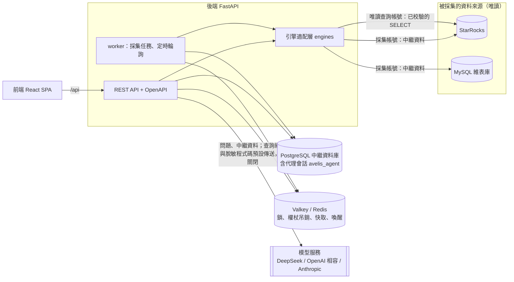
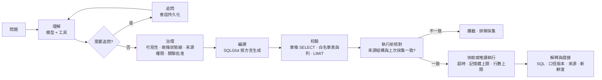
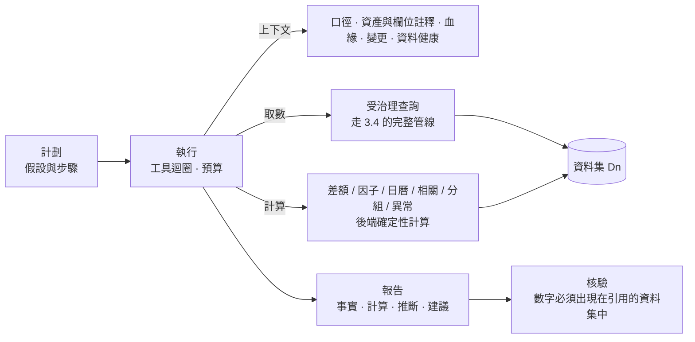
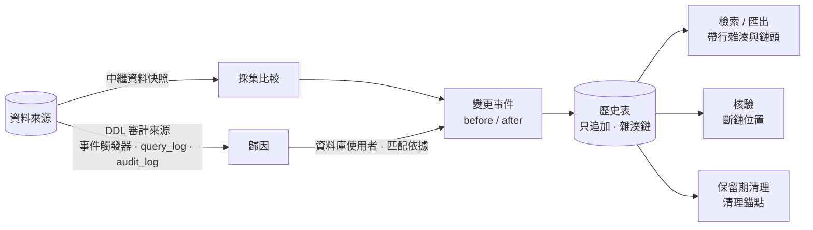

# Avelis 架構與治理說明

[English](architecture.en.md) | [简体中文](architecture.md) | 繁體中文

Avelis 是建立在資料庫血緣、業務口徑和變更管理之上的智慧問數平臺。

- 每個答案都要有來源、口徑、版本和權限依據。
- 上游變化後，系統知道哪些口徑和答案需要重新確認，並由**後端**阻止受影響的口徑繼續被使用。

本文說明系統由哪些部分組成、資料怎麼流動、治理規則在哪裡生效。設計決定見 [decisions/](decisions/)（簡體中文）。

## 組成

| 部件 | 職責 | 主要程式碼 |
|---|---|---|
| 引擎適配層 | 每種資料庫一個配接器：聯結器、SQLGlot 方言、資產名層級、能力宣告；核心模組不按資料庫型別分支 | `engines/`、`connectors/`（[ADR 0004](decisions/0004-engine-adapters.md)（簡體中文）） |
| 採集 | 讀中繼資料快照；按物理 ID 識別同一物件；產生資產版本與變更事件；解析檢視表；重算外部表身份對映與欄位指紋；按資料庫的 DDL 審計把變更歸因到資料庫使用者 | `collect/service.py`、`collect/attribution.py` |
| 留底 | 歷史表只追加（資料庫觸發器）、提交時封入雜湊鏈、核驗；變更記錄檢索與匯出；保留期清理與清理錨點 | `history/`（[ADR 0008](decisions/0008-history-integrity.md)（簡體中文）） |
| 血緣 | SQL 解析與規範化指紋；欄位推導指紋；粒度的來源、傳播與關聯基數 | `lineage/sql.py`、`lineage/fingerprint.py`、`lineage/grain.py` |
| 治理 | 指標與版本狀態機、發布檢查；關聯路徑與跨域批准；變更 → 影響 → 複核；業務域權限 | `governance/` |
| 問數 | LangGraph 代理理解問題、追問；確定性的治理、編譯、校驗、唯讀執行、快取、證據 | `ask/agent.py`、`ask/service.py`、`ask/compiler.py` |
| 匯入血緣 | SQL / Python / Shell 中抽取語句；解析出的邊直接寫入；解析不了的由模型提出候選，人工處理 | `importer/` |
| 模型設定 | 提供方、金鑰加密、按用途指定、資料外發開關 | `modelcfg.py`、`api/model_settings.py` |
| 後臺任務 | job 表是事實來源，Redis 只負責喚醒；定時採集；積壓掃描；執行超時記為失敗 | `jobs.py` |
| 認證與審計 | OAuth2 密碼模式 + PyJWT、pwdlib（Argon2）、Fernet 加密資料來源密碼；所有治理動作寫審計 | `security.py`、`audit.py`（[ADR 0002](decisions/0002-backend-foundations.md)（簡體中文）） |

## 四層資料模型

| 層 | 表 | 含義 |
|---|---|---|
| 身份 | `datasource`、`endpoint_alias`、`asset`、`asset_column` | 「是哪個東西」。資產按物理 ID（StarRocks `TABLE_ID`）識別：改名仍是同一資產；刪後同名重建是新資產。列刪除後同名重建也是新列 |
| 觀察 | `collection_run`、`asset_version`、`column_version`、`definition` | 「某次採集看到了什麼」。內容不變不產生新版本；檢視表定義儲存原文與規範化 SQL。只追加，在雜湊鏈上（見[觀察層與留底](#觀察層與留底)） |
| 推導 | `parse_result`、`lineage_edge`、`identity_link`、`column_fingerprint`、`grain` | 「由觀察推出的結論」。每條邊記錄來源：`parsed`、`manual`、`import`、`model_confirmed` 等。外部表經端點別名與例項身份追到他庫真實表 |
| 治理 | `metric`、`metric_version`、`join_path`、`confirmation`、`change_set` / `change_event`、`impact`、`review_task`、`audit_event` | 「業務上認可了什麼、誰認可的」。這一層只由人或確定性規則改變，模型不能直接改 |

問數與匯入另有 `ask_thread`、`answer`、`import_job`、`extracted_statement`、`candidate_edge` 等表。留底另有 `history_chain_head`（鏈頭）、`history_mark`（狀態列的合法變化）、`history_anchor`（清理錨點）。

## 關鍵機制

### 欄位推導指紋

每個欄位有一個指紋，概括「這個值是怎麼算出來的」：

- **實體表欄位**：欄位身份 + 型別。
- **外部表 / Catalog 表欄位**：自身身份 + 型別 + 身份對映到的他庫欄位指紋。
- **檢視表欄位**：本列表示式 + 取值來源的指紋 + 檢視表內全部影響條件（過濾、關聯鍵、分組）及其來源指紋。

由此：

- 只改格式不變；
- 改表示式、改過濾或關聯、上游欄位被刪除或重建、他庫欄位改型別，都會改變指紋。

指紋狀態有三種：`ok`；`broken`（上游缺失）；`unknown`（證據不全，例如 UNION 檢視表、未採集的來源）。

### 兩條狀態線

指標版本發布時，繫結它依賴的每個欄位的指紋。問數執行前要同時滿足兩條：

1. **觀察線**：當前指紋與發布時一致，且狀態為 `ok`。
2. **業務線**：版本狀態是 `published`。

指紋變化後，版本被標為 `affected`，並生成複核任務。複核有三種結論：

- 恢復原定義：觀察線恢復後由負責人確認；
- 改由新口徑承接：舊版本失效，答案指向新口徑；
- 停用。

在複核完成前，即使問題與之前完全相同、快取裡有舊答案，也會被後端攔截。

### 粒度與關聯基數

粒度有五種來源：

- `observed`：主鍵、唯一鍵；
- `parsed`：由 GROUP BY 推出；
- `declared`：人工宣告，可用唯讀查詢核驗；
- `linked`：外部表繼承他庫主鍵；
- `passthrough`：檢視表直接透傳來源表的粒度。

關聯路徑的基數（N:1、1:N、N:N）由兩側粒度判定。可加度量經 1:N 或 N:N 關聯會放大，這種指標不能發布，除非右側先按關聯鍵聚合。

### 問數管線

- 模型只能經工具提交結構化意圖，**從不寫 SQL**。意圖包括：
  - 一個或多個指標；
  - 時間範圍；
  - 維度過濾與分組；
  - 排名與前 N；
  - 環比 / 同比。
- 組合問題（多個指標、對比期、衍生指標）展開為「指標 × 時間段」的子查詢。每個子查詢都走下圖的完整管線；全部通過後，後端按維度鍵對齊，計算派生公式與對比列，再排序、取前 N（[ADR 0005](decisions/0005-ask-expressiveness.md)（簡體中文））。
- 衍生指標（如客單價 = 實付銷售額 / 訂單數）在提交時鎖定組成指標的版本；組成指標受影響時，衍生指標隨之受影響並進入複核。
- 意圖中的指標必須對當前使用者可見；維度必須是該指標開放的維度；取值只會成為轉義後的常量。偽造或注入的意圖被拒絕或無害化。
- **執行前核對（中繼資料過期）**：輪詢採集之間，庫側可能已經變了。所以每次執行前（包括命中快取時），都用唯讀帳號讀取來源物件當前的列和檢視表定義，與上次採集比較：
  - 只看口徑實際依賴的列，沿血緣一直展開到實體表；無關列的增刪不攔截；
  - 檢視表定義一變就攔截；
  - 不一致時不執行、不用快取（`metadata_stale`），說明哪裡變了，併為該資料來源排隊一次採集；
  - 由 `AVELIS_ASK_LIVE_CHECK` 控制，預設開啟；只核對該資料來源內部 Catalog 的表與檢視表。
- 執行前的最後一刻還要核對版本與依賴是否變化。
- 資料庫報錯（超時 5024、物件無法解析 1064 等）如實返回，不改寫成成功或空結果。
- 答案快取鍵包含：SQL、版本、依賴指紋、資產版本、權限範圍、表更新時間。
- 按時間分組：意圖可帶 `time_grain`（day / month），結果首列為 `period`，日期格式化由 SQLGlot 按方言生成；不能與對比期同用。

### 分析代理

- 模型負責多步思考（規劃、下鑽、調整方向）。數字只能來自資料集：
  - 取數只能經 `query_metric`，複用問數管線，每次都留下一條問數依據；
  - 計算工具的輸入只能是資料集編號和列名，模型不能手填數字。
- 預算（預設值，可在[設定參考](configuration.zh-TW.md#分析代理-analysis)中修改）：工具呼叫 30 次、查詢類工具 20 次、5 分鐘。超出後工具拒絕執行，模型仍未提交報告時，由後端生成「未完成」的報告。
- 核驗按顯示精度匹配數字，支援百分比和「萬 / 億」；找不到的數字標為未核實，不靜默刪除。
- 執行以發起人身份執行，權限逐次檢查。分析任務可按 cron 定時，由 worker 入隊；發起人失去權限時任務自動暫停併發站內通知。
- 報告可匯出為 PDF（嵌入中文字型，含圖表與證據附錄）、Markdown、資料集 CSV。
- 需要模型支援工具呼叫，並允許向模型傳送查詢結果（預設允許；需保密請接入本地模型）。設計見 [ADR 0007](decisions/0007-analysis-agent.md)（簡體中文）。

### 觀察層與留底

變更只在中繼資料與血緣治理層留存；問數層只看當前結構，不按舊口徑查詢（[ADR 0008](decisions/0008-history-integrity.md)（簡體中文））。

- **完整**：表、檢視表、列的增刪、改名、型別、定義、粒度、外部地址、表註釋與列註釋變化都生成變更事件。
- **誰改的**：引擎宣告 `ddl_audit` 能力時，採集讀取「上次採集開始 − 容差」到「本次快照 + 容差」之間的 DDL 審計，按物件名（欄位級變化還要語句點名該列）關聯到變更事件：
  - 只來自一個資料庫使用者才記為該使用者（`matched`）；
  - 多個使用者為 `ambiguous`，沒有記錄為 `unmatched`，讀取失敗為 `unavailable`，引擎未接入為 `unsupported`；
  - 推匯出的變化（欄位推導、上游缺失、身份對映）為 `not_applicable`。
  - 已接入：PostgreSQL（事件觸發器）、ClickHouse（`system.query_log`）、Doris（`__internal_schema.audit_log`）；StarRocks、SQL Server、Oracle、MySQL 未接入。
- **只追加**：`asset_version`、`column_version`、`definition`、`lineage_edge`、`change_set`、`change_event`、`audit_event`、`metric_version_transition` 及留底自身的表，在資料庫層用觸發器拒絕 UPDATE / DELETE / TRUNCATE。狀態列只能按規則改一次（如 `superseded_at` 由空變為非空），每次變化追加一條 `history_mark`；「最近一次看到」（`last_seen_*`）只能前移，不算歷史內容。
- **雜湊鏈**：一條全域性鏈，提交時由約束觸發器封鏈：`row_hash = sha256(prev_hash | chain_seq | 表名 | 內容摘要)`。只有一把鏈鎖，只在提交階段持有。核驗（`GET /api/history/verify`、`bootstrap verify-history`）報告第一處斷鏈與全部問題。
- **保留期**：`AVELIS_HISTORY_RETENTION_DAYS`（預設 1095 天）。worker 每天清理一次：先核驗，鏈不完整就不清理；不刪當前版本、被非終態口徑引用的版本、未處理的變更集；刪除只走事務內 `avelis.history_purge = on` 的專用路徑，鏈上留下清理錨點（登記序號空洞及兩端雜湊），剩餘的鏈仍可核驗；清理寫審計。

## 治理規則

| 規則 | 預設 | 在哪裡生效 |
|---|---|---|
| 資產可見性 | 按業務域成員關係；**未歸屬業務域的資產只對管理員與維護者可見**（`AVELIS_UNASSIGNED_ASSET_POLICY=deny`） | 資產檢索、血緣圖、問數來源閉包（含檢視表背後的表） |
| 問數權限 | 指標可見只是前提；查詢會讀到的全部來源都必須可見，否則拒絕執行，也不返回快取 | `ask/service.py` |
| 自審 | 禁止：提交人、建立人不能批准同一版本（`/api/settings` 可見） | `governance/metrics.py` |
| 跨域關聯 | 涉及幾個業務域，就需要這幾個域的負責人分別批准 | `governance/joins.py` |
| 複核任務 | 只有任務負責人能處理 | `governance/changes.py` |
| 憑據 | 資料來源密碼加密儲存，介面永不回傳；模型金鑰只顯示末四位；密碼不進日誌、不進模型上下文 | `security.py`、`modelcfg.py` |
| 資料外發 | 向模型傳送查詢結果、傳送程式碼片段預設開啟（分析需要），管理員可關閉；需保密時接入本地模型；程式碼片段在傳送前脫敏；外部追蹤（LangSmith）關閉 | 模型設定頁 |
| 唯讀 | 採集帳號唯讀中繼資料；查詢帳號只執行校驗後的單條 SELECT，帶超時與記憶體上限 | `engines/`、`ask/compiler.py` |
| 審計 | 發布、批准、複核、匯入處理、採集、問數（含被拒絕的）、變更記錄匯出、鏈核驗、保留期清理都寫審計 | `audit_event` |
| 留底 | 歷史表只追加（觸發器）；雜湊鏈可核驗；預設保留 3 年；變更歸因只取資料庫審計裡能唯一確定的使用者 | `history/`、遷移 `0007` |

## 執行

- **程序**：API（`python -m avelis.server`，生產模式下同一埠託管前端）與 worker（`python -m avelis.jobs`）是兩個獨立程序，共用中繼資料庫與 Redis。部署方式見 [deployment.md](deployment.zh-TW.md)，設定見 [configuration.md](configuration.zh-TW.md)。
- **採集**：worker 按資料來源的採集間隔（預設 15 分鐘）輪詢入隊。也可以在介面或介面裡手動採集。
  - 同一資料來源的採集用 Redis 鎖互斥。
  - 未發現變更不代表沒有變更：採集發現的延遲最長為一個採集間隔。問數時的執行前核對會補上這個視窗：被問到的來源若已變化，會立即攔截並觸發採集。
- **任務**：job 表是事實來源，Redis 只負責喚醒。
  - Redis 丟失時，worker 會掃描排隊過久的任務（`AVELIS_WORKER_STALE_SECONDS`）。
  - worker 在執行中退出時，任務超過 `AVELIS_WORKER_RUNNING_TIMEOUT_SECONDS` 會被記為失敗，不會讓該資料來源的定時採集永久停止。
- **代理會話**：存在 PostgreSQL 模式 `avelis_agent`，服務重啟後能繼續追問。該模式被刪除時自動重建，但原會話的追問狀態不可恢復。

## 已知邊界

- StarRocks 結論只來自本機 Docker 3.5.14 單節點；不連線任何生產庫。
- 引擎能力只宣告真實聯調過的部分。MySQL 目前只採中繼資料，並作為外部表的追溯目標。後續只接入 SQLGlot 支援方言的引擎。
- 可追溯 ≠ 可復現：儲存 SQL、口徑與中繼資料版本，不儲存資料快照。
- 留底的防篡改是「可發現」，不是「不可改」：掌握中繼資料庫超級權限並瞭解演算法的人可以重算整條鏈。核驗與匯出都給出鏈頭（序號 + 雜湊），可定期記到庫外作為外部錨點。
- 歸因依賴資料庫自己的審計：審計未開啟、尚未落盤（ClickHouse 約 7.5 秒、Doris 最長 60 秒）或改動經由未審計的路徑時，變更如實記為「未知」，事後不重算。
- 執行前核對不覆蓋：他庫經外部表或 Catalog 存取的物件（由那個資料來源的採集發現）；不改變列和定義的語義變化（例如上游資料本身被改寫）。
- 列級血緣不覆蓋：UNION 等集合運算、標量子查詢投影、LATERAL / UNNEST。這些會如實標為證據不全，不能據此發布指標。
