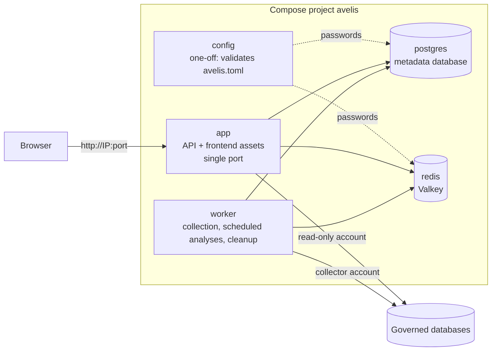

# Deployment Guide

English | [简体中文](deployment.md) | [繁體中文](deployment.zh-TW.md)

This guide explains how to run Avelis as a service: one-command Docker Compose deployment, running a single container, using an external PostgreSQL / Redis, deploying without Docker, and upgrades, backups and troubleshooting. All settings are listed in the [configuration reference](configuration.en.md).

> The deployment stack in this guide (`deploy/docker/`, Compose project `avelis`) is independent of the local demo environment used for development (`deploy/demo/`, project `avelis-demo`). They use different project names, networks and volumes, so a deployment never recreates or removes demo containers.

## 1. Topology



- **config**: a one-off container. It validates `avelis.toml`; on errors it prints an explanation and exits, and the other services do not start. On success it hands the metadata database and Redis passwords to the built-in postgres and redis services, so each password is written only once, in `avelis.toml`.
- **app**: `python -m avelis.server`. One port serves `/api` (API docs at `/api/docs`) and the built frontend (other paths fall back to `index.html` for client-side routing). On start it migrates the metadata database and creates the first administrator.
- **worker**: `python -m avelis.jobs`. Runs collection jobs, scheduled collection and scheduled analyses, and purges expired history. Same image and configuration as app, in its own container.
- **postgres**: the metadata database (only PostgreSQL is supported; it also stores the Ask agent's session state).
- **redis**: a Redis-protocol service (Valkey 8 image) for job wake-ups, caching, locks and token revocation.

The image is built by the multi-stage `Dockerfile` at the repository root: pnpm builds the frontend → uv installs backend dependencies from the lock file → runtime image (Python 3.12, non-root user `avelis`, UID 10001, with a health check and CJK fonts).

Files in `deploy/docker/`:

| File | Purpose |
|---|---|
| `avelis.example.toml` | Sample configuration with comments (in Chinese). Copy it to `avelis.toml` and fill it in |
| `compose.yaml` | Services: config, app, worker, postgres, redis |
| `compose.external.yaml` | Overlay that disables the built-in services when you use an external PostgreSQL / Redis |
| `.env.example` | Optional Compose parameters (published port, image name); no application settings |

## 2. Deploy with Docker Compose

### 2.1 Requirements

- Docker Engine 24+ with Compose v2.24+ (or Docker Desktop).
- Memory: about 1 GB for app and worker together, plus PostgreSQL and Redis.
- Network access from the server to the governed databases (collector and read-only accounts) and, if you use a real model, to the model provider.

### 2.2 Copy the sample configuration

```bash
cd deploy/docker
cp avelis.example.toml avelis.toml
```

### 2.3 Fill in the configuration

Open `avelis.toml` in a text editor and fill in the four values marked 【必填】 (required). To generate random values: `openssl rand -hex 32`.

| Setting | Description |
|---|---|
| `[security] secret` | Master key, at least 16 characters. Encrypts data source passwords and model keys and signs sign-in tokens. **Do not change it after going live**, or saved passwords and keys can no longer be decrypted |
| `[database] password` | Metadata database password. The built-in postgres initializes itself with it on first start |
| `[redis] password` | Redis password. The built-in redis starts with it |
| `[bootstrap] initial_admin_password` | Initial password of the first administrator `admin`: 12–128 characters, must not contain the username, at least 4 distinct characters; must be changed on first sign-in |

Everything else (business time zone, session length, query timeout and row limit, analysis budget, log level, automatic migration, and so on) has a default; change it as needed. `avelis.toml` contains passwords: restrict who can read it, and make sure the container user (UID 10001) can:

```bash
chmod 640 avelis.toml && sudo chgrp 10001 avelis.toml    # Linux; not needed on Docker Desktop
```

To change the port (default 8080), copy `.env.example` to `.env` and set `AVELIS_HTTP_PORT`.

### 2.4 Start

```bash
docker compose up -d --build
docker compose ps
```

The first start builds the image (a few minutes; it downloads dependencies). If the build machine needs a proxy, build first with `docker compose build --build-arg HTTP_PROXY=http://proxy:port --build-arg HTTPS_PROXY=http://proxy:port` (the proxy is only used during the build and is not written into the image), then run `docker compose up -d`. Start-up order: config validates the configuration → postgres and redis become ready → app migrates the metadata database, creates the first administrator and starts listening → once the readiness check `/api/health/ready` passes, app becomes `healthy` → worker starts.

If the configuration is wrong, `docker compose up` reports that the config service failed. See which setting to fix with:

```bash
docker compose logs config
```

### 2.5 Open in a browser

Open `http://<server-ip>:8080`, sign in as `admin` with the initial password and change it when prompted. Then, in the UI: configure a model (**设置 → 模型配置**, Settings → Models) → register a data source and collect it → create business domains and users → publish metric definitions.

### 2.6 Common operations

```bash
docker compose logs -f app worker                                  # follow logs
docker compose run --rm app python -m avelis.config check          # show the effective configuration (passwords masked)
docker compose exec app python -m avelis.bootstrap migrate         # migrate manually (when auto_migrate = false)
docker compose exec app python -m avelis.bootstrap init-admin      # create the first administrator manually
docker compose exec app python -m avelis.bootstrap verify-history  # verify the change-history hash chain
docker compose down                                                # stop (volumes are kept)
```

After editing `avelis.toml`, apply it with `docker compose up -d --force-recreate`: this reruns the config check and recreates all containers (data stays in the volumes). A plain `docker compose up -d` does not recreate running containers, so the new configuration would not take effect.

- **Changing the Redis password**: edit `[redis] password` and run the command above; redis restarts with the new password.
- **Changing the metadata database password**: the built-in postgres reads the password only on first initialization. Change it in the database first: `docker compose exec postgres psql -U avelis -d avelis -c "ALTER USER avelis PASSWORD 'new-password'"`, then edit `[database] password` and run the command above.
- **Do not change `[security] secret`**: saved data source passwords and model keys are encrypted with it.

### 2.7 Reaching the governed databases

A data source's host is resolved **from inside the container**:

- Database on another server: use its hostname or IP.
- Database on the same machine as Avelis: use `host.docker.internal` (Compose maps it to `host-gateway` on Linux; Docker Desktop provides it). Do not use `127.0.0.1`: that is the container itself.
- Database also running in Docker: attach its network to `app` and `worker` (`networks` in a Compose override file) and use the service name.

## 3. Use an external PostgreSQL / Redis

1. Create the database and account on the external PostgreSQL. The account must be able to create tables and schemas in that database; agent session state is stored in the schema `avelis_agent`.
2. In `avelis.toml`, fill in `[database]` and `[redis]` with the external host, port, account and password (and `sslmode` / `ssl`).
3. Start with the `compose.external.yaml` overlay; the built-in postgres and redis will not start:

   ```bash
   docker compose -f compose.yaml -f compose.external.yaml up -d --build
   ```

   Alternatively, set `COMPOSE_FILE=compose.yaml:compose.external.yaml` in `.env` (use a semicolon on Windows) and run `docker compose up -d` as usual. If only one of the two is external, delete the other service's section from `compose.external.yaml`.

## 4. Run a single container

With an external PostgreSQL and Redis, you can run the image on its own:

```bash
docker build -t avelis:1.0.1 .                       # build at the repository root
docker run -d --name avelis -p 8080:8000 \
  -v "$PWD/avelis.toml:/etc/avelis/avelis.toml:ro" \
  avelis:1.0.1
docker run -d --name avelis-worker --no-healthcheck \
  -v "$PWD/avelis.toml:/etc/avelis/avelis.toml:ro" \
  avelis:1.0.1 python -m avelis.jobs
```

The image reads `/etc/avelis/avelis.toml` by default. Its built-in health check targets the API, so the worker container disables it with `--no-healthcheck`. Point `[database]` and `[redis]` at the external services and keep `[bootstrap] auto_migrate` and `auto_init_admin` set to `true` (the sample defaults). You can also skip the configuration file and pass everything as `-e AVELIS_*` environment variables.

## 5. Reverse proxy and HTTPS

In production, put a reverse proxy (Nginx, Caddy, a cloud load balancer) in front to terminate HTTPS, and set `AVELIS_BIND_ADDRESS` to `127.0.0.1` in `.env` so that only the proxy can connect. Sign-in rate limiting counts failures per account and client address, so the proxy must send `X-Forwarded-For`, and the proxy's address must be listed in `[server] forwarded_allow_ips` in `avelis.toml` (list trusted proxies only; `"*"` trusts everyone). Set `[server] public_url` to the address users actually open (for example `https://avelis.example.com`).

Nginx example (the synchronous analysis endpoint can wait up to about 7 minutes, so allow a long read timeout):

```nginx
location / {
    proxy_pass http://127.0.0.1:8080;
    proxy_set_header Host $host;
    proxy_set_header X-Forwarded-For $proxy_add_x_forwarded_for;
    proxy_set_header X-Forwarded-Proto $scheme;
    proxy_read_timeout 600s;
    client_max_body_size 10m;
}
```

## 6. Deploy without Docker

For servers that already have Python 3.12, Node.js 24 and pnpm.

```bash
# 1. Build the frontend
cd frontend
pnpm install --frozen-lockfile
pnpm build                                   # output in frontend/dist

# 2. Install the backend
cd ../backend
uv sync --frozen --no-dev

# 3. Configure: copy the sample, fill it in, and uncomment host, port and frontend_dir under [server]
cp ../deploy/docker/avelis.example.toml /etc/avelis/avelis.toml
#    [server] host = "0.0.0.0", port = 8000, frontend_dir = "frontend/dist"
#    [database] / [redis]: real addresses

# 4. Check the configuration and start (/etc/avelis/avelis.toml is read automatically; set AVELIS_CONFIG for another path)
uv run python -m avelis.config check
uv run python -m avelis.server               # API + frontend on one port; migrates and creates the admin as configured
uv run python -m avelis.jobs                 # worker, in a separate process
```

Run both processes under systemd or another process manager with automatic restarts.

## 7. Offline delivery (no internet on the server)

The image is self-contained: the built frontend, all Python dependencies, CJK fonts and the tiktoken encodings are installed at build time. The runtime image has no uv or pnpm and downloads nothing when it starts or runs. If the server has no internet access, build and export the images on a connected machine, then copy and load them on the server:

```bash
# Connected machine (repository root)
docker build -t avelis:1.0.1 .
docker pull postgres:18-alpine
docker pull valkey/valkey:8-alpine
docker save avelis:1.0.1 postgres:18-alpine valkey/valkey:8-alpine | gzip > avelis-1.0.1-images.tar.gz   # about 260 MB

# Server (copy the image archive and the deploy/docker directory)
docker load -i avelis-1.0.1-images.tar.gz
cd deploy/docker
cp avelis.example.toml avelis.toml   # fill it in
docker compose up -d --no-build --pull never
```

`--no-build --pull never` makes Compose use only the loaded images and fail immediately if one is missing, instead of trying to download it. The server must have the same CPU architecture as the build (images are built for the build machine's architecture; add `--platform linux/amd64` when building for an x86_64 server on another architecture).

## 8. Upgrade

```bash
git pull
cd deploy/docker
docker compose up -d --build
```

With `auto_migrate = true`, the new app migrates the metadata database on start (with several replicas, a PostgreSQL advisory lock serializes the migration); the worker restarts only after the migration finishes and the app is ready. Back up the metadata database before upgrading.

## 9. Backup and restore

Back up the metadata database and `avelis.toml`. Data source passwords and model keys are stored encrypted in the database, so a restore needs the same `[security] secret`. Redis holds only rebuildable caches and wake-up signals.

```bash
# Back up
docker compose exec -T postgres pg_dump -U avelis -d avelis -Fc > avelis-$(date +%F).dump
# Restore into an empty database (stop app and worker first)
docker compose stop app worker
docker compose exec -T postgres pg_restore -U avelis -d avelis --clean --if-exists < avelis-2026-10-31.dump
docker compose start app worker
```

## 10. Troubleshooting

| Symptom | What to check |
|---|---|
| `docker compose up` reports `bind source path does not exist: …avelis.toml` | The sample has not been copied yet: run `cp avelis.example.toml avelis.toml` |
| `service "config" didn't complete successfully` | The configuration is wrong: `docker compose logs config` lists each problem and how to fix it |
| app never becomes `healthy` | `docker compose logs app`; `/api/health/ready` reports whether the metadata database or Redis is unreachable |
| The sign-in page opens but there is no administrator | `initial_admin_password` was empty or invalid on first start (the app log explains why). Fill it in, then run `docker compose exec app python -m avelis.bootstrap init-admin` |
| The built-in postgres rejects the password | The built-in postgres uses the password only on **first** initialization; if you changed `[database] password` later, run `ALTER USER avelis PASSWORD '…'` in the database first |
| Collection or Ask cannot reach a database | The data source address is resolved from inside the container; see 2.7 |
| Data sources report wrong passwords after changing `secret` | Saved passwords cannot be decrypted with the new key: restore the old key, or re-enter the passwords in each data source's details |
