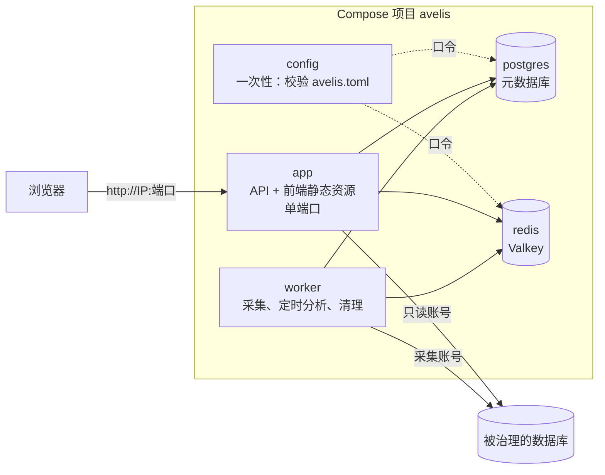

# 部署指南

[English](deployment.en.md) | 简体中文 | [繁體中文](deployment.zh-TW.md)

本文说明如何把 Avelis 部署为一个可访问的服务：Docker Compose 一键部署、单容器运行、使用外部 PostgreSQL / Redis、不用 Docker 部署，以及升级、备份与排障。全部配置项见 [configuration.md](configuration.md)。

> 本文的部署编排（`deploy/docker/`，Compose 项目名 `avelis`）与本地开发用的演示环境（`deploy/demo/`，项目名 `avelis-demo`）相互独立：项目名、网络、数据卷都不同，部署不会重建或删除演示容器。

## 1. 部署形态



- **config**：一次性容器。校验 `avelis.toml`，有错误就打印中文说明并退出（其余服务不会启动）；通过后把元数据库与 Redis 的口令交给内置的 postgres、redis 服务，所以口令只需要在 `avelis.toml` 里写一次。
- **app**：`python -m avelis.server`。同一端口提供 `/api`（接口，文档在 `/api/docs`）与构建好的前端（其他路径回退到 `index.html`，由前端路由处理）。启动时自动迁移元数据库、创建首个管理员。
- **worker**：`python -m avelis.jobs`。执行采集任务、定时采集与定时分析、超期历史清理。与 app 同一镜像、同一配置，单独一个容器。
  worker 启动后每轮向 Redis 写入 UTC ISO 时间心跳（`avelis:worker:heartbeat`，TTL 60 秒，正常退出时删除），可通过无需登录的 `GET /api/health/worker` 查询 `alive` 与 `last_seen`；心跳缺失或 Redis 不可用时返回 `false` 与 `null`，HTTP 状态始终为 200。
- **postgres**：元数据库（只支持 PostgreSQL，也存放问数智能体的会话状态）。
- **redis**：Redis 协议服务（镜像为 Valkey 8），用于任务唤醒、缓存、锁与令牌吊销。

镜像由仓库根目录的多阶段 `Dockerfile` 构建：pnpm 构建前端 → uv 按锁文件安装后端依赖 → 运行镜像（Python 3.12，非 root 用户 `avelis`，UID 10001，带健康检查与中文字体）。

部署目录 `deploy/docker/` 里的文件：

| 文件 | 用途 |
|---|---|
| `avelis.example.toml` | 配置样例（带中文注释）。复制为 `avelis.toml` 后填写 |
| `compose.yaml` | 编排：config、app、worker、postgres、redis |
| `compose.external.yaml` | 叠加文件：使用外部 PostgreSQL / Redis 时停用内置服务 |
| `.env.example` | 可选的编排参数（对外端口、镜像名），不含应用配置 |

## 2. 用 Docker Compose 部署

### 2.1 前置条件

- Docker Engine 24+ 与 Compose v2.24+（Docker Desktop 亦可）。
- 内存：应用与 worker 合计约 1 GB，PostgreSQL 与 Redis 另计。
- 能从服务器访问被治理的数据库（采集账号、只读查询账号）与模型服务（如使用真实模型）。

### 2.2 复制配置样例

```bash
cd deploy/docker
cp avelis.example.toml avelis.toml
```

### 2.3 填写配置

用文本编辑器打开 `avelis.toml`，填写标为【必填】的 3 项（生成随机值：`openssl rand -hex 32`）：

| 配置 | 说明 |
|---|---|
| `[security] secret` | 主密钥，至少 16 个字符。加密数据源口令、模型密钥并签发登录令牌。**上线后不要更换**，否则已保存的口令与密钥无法解密 |
| `[database] password` | 元数据库口令。使用内置 postgres 时，它首次启动就用这个口令初始化 |
| `[redis] password` | Redis 口令。使用内置 redis 时，它用这个口令启动 |

`[bootstrap] initial_admin_password` 可选：未配置或留空时，首个管理员默认使用 `admin` / `123456`，不校验口令强度、不强制改密，请登录后在界面修改口令。显式填写时须为 12–128 个字符、不包含用户名、至少 4 种不同字符，首次登录强制改密。用户名可通过 `initial_admin_username` 修改。

`bootstrap.auto_migrate` 与 `bootstrap.auto_init_admin` 默认均为 `true`，不写 `[bootstrap]` 段也会自动迁移并初始化管理员。MCP 默认开启，部署后可直接使用“设置 → MCP 接入”及 `/mcp`、`/oauth/*`、`/.well-known/*`，无需设置 `AVELIS_MCP_ENABLED=true` 或先填写对外地址。未配置 `AVELIS_PUBLIC_URL` 时，后端用请求经 uvicorn 处理后的 scheme、Host 与 ASGI `root_path` 推导 issuer 和资源地址；在完整授权与访问流程中保持同一主机名。若不需要 MCP，可显式设置 `AVELIS_MCP_ENABLED=false`。

其余各项（业务时区、登录时长、查询超时与行数上限、分析预算、日志级别、是否自动迁移等）都有默认值，按需修改。`avelis.toml` 含口令，请限制读取权限，并确保容器用户（UID 10001）能读到：

```bash
chmod 640 avelis.toml && sudo chgrp 10001 avelis.toml    # Linux；Docker Desktop 不需要
```

改端口（默认 8080）时，复制 `.env.example` 为 `.env` 并修改 `AVELIS_HTTP_PORT`。

### 2.4 启动

```bash
docker compose up -d --build
docker compose ps
```

首次启动会构建镜像（约数分钟，需要联网下载依赖；构建机要经代理上网时，先单独构建：`docker compose build --build-arg HTTP_PROXY=http://代理:端口 --build-arg HTTPS_PROXY=http://代理:端口`，代理只用于构建，不会写进镜像，再执行 `docker compose up -d`）。启动顺序：config 校验配置 → postgres、redis 就绪 → app 迁移元数据库、创建首个管理员、开始监听 → 就绪检查 `/api/health/ready` 通过后 app 变为 `healthy` → 启动 worker。

配置有误时 `docker compose up` 会提示 config 服务失败，用下面的命令查看哪一项、怎么改：

```bash
docker compose logs config
```

### 2.5 浏览器访问

编排默认只监听 `127.0.0.1`，在服务器本机浏览器打开 `http://127.0.0.1:8080`。未配置初始口令时，用默认 `admin` / `123456` 登录后在界面修改口令；显式配置了初始口令时，用该口令登录并按提示改密。从其他机器访问时，先修改默认管理员口令，再在 `.env` 把 `AVELIS_BIND_ADDRESS` 设为 `0.0.0.0` 或具体网卡地址，访问 `http://<服务器 IP>:8080`；生产环境建议放在 HTTPS 反向代理之后。之后在界面里依次：配置模型（设置 → 模型配置）→ 登记数据源并采集 → 建业务域与用户 → 发布口径。

### 2.6 常用操作

```bash
docker compose logs -f app worker                                  # 查看日志
docker compose run --rm app python -m avelis.config check          # 查看生效配置（口令脱敏）
docker compose exec app python -m avelis.bootstrap migrate         # 手动迁移（auto_migrate = false 时）
docker compose exec app python -m avelis.bootstrap init-admin      # 手动创建首个管理员
docker compose exec app python -m avelis.bootstrap verify-history  # 核验变更留底的哈希链
docker compose down                                                # 停止（保留数据卷）
```

修改 `avelis.toml` 后，用 `docker compose up -d --force-recreate` 让配置生效：它会重新运行 config 校验并重建全部容器（数据保留在数据卷）。只执行 `docker compose up -d` 不会重建已在运行的容器，新配置不生效。

- **改 Redis 口令**：直接改 `[redis] password` 后执行上面的命令即可（redis 随之用新口令重启）。
- **改元数据库口令**：内置 postgres 只在首次初始化时读取口令。先在库里改：`docker compose exec postgres psql -U avelis -d avelis -c "ALTER USER avelis PASSWORD '新口令'"`，再改 `[database] password` 并执行上面的命令。
- **不要改 `[security] secret`**：已保存的数据源口令与模型密钥都用它加密。

### 2.7 访问被治理的数据库

数据源的主机地址是从**容器内部**连接的：

- 数据库在其他服务器上：直接填它的主机名或 IP。
- 数据库在部署 Avelis 的同一台机器上：填 `host.docker.internal`（Compose 已为 Linux 配好 `host-gateway` 映射；Docker Desktop 自带）。不要填 `127.0.0.1`，那是容器自己。
- 数据库也在 Docker 里：可以把它所在的网络加到 `app` 与 `worker`（Compose 覆盖文件里的 `networks`），再用服务名访问。

## 3. 使用外部 PostgreSQL / Redis

1. 在外部 PostgreSQL 建好库与账号（账号需要能在该库建表与模式；智能体会话状态存放在模式 `avelis_agent`）。
2. 在 `avelis.toml` 的 `[database]`、`[redis]` 填外部服务的地址、端口、账号、口令（以及 `sslmode`、`ssl`）。
3. 叠加 `compose.external.yaml` 启动，内置的 postgres、redis 不再启动：

   ```bash
   docker compose -f compose.yaml -f compose.external.yaml up -d --build
   ```

   也可以在 `.env` 写 `COMPOSE_FILE=compose.yaml:compose.external.yaml`（Windows 用分号），之后照常 `docker compose up -d`。只有一个用外部服务时，删掉 `compose.external.yaml` 里另一个服务的配置。

## 4. 单容器运行

已有外部 PostgreSQL 与 Redis 时，可以只运行镜像：

```bash
docker build -t avelis:1.0.4 .                       # 在仓库根目录构建
docker run -d --name avelis -p 8080:8000 \
  -v "$PWD/avelis.toml:/etc/avelis/avelis.toml:ro" \
  avelis:1.0.4
docker run -d --name avelis-worker --no-healthcheck \
  -v "$PWD/avelis.toml:/etc/avelis/avelis.toml:ro" \
  avelis:1.0.4 python -m avelis.jobs
```

镜像默认读取 `/etc/avelis/avelis.toml`；镜像自带的健康检查针对 API，worker 容器用 `--no-healthcheck` 关闭。`[database]`、`[redis]` 写外部服务的地址；`[bootstrap] auto_migrate`、`auto_init_admin` 默认均为 `true`，可省略。也可以不挂载配置文件，全部用 `-e AVELIS_*` 环境变量传入。

## 5. 反向代理与 HTTPS

生产环境建议在前面放一个反向代理（Nginx、Caddy、云负载均衡）终止 HTTPS，并保持 `AVELIS_BIND_ADDRESS` 的默认值 `127.0.0.1` 只让本机代理访问。登录失败限流按“账号 + 来源地址”计数；MCP 未配置对外地址时还要使用正确的外部 scheme 与 Host。代理须保留 Host（含端口），传递 `X-Forwarded-For` 与 `X-Forwarded-Proto`，并把代理地址写进 `avelis.toml` 的 `[server] forwarded_allow_ips`（或 `AVELIS_FORWARDED_ALLOW_IPS`，只写可信代理，`"*"` 表示全部信任）。也可直接把 `[server] public_url`（`AVELIS_PUBLIC_URL`）设为用户实际访问的地址（如 `https://avelis.example.com`）。后端不额外信任 `X-Forwarded-Host` 等转发头；使用路径前缀时须正确设置 ASGI `root_path` 并让代理保留相应公开路径。

Nginx 示例（同步分析接口最长等待约 7 分钟，读超时要留足）：

```nginx
location / {
    proxy_pass http://127.0.0.1:8080;
    proxy_set_header Host $http_host;
    proxy_set_header X-Forwarded-For $proxy_add_x_forwarded_for;
    proxy_set_header X-Forwarded-Proto $scheme;
    proxy_read_timeout 600s;
    client_max_body_size 10m;
}
```

## 6. 不用 Docker 部署

适用于已有 Python 3.12、Node.js 24 与 pnpm 的服务器。

```bash
# 1. 构建前端
cd frontend
pnpm install --frozen-lockfile
pnpm build                                   # 产物在 frontend/dist

# 2. 安装后端
cd ../backend
uv sync --frozen --no-dev

# 3. 配置：复制样例并填写，另外取消注释 [server] 的 host、port、frontend_dir
cp ../deploy/docker/avelis.example.toml /etc/avelis/avelis.toml
#    [server] host = "0.0.0.0"、port = 8000、frontend_dir = "frontend/dist"
#    [database] / [redis] 填实际地址

# 4. 检查配置并启动（/etc/avelis/avelis.toml 会被自动读取；其他位置用 AVELIS_CONFIG 指定）
uv run python -m avelis.config check
uv run python -m avelis.server               # API + 前端，单端口；按配置自动迁移与创建管理员
uv run python -m avelis.jobs                 # worker，另起一个进程
```

两个进程建议交给 systemd 或其他进程管理器托管并设置自动重启。

## 7. 离线交付（服务器不能访问外网）

镜像是自包含的：前端构建产物、全部 Python 依赖、中文字体与 tiktoken 编码表都在构建时装进镜像，运行镜像里没有 uv / pnpm，启动与运行时不会下载任何依赖。服务器不能访问外网时，在能联网的机器上构建并导出镜像，拷到服务器导入：

```bash
# 联网机器（仓库根目录）
docker build -t avelis:1.0.4 .
docker pull postgres:18-alpine
docker pull valkey/valkey:8-alpine
docker save avelis:1.0.4 postgres:18-alpine valkey/valkey:8-alpine | gzip > avelis-1.0.4-images.tar.gz   # 约 260 MB

# 服务器（把镜像包与 deploy/docker 目录拷过去）
docker load -i avelis-1.0.4-images.tar.gz
cd deploy/docker
cp avelis.example.toml avelis.toml   # 填写
docker compose up -d --no-build --pull never
```

`--no-build --pull never` 保证只使用已导入的镜像，缺镜像时直接报错，而不会尝试联网。服务器与 CPU 架构需一致（镜像默认按构建机架构构建；为 x86_64 服务器在其他架构上构建时加 `--platform linux/amd64`）。

## 8. 升级

```bash
git pull
cd deploy/docker
docker compose up -d --build
```

`auto_migrate = true` 时，新版本的 app 启动时自动迁移元数据库（多副本时用 PostgreSQL 咨询锁串行执行）；迁移完成并就绪后 worker 才会重启。升级前先备份元数据库。

## 9. 备份与恢复

需要备份的是元数据库与 `avelis.toml`（数据源口令与模型密钥以加密形式存在库里，恢复时需要同一个 `[security] secret`）。Redis 只放可重建的缓存与唤醒信号。

```bash
# 备份
docker compose exec -T postgres pg_dump -U avelis -d avelis -Fc > avelis-$(date +%F).dump
# 恢复到空库（先停 app 与 worker）
docker compose stop app worker
docker compose exec -T postgres pg_restore -U avelis -d avelis --clean --if-exists < avelis-2026-10-31.dump
docker compose start app worker
```

## 10. 排障

| 现象 | 排查 |
|---|---|
| `docker compose up` 报 `bind source path does not exist: …avelis.toml` | 还没有复制配置样例，执行 `cp avelis.example.toml avelis.toml` |
| `service "config" didn't complete successfully` | 配置有误：`docker compose logs config` 列出每一项问题与修改方法 |
| app 一直不是 `healthy` | `docker compose logs app`；`/api/health/ready` 会给出元数据库或 Redis 哪一项不通 |
| 登录页能打开但没有管理员 | 查看 app 日志：检查 `auto_init_admin` 是否启用、显式配置的初始口令是否合规、是否有同名用户冲突或元数据库错误。修正后执行 `docker compose exec app python -m avelis.bootstrap init-admin`；初始口令留空时使用默认 `123456` |
| 内置 postgres 报口令错误 | 内置 postgres 只在**首次**初始化时使用口令；之后改了 `[database] password`，需要先在库里 `ALTER USER avelis PASSWORD '…'` |
| 采集或问数连不上数据库 | 数据源地址是从容器里连接的，见 2.7 |
| 更换 `secret` 后数据源报口令错误 | 已保存的口令无法用新密钥解密：换回原密钥，或在数据源详情里重新填写口令 |
