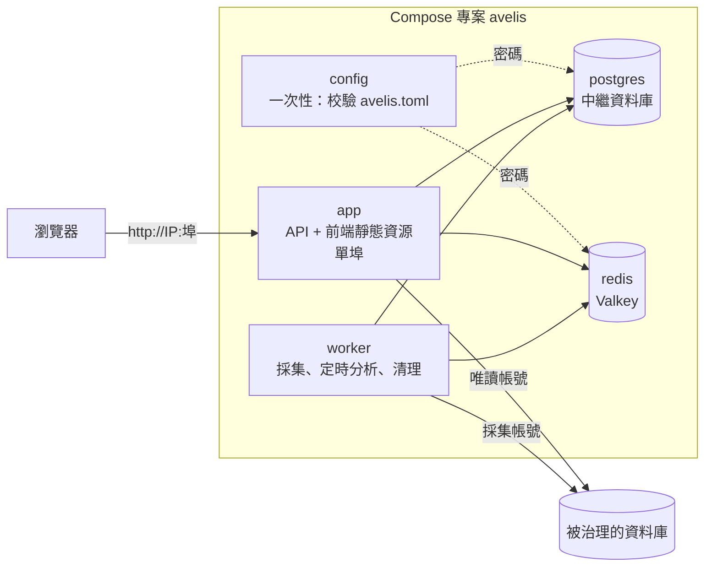

# 部署指南

[English](deployment.en.md) | [简体中文](deployment.md) | 繁體中文

本文說明如何把 Avelis 部署為一個可存取的服務：Docker Compose 一鍵部署、單容器執行、使用外部 PostgreSQL / Redis、不用 Docker 部署，以及升級、備份與排障。全部設定項見 [configuration.md](configuration.zh-TW.md)。

> 本文的部署編排（`deploy/docker/`，Compose 專案名 `avelis`）與本地開發用的示範環境（`deploy/demo/`，專案名 `avelis-demo`）相互獨立：專案名、網路、資料卷都不同，部署不會重建或刪除示範容器。

## 1. 部署形態



- **config**：一次性容器。校驗 `avelis.toml`，有錯誤就列印中文說明並退出（其餘服務不會啟動）；通過後把中繼資料庫與 Redis 的密碼交給內建的 postgres、redis 服務，所以密碼只需要在 `avelis.toml` 裡寫一次。
- **app**：`python -m avelis.server`。同一埠提供 `/api`（介面，文件在 `/api/docs`）與建置好的前端（其他路徑回退到 `index.html`，由前端路由處理）。啟動時自動遷移中繼資料庫、建立首個管理員。
- **worker**：`python -m avelis.jobs`。執行採集任務、定時採集與定時分析、超期歷史清理。與 app 同一映像、同一設定，單獨一個容器。
- **postgres**：中繼資料庫（只支援 PostgreSQL，也存放問數代理的會話狀態）。
- **redis**：Redis 協議服務（映像為 Valkey 8），用於任務喚醒、快取、鎖與權杖吊銷。

映像由儲存庫根目錄的多階段 `Dockerfile` 建置：pnpm 建置前端 → uv 按鎖檔案安裝後端依賴 → 執行映像（Python 3.12，非 root 使用者 `avelis`，UID 10001，帶健康檢查與中文字型）。

部署目錄 `deploy/docker/` 裡的檔案：

| 檔案 | 用途 |
|---|---|
| `avelis.example.toml` | 設定樣例（帶中文註釋）。複製為 `avelis.toml` 後填寫 |
| `compose.yaml` | 編排：config、app、worker、postgres、redis |
| `compose.external.yaml` | 疊加檔案：使用外部 PostgreSQL / Redis 時停用內建服務 |
| `.env.example` | 可選的編排引數（對外埠、映像名），不含應用設定 |

## 2. 用 Docker Compose 部署

### 2.1 前置條件

- Docker Engine 24+ 與 Compose v2.24+（Docker Desktop 亦可）。
- 記憶體：應用與 worker 合計約 1 GB，PostgreSQL 與 Redis 另計。
- 能從伺服器存取被治理的資料庫（採集帳號、唯讀查詢帳號）與模型服務（如使用真實模型）。

### 2.2 複製設定樣例

```bash
cd deploy/docker
cp avelis.example.toml avelis.toml
```

### 2.3 填寫設定

用文字編輯器開啟 `avelis.toml`，填寫標為【必填】的 3 項（生成隨機值：`openssl rand -hex 32`）：

| 設定 | 說明 |
|---|---|
| `[security] secret` | 主金鑰，至少 16 個字元。加密資料來源密碼、模型金鑰並簽發登入權杖。**上線後不要更換**，否則已儲存的密碼與金鑰無法解密 |
| `[database] password` | 中繼資料庫密碼。使用內建 postgres 時，它首次啟動就用這個密碼初始化 |
| `[redis] password` | Redis 密碼。使用內建 redis 時，它用這個密碼啟動 |

`[bootstrap] initial_admin_password` 選填：未設定或留空時，首個管理員預設使用 `admin` / `123456`，不校驗密碼強度、不強制改密，請登入後在介面修改密碼。明確填寫時須為 12–128 個字元、不包含使用者名稱、至少 4 種不同字元，首次登入強制改密。使用者名稱可透過 `initial_admin_username` 修改。

其餘各項（業務時區、登入時長、查詢超時與行數上限、分析預算、日誌級別、是否自動遷移等）都有預設值，按需修改。`avelis.toml` 含密碼，請限制讀取權限，並確保容器使用者（UID 10001）能讀到：

```bash
chmod 640 avelis.toml && sudo chgrp 10001 avelis.toml    # Linux；Docker Desktop 不需要
```

改埠（預設 8080）時，複製 `.env.example` 為 `.env` 並修改 `AVELIS_HTTP_PORT`。

### 2.4 啟動

```bash
docker compose up -d --build
docker compose ps
```

首次啟動會建置映像（約數分鐘，需要聯網下載依賴；建置機要經代理上網時，先單獨建置：`docker compose build --build-arg HTTP_PROXY=http://代理:埠 --build-arg HTTPS_PROXY=http://代理:埠`，代理只用於建置，不會寫進映像，再執行 `docker compose up -d`）。啟動順序：config 校驗設定 → postgres、redis 就緒 → app 遷移中繼資料庫、建立首個管理員、開始監聽 → 就緒檢查 `/api/health/ready` 通過後 app 變為 `healthy` → 啟動 worker。

設定有誤時 `docker compose up` 會提示 config 服務失敗，用下面的命令檢視哪一項、怎麼改：

```bash
docker compose logs config
```

### 2.5 瀏覽器存取

瀏覽器開啟 `http://<伺服器 IP>:8080`。未設定初始密碼時，用預設 `admin` / `123456` 登入後在介面修改密碼；明確設定了初始密碼時，用該密碼登入並按提示改密。之後在介面裡依次：設定模型（設定 → 模型設定）→ 登記資料來源並採集 → 建業務域與使用者 → 發布口徑。

### 2.6 常用操作

```bash
docker compose logs -f app worker                                  # 檢視日誌
docker compose run --rm app python -m avelis.config check          # 檢視生效設定（密碼脫敏）
docker compose exec app python -m avelis.bootstrap migrate         # 手動遷移（auto_migrate = false 時）
docker compose exec app python -m avelis.bootstrap init-admin      # 手動建立首個管理員
docker compose exec app python -m avelis.bootstrap verify-history  # 核驗變更留存的雜湊鏈
docker compose down                                                # 停止（保留資料卷）
```

修改 `avelis.toml` 後，用 `docker compose up -d --force-recreate` 讓設定生效：它會重新執行 config 校驗並重建全部容器（資料保留在資料卷）。只執行 `docker compose up -d` 不會重建已在執行的容器，新設定不生效。

- **改 Redis 密碼**：直接改 `[redis] password` 後執行上面的命令即可（redis 隨之用新密碼重啟）。
- **改中繼資料庫密碼**：內建 postgres 只在首次初始化時讀取密碼。先在庫裡改：`docker compose exec postgres psql -U avelis -d avelis -c "ALTER USER avelis PASSWORD '新密碼'"`，再改 `[database] password` 並執行上面的命令。
- **不要改 `[security] secret`**：已儲存的資料來源密碼與模型金鑰都用它加密。

### 2.7 存取被治理的資料庫

資料來源的主機地址是從**容器內部**連線的：

- 資料庫在其他伺服器上：直接填它的主機名或 IP。
- 資料庫在部署 Avelis 的同一臺機器上：填 `host.docker.internal`（Compose 已為 Linux 配好 `host-gateway` 對映；Docker Desktop 自帶）。不要填 `127.0.0.1`，那是容器自己。
- 資料庫也在 Docker 裡：可以把它所在的網路加到 `app` 與 `worker`（Compose 覆蓋檔案裡的 `networks`），再用服務名存取。

## 3. 使用外部 PostgreSQL / Redis

1. 在外部 PostgreSQL 建好庫與帳號（帳號需要能在該庫建表與模式；代理會話狀態存放在模式 `avelis_agent`）。
2. 在 `avelis.toml` 的 `[database]`、`[redis]` 填外部服務的地址、埠、帳號、密碼（以及 `sslmode`、`ssl`）。
3. 疊加 `compose.external.yaml` 啟動，內建的 postgres、redis 不再啟動：

   ```bash
   docker compose -f compose.yaml -f compose.external.yaml up -d --build
   ```

   也可以在 `.env` 寫 `COMPOSE_FILE=compose.yaml:compose.external.yaml`（Windows 用分號），之後照常 `docker compose up -d`。只有一個用外部服務時，刪掉 `compose.external.yaml` 裡另一個服務的設定。

## 4. 單容器執行

已有外部 PostgreSQL 與 Redis 時，可以只執行映像：

```bash
docker build -t avelis:1.0.1 .                       # 在儲存庫根目錄建置
docker run -d --name avelis -p 8080:8000 \
  -v "$PWD/avelis.toml:/etc/avelis/avelis.toml:ro" \
  avelis:1.0.1
docker run -d --name avelis-worker --no-healthcheck \
  -v "$PWD/avelis.toml:/etc/avelis/avelis.toml:ro" \
  avelis:1.0.1 python -m avelis.jobs
```

映像預設讀取 `/etc/avelis/avelis.toml`；映像自帶的健康檢查針對 API，worker 容器用 `--no-healthcheck` 關閉。`[database]`、`[redis]` 寫外部服務的地址；`[bootstrap] auto_migrate`、`auto_init_admin` 保持 `true`（樣例的預設值）。也可以不掛載設定檔，全部用 `-e AVELIS_*` 環境變數傳入。

## 5. 反向代理與 HTTPS

生產環境建議在前面放一個反向代理（Nginx、Caddy、雲負載均衡）終止 HTTPS，並在 `.env` 把 `AVELIS_BIND_ADDRESS` 改為 `127.0.0.1` 只讓代理存取。登入失敗限流按「帳號 + 來源地址」計數，代理需要傳 `X-Forwarded-For`，並把代理地址寫進 `avelis.toml` 的 `[server] forwarded_allow_ips`（只寫可信代理，`"*"` 表示全部信任）。`[server] public_url` 填使用者實際存取的地址（如 `https://avelis.example.com`）。

Nginx 示例（同步分析介面最長等待約 7 分鐘，讀超時要留足）：

```nginx
location / {
    proxy_pass http://127.0.0.1:8080;
    proxy_set_header Host $host;
    proxy_set_header X-Forwarded-For $proxy_add_x_forwarded_for;
    proxy_set_header X-Forwarded-Proto $scheme;
    proxy_read_timeout 600s;
    client_max_body_size 10m;
}
```

## 6. 不用 Docker 部署

適用於已有 Python 3.12、Node.js 24 與 pnpm 的伺服器。

```bash
# 1. 建置前端
cd frontend
pnpm install --frozen-lockfile
pnpm build                                   # 產物在 frontend/dist

# 2. 安裝後端
cd ../backend
uv sync --frozen --no-dev

# 3. 設定：複製樣例並填寫，另外取消註釋 [server] 的 host、port、frontend_dir
cp ../deploy/docker/avelis.example.toml /etc/avelis/avelis.toml
#    [server] host = "0.0.0.0"、port = 8000、frontend_dir = "frontend/dist"
#    [database] / [redis] 填實際地址

# 4. 檢查設定並啟動（/etc/avelis/avelis.toml 會被自動讀取；其他位置用 AVELIS_CONFIG 指定）
uv run python -m avelis.config check
uv run python -m avelis.server               # API + 前端，單埠；按設定自動遷移與建立管理員
uv run python -m avelis.jobs                 # worker，另起一個程序
```

兩個程序建議交給 systemd 或其他程序管理器託管並設定自動重啟。

## 7. 離線交付（伺服器不能存取外網）

映像是自包含的：前端建置產物、全部 Python 依賴、中文字型與 tiktoken 編碼表都在建置時裝進映像，執行映像裡沒有 uv / pnpm，啟動與執行時不會下載任何依賴。伺服器不能存取外網時，在能聯網的機器上建置並匯出映像，拷到伺服器匯入：

```bash
# 聯網機器（儲存庫根目錄）
docker build -t avelis:1.0.1 .
docker pull postgres:18-alpine
docker pull valkey/valkey:8-alpine
docker save avelis:1.0.1 postgres:18-alpine valkey/valkey:8-alpine | gzip > avelis-1.0.1-images.tar.gz   # 約 260 MB

# 伺服器（把映像包與 deploy/docker 目錄拷過去）
docker load -i avelis-1.0.1-images.tar.gz
cd deploy/docker
cp avelis.example.toml avelis.toml   # 填寫
docker compose up -d --no-build --pull never
```

`--no-build --pull never` 保證只使用已匯入的映像，缺映像時直接報錯，而不會嘗試聯網。伺服器與 CPU 架構需一致（映像預設按建置機架建置置；為 x86_64 伺服器在其他架構上建置時加 `--platform linux/amd64`）。

## 8. 升級

```bash
git pull
cd deploy/docker
docker compose up -d --build
```

`auto_migrate = true` 時，新版本的 app 啟動時自動遷移中繼資料庫（多副本時用 PostgreSQL 諮詢鎖序列執行）；遷移完成並就緒後 worker 才會重啟。升級前先備份中繼資料庫。

## 9. 備份與恢復

需要備份的是中繼資料庫與 `avelis.toml`（資料來源密碼與模型金鑰以加密形式存在庫裡，恢復時需要同一個 `[security] secret`）。Redis 只放可重建的快取與喚醒訊號。

```bash
# 備份
docker compose exec -T postgres pg_dump -U avelis -d avelis -Fc > avelis-$(date +%F).dump
# 恢復到空庫（先停 app 與 worker）
docker compose stop app worker
docker compose exec -T postgres pg_restore -U avelis -d avelis --clean --if-exists < avelis-2026-10-31.dump
docker compose start app worker
```

## 10. 排障

| 現象 | 排查 |
|---|---|
| `docker compose up` 報 `bind source path does not exist: …avelis.toml` | 還沒有複製設定樣例，執行 `cp avelis.example.toml avelis.toml` |
| `service "config" didn't complete successfully` | 設定有誤：`docker compose logs config` 列出每一項問題與修改方法 |
| app 一直不是 `healthy` | `docker compose logs app`；`/api/health/ready` 會給出中繼資料庫或 Redis 哪一項不通 |
| 登入頁能開啟但沒有管理員 | 查看 app 日誌：檢查 `auto_init_admin` 是否啟用、明確設定的初始密碼是否合規、是否有同名使用者衝突或中繼資料庫錯誤。修正後執行 `docker compose exec app python -m avelis.bootstrap init-admin`；初始密碼留空時使用預設 `123456` |
| 內建 postgres 報密碼錯誤 | 內建 postgres 只在**首次**初始化時使用密碼；之後改了 `[database] password`，需要先在庫裡 `ALTER USER avelis PASSWORD '…'` |
| 採集或問數連不上資料庫 | 資料來源地址是從容器裡連線的，見 2.7 |
| 更換 `secret` 後資料來源報密碼錯誤 | 已儲存的密碼無法用新金鑰解密：換回原金鑰，或在資料來源詳情裡重新填寫密碼 |
