# Product Tour

English | [简体中文](product-tour.md) | [繁體中文](product-tour.zh-TW.md)

This tour walks through the main pages of Avelis with screenshots. They were taken on 2026-11-27 from v1.1.0, at a 1440×900 viewport in the default light theme, plus two in the dark theme. The data on the pages is synthetic e-commerce and store demo data, and all names are fictional. The entries on the personal experience page were saved before the screenshots from what was confirmed in this analysis, and the skills on the skills page are sample packages uploaded beforehand.

## Sign-in

The sign-in page shows the product's tagline and a three-step preview (lineage trace → metric check → grounded insight) on the left, and the sign-in form on the right, with “Remember me (7 days)”; when single sign-on is configured, its sign-in button appears as well. Accounts whose password was created or reset by an administrator must change it on first sign-in.

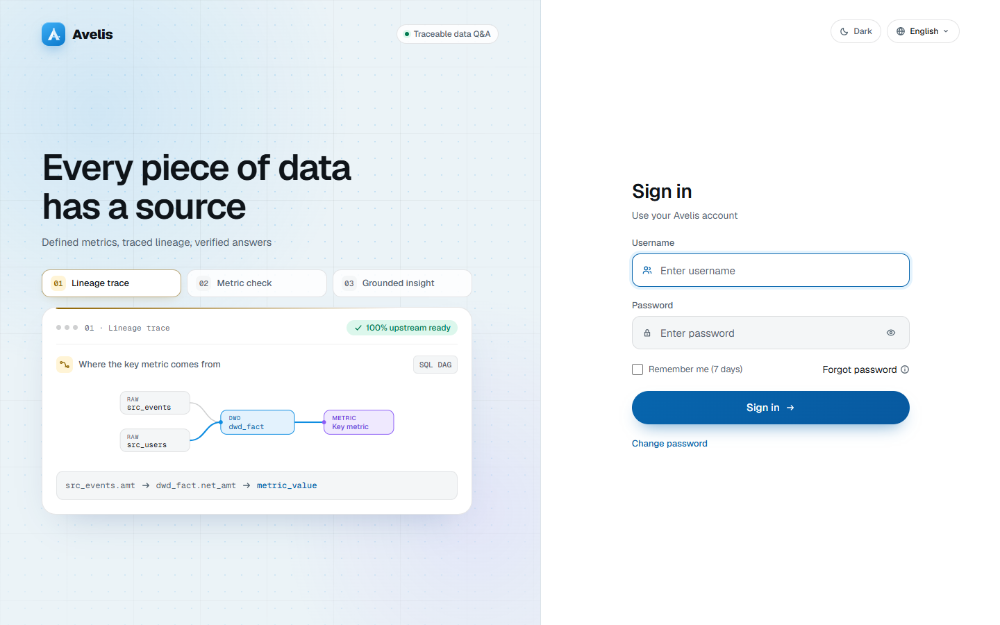

A dark theme is available (switch it in the app, or follow the system):

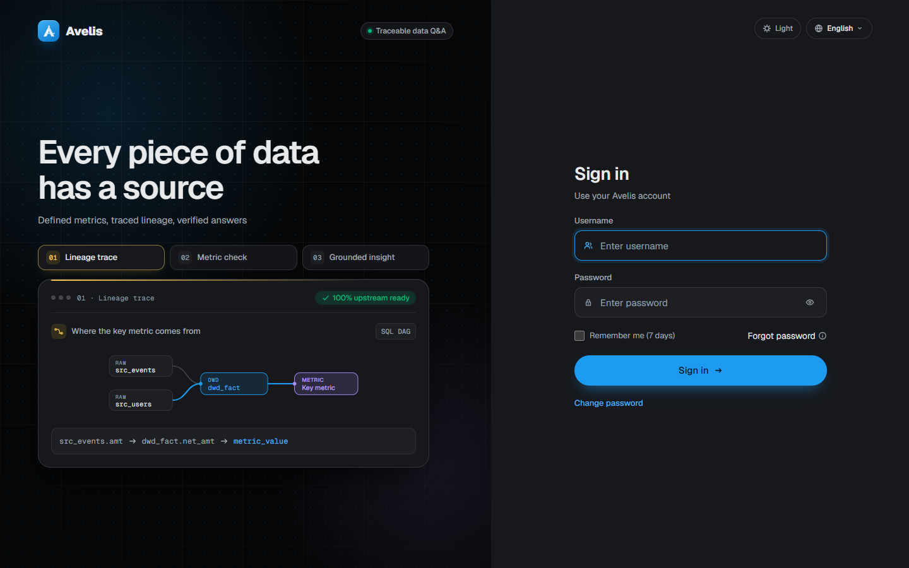

## Workbench

The home page after sign-in: overviews of collection, lineage, changes, metric definitions and Ask; to-dos (assigned to me, blocked questions); the metrics I own; and the collection status, schedule and recent changes of each data source.

## Ask and analysis

### Asking a question

Start from **Ask** or **New question**. You can ask for a single number, or ask “why did this change, what is related”. Below the input box you can choose how time is interpreted, how confirmations are handled and which model to use; example questions configured for the business domain are listed underneath.

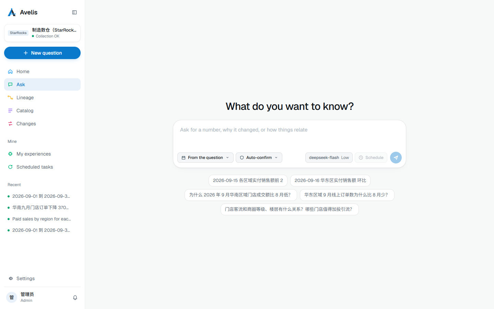

### Analysis session

An analysis is a conversation in time order:

- the user's question and a collapsible “Thought for N s” section (time taken, reasoning passages, tool calls);
- a conclusion-first report: key conclusions (numbers carry source markers), source verification results, ranked causes (primary cause, direction, contribution and the datasets cited);
- the evidence panel on the right: every dataset produced by this analysis, labelled as governed query, calculation, exploration or context;
- the input box and model bar fixed at the bottom (model name, thinking level, a ring showing context usage), where you can follow up, point out mistakes or add rules.

Further down the report is “Still unresolved · the model can keep investigating”: each unexplained point can be investigated further with one click. Below that are the basis for the conclusions, the basis for the analysis, and the confirmations and corrections that can be saved as experience.

### Thinking and steps

Open “Thought for N s” to see the analysis as a timeline, one row per reasoning passage or tool call. Tool rows show whether the call succeeded or failed, how long it took and the dataset it produced; expand one to see its arguments and a summary of the result. Reasoning rows expand to the full reasoning text. While an analysis runs, the current step shows a spinner and the header shows “Thinking…”, the current step and the time so far; with models whose thinking protocol has been verified, such as DeepSeek, the reasoning text appears live.

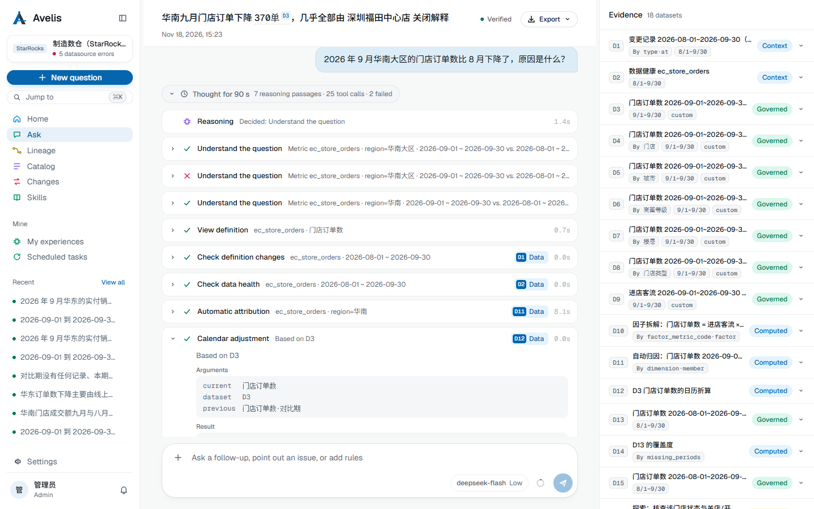

### Export

Reports export to PDF, HTML or Markdown. The default is a brief for decision makers; tick “Include basis” to export the full report with data sources and query details.

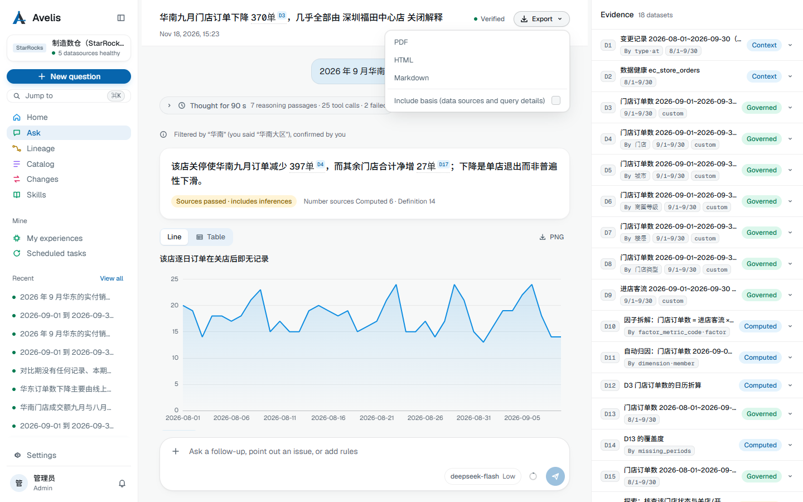

### Dataset view

Click a dataset in the evidence panel or a dataset reference in the report (such as D4) to open it in the main area: a chart and the rows, the window and notes. You can rerun it with a different time window or export it as CSV; “Back to report” returns to the conversation.

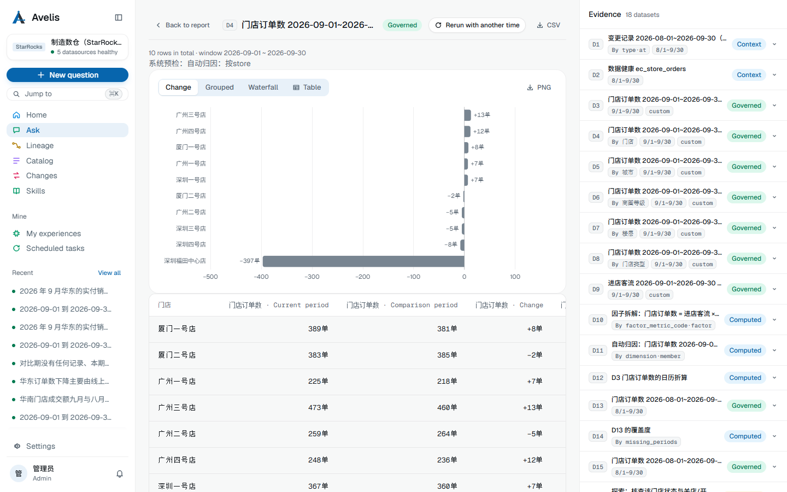

An analysis session in the dark theme:

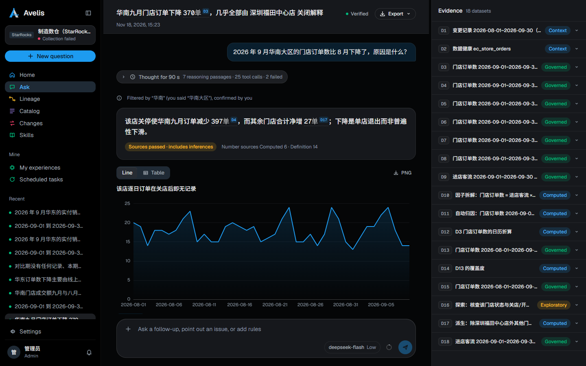

## Personal experience

What you confirm or correct during analyses is kept as personal experience (rules, joins and so on) and recalled automatically by metric definition and asset in later analyses. Join experience can be turned into a governed join path.

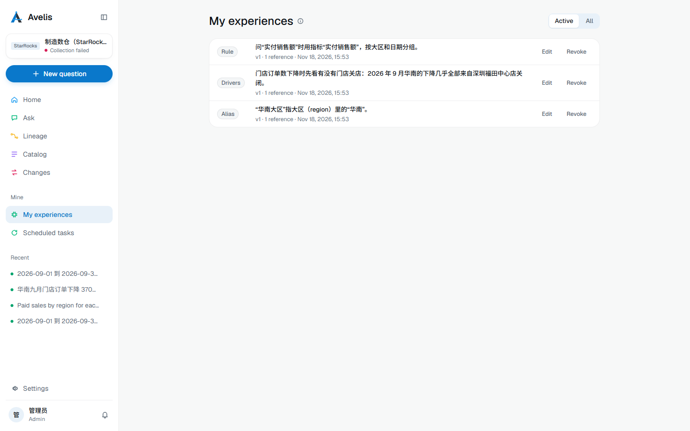

## Skills

“Skills” in the sidebar is a skill marketplace. Packages follow the open [Agent Skills](https://agentskills.io) format: a zip holding one skill folder with a `SKILL.md`, optionally with reference files and scripts. Anyone can upload; an admin reviews a skill before it is listed. Each user enables listed skills for themselves, and none are enabled by default. Scripts in a package are stored and viewable but never executed.

Q&A and analysis pick relevant skills from the ones you have enabled. You can also reference skills explicitly with the “+” at the left of the input box or by typing `/`. The report's analysis basis lists the skills and versions that were used.

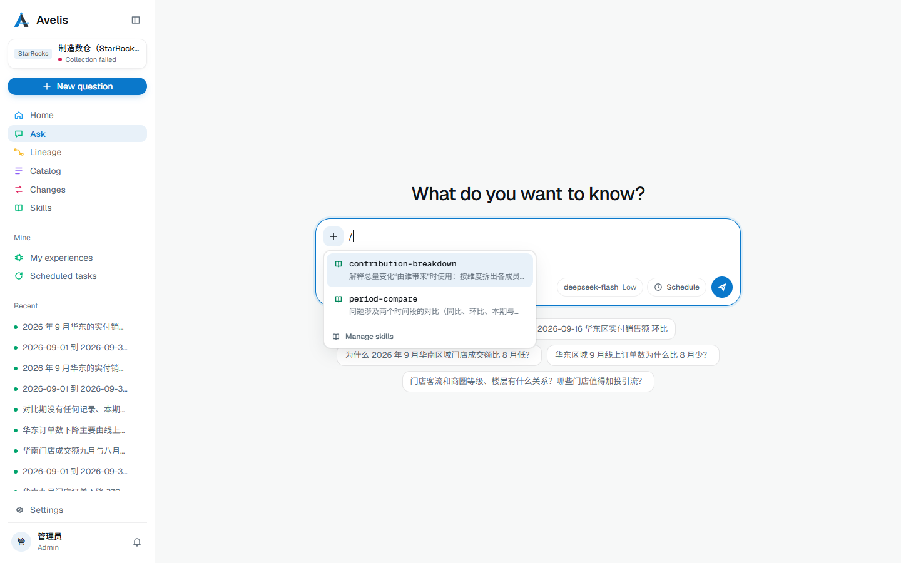

## Lineage

Table-level and column-level lineage graph: filter by business domain, search for tables, and show join paths or columns. When a table is selected, the inspector on the right shows its grain, upstream tables and parsed column-level edges, join paths with their review status, and influencing conditions.

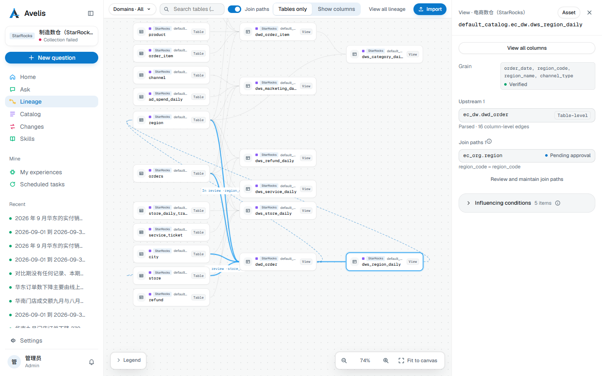

## Catalog

Metrics, assets, business domains and join paths. The metric detail page shows the metric definition's versions, description, base asset, expression, time column, allowed dimensions, grain and unit, and the pre-publish check (for example, columns without database comments and upstream comments that can be reused).

### Asset dossier

Open a table in the catalog and you land on its dossier. The top is a flow band: where the table comes from → the table → what uses it (metric definitions, questions and downstream tables). The row of cards below shows the metric definitions in use, who asked about it recently, and recent structure changes.

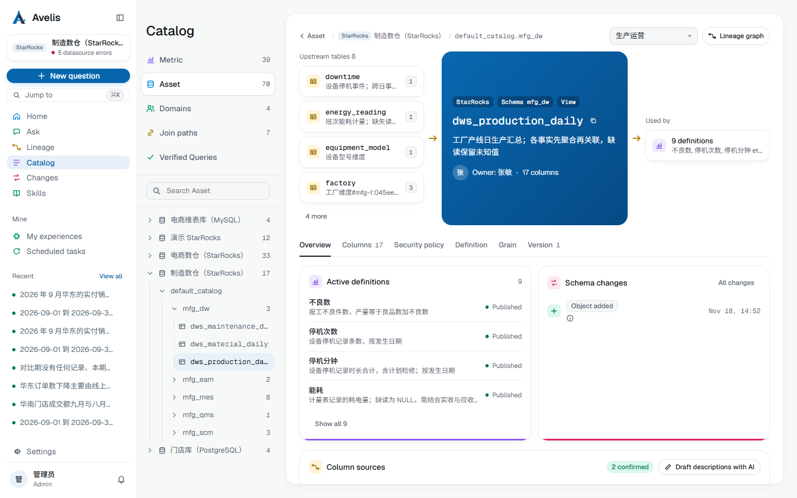

Further down is “Column sources”: each column lists its source columns, the kind of processing (direct, aggregate and so on) and a one-sentence description. The model drafts the description and the owner confirms it, so each line is marked either confirmed or “Model draft · needs confirmation”; expressions are collapsed by default and open with “View expression”. A view shows its definition, and a table that scripts were imported for shows the script that writes it and how it writes.

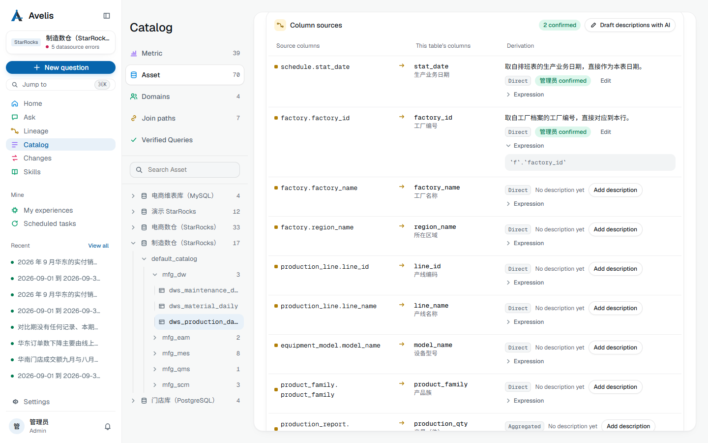

## Settings

Data sources, models, users, business calendar, notifications and MCP access. The data source page shows the connection, endpoint aliases, collection scope and interval, and the result of each collection run.

