# Product Tour

English | [简体中文](product-tour.md) | [繁體中文](product-tour.zh-TW.md)

This tour walks through the main pages of Avelis with screenshots. The screenshots were taken from build a8dce65 of main (some pages include two style fixes made while taking them on 2026-11-01), at a 1440×900 viewport in the dark theme, plus two in the light theme. The data on the pages is synthetic e-commerce, store and manufacturing demo data, and all names are fictional.

> The screenshots show the current Simplified Chinese interface. Screenshots of the English and Traditional Chinese interfaces will be added once the interface supports those languages.

## Sign-in

The sign-in page shows the product's key points and an example of a grounded analysis on the left, and the sign-in form on the right. Accounts whose password was created or reset by an administrator must change it on first sign-in.

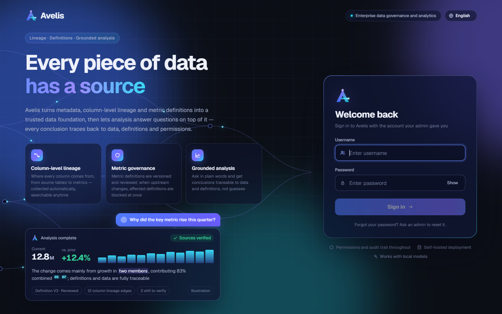

A light theme is available (follows the system, and can be switched in the app):

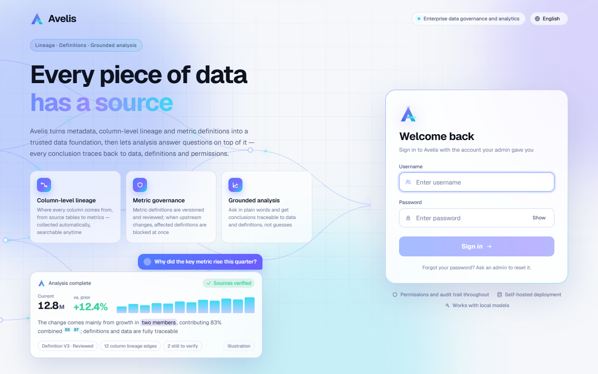

## Workbench

The home page after sign-in: overviews of collection, lineage, changes, metric definitions and Ask; to-dos (assigned to me, blocked questions); the metrics I own; and the collection status, schedule and recent changes of each data source.

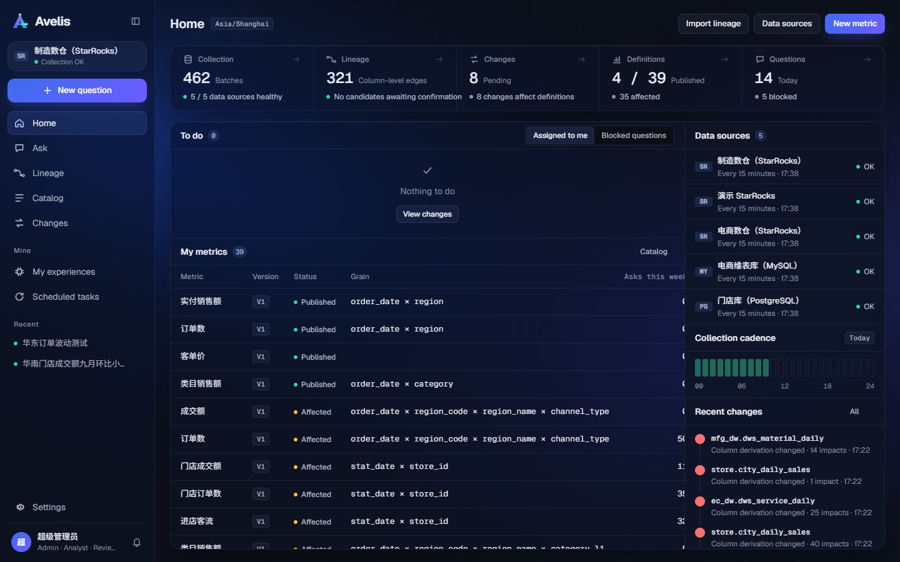

## Ask and analysis

### Asking a question

Start from **问数** (Ask) or **新问题** (New question). You can ask for a single number, or ask “why did this change, what is related”. Below the input box you can choose how time is interpreted, how confirmations are handled and which model to use; example questions configured for the business domain are listed underneath.

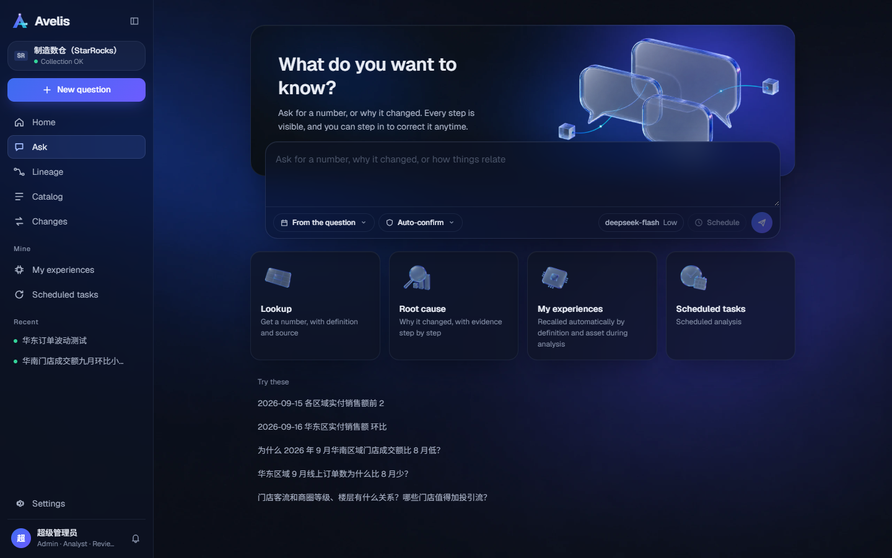

### Analysis session

An analysis is a conversation in time order:

- the user's question and a collapsible “thought deeply” section (time taken, steps, reasoning segments);
- a conclusion-first report: key conclusions (numbers carry source markers), source verification results, ranked causes (primary cause, direction, contribution and the datasets cited);
- the evidence panel on the right: every dataset produced by this analysis, labelled as governed query, calculation, exploration or context;
- the input box and model bar fixed at the bottom (model name, thinking level, a ring showing context usage), where you can follow up, point out mistakes or add rules.

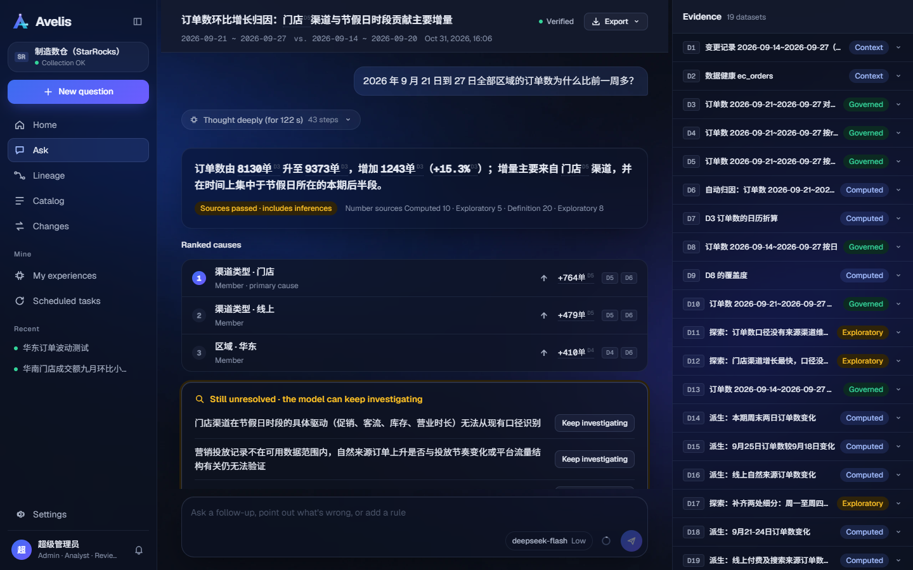

Further down the report is “not yet explained · let the model keep investigating”: each unexplained point can be investigated further with one click. Below that are the basis for the conclusions, the basis for the analysis, and the confirmations and corrections that can be saved as experience.

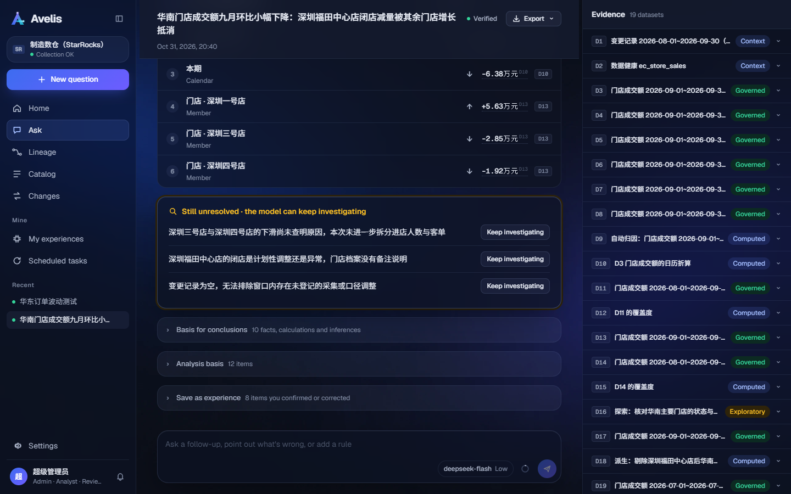

### Export

Reports export to PDF, HTML or Markdown. The default is a brief for decision makers; tick “include evidence” to export the full report with data sources and query details.

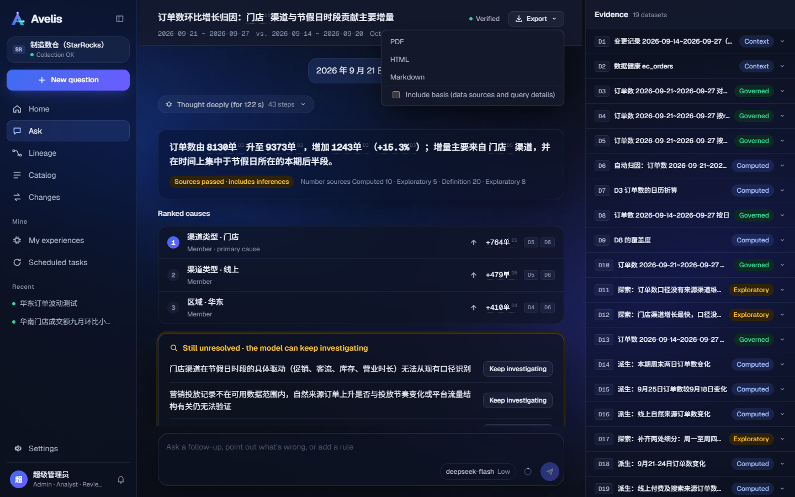

### Dataset view

Click a dataset in the evidence panel or a dataset reference in the report (such as D13) to open it in the main area: a chart and the rows, the window and notes. You can rerun it with a different time window or export it as CSV; “back to report” returns to the conversation.

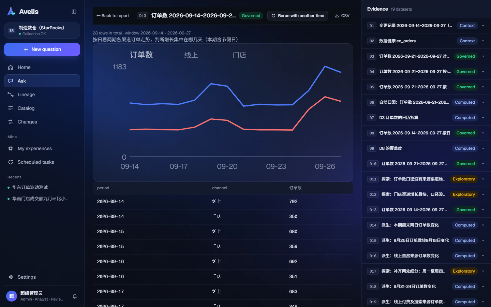

An analysis session in the light theme:

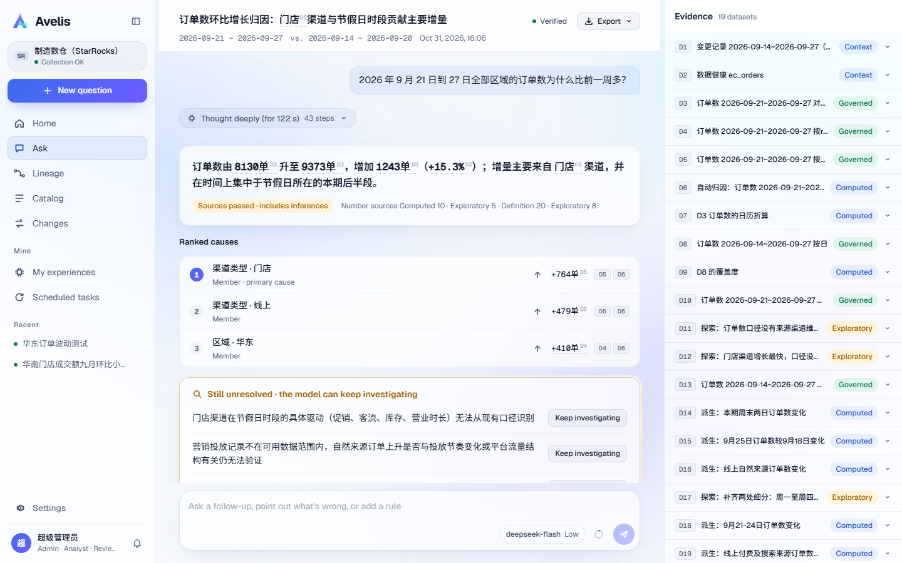

## Personal experience

What you confirm or correct during analyses is kept as personal experience (rules, joins and so on) and recalled automatically by metric definition and asset in later analyses. Join experience can be turned into a governed join path.

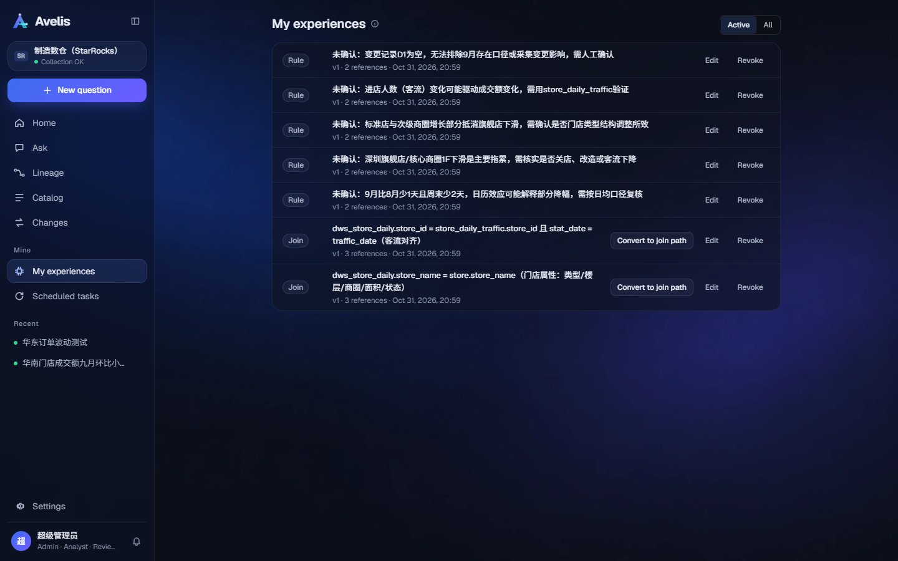

## Lineage

Table-level and column-level lineage graph: filter by business domain, search for tables, and show join paths or columns. When a table is selected, the inspector on the right shows its grain, upstream tables and parsed column-level edges, join paths with their review status, and influencing conditions.

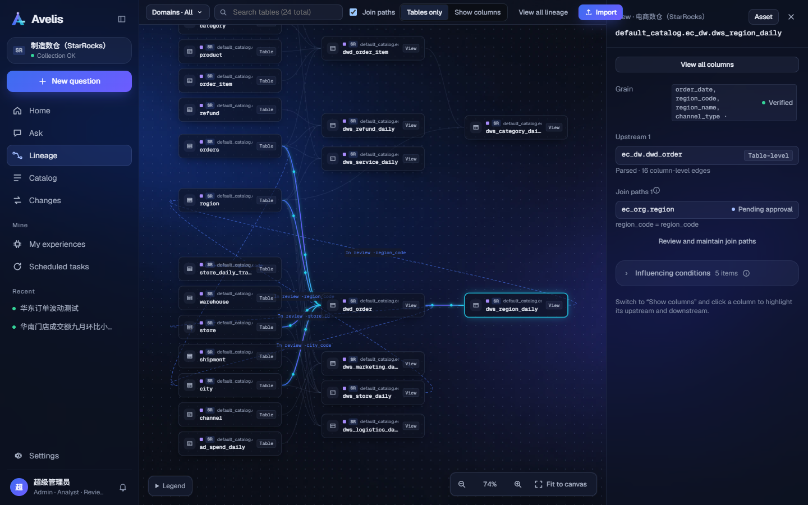

## Catalog

Metrics, assets, business domains and join paths. The metric detail page shows the metric definition's versions, description, base asset, expression, time column, allowed dimensions, grain and unit, and the pre-publish check (for example, columns without database comments and upstream comments that can be reused).

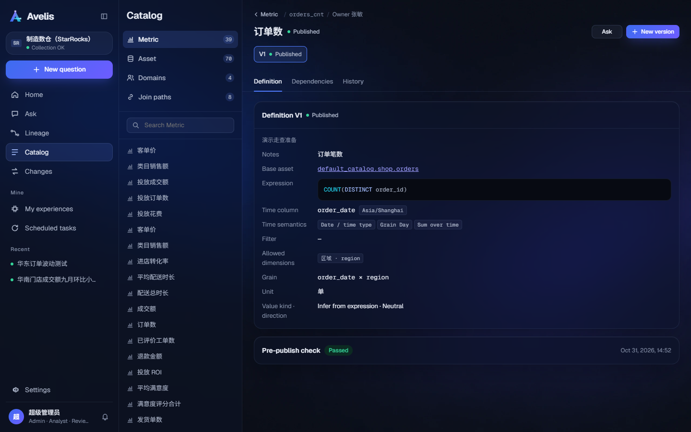

## Settings

Data sources, model settings and users. The data source page shows the connection, endpoint aliases, collection scope and interval, and the result of each collection run.

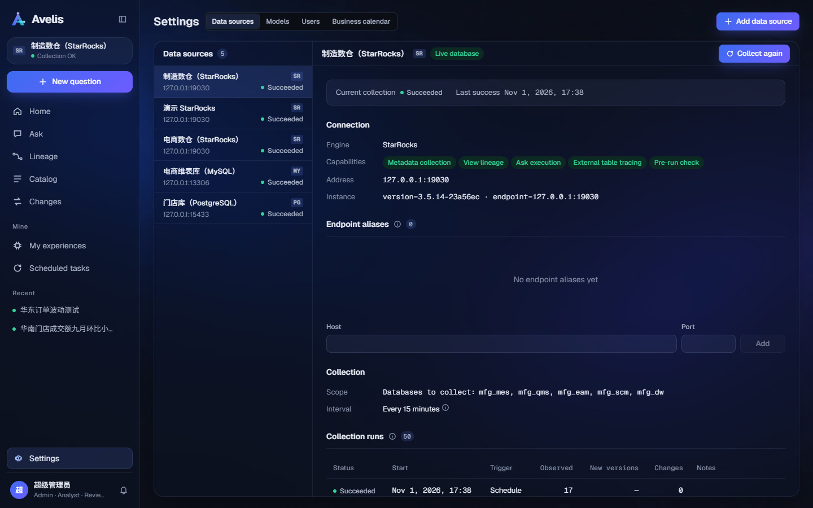
