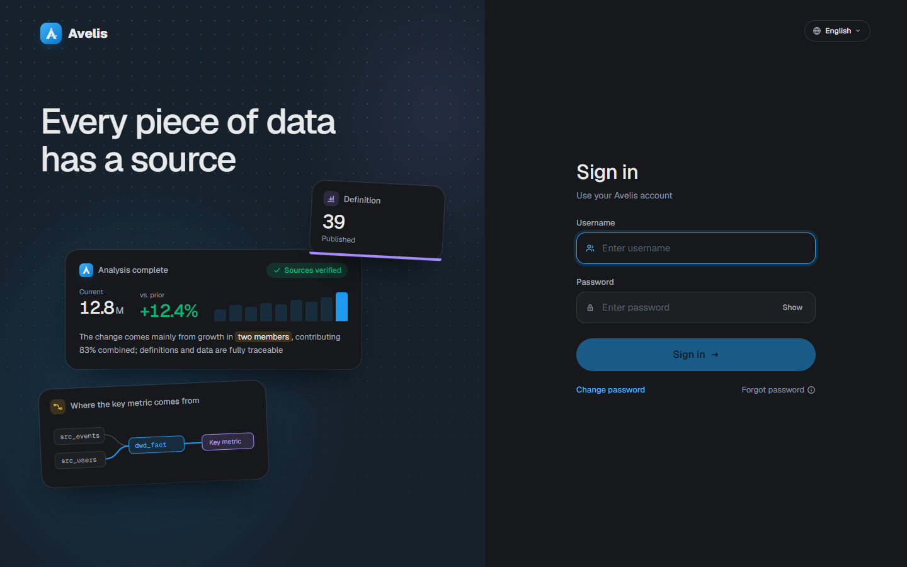
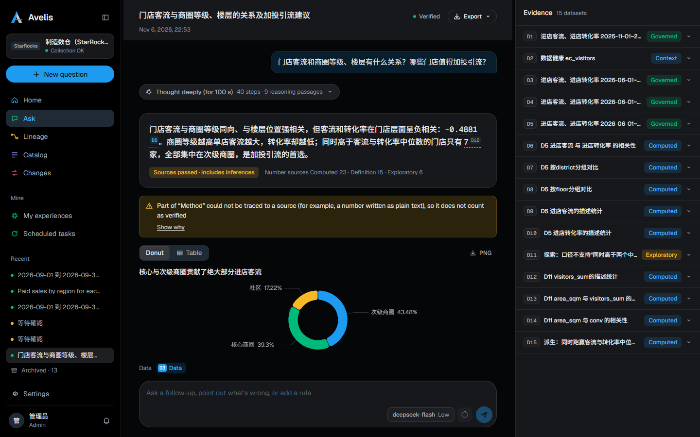
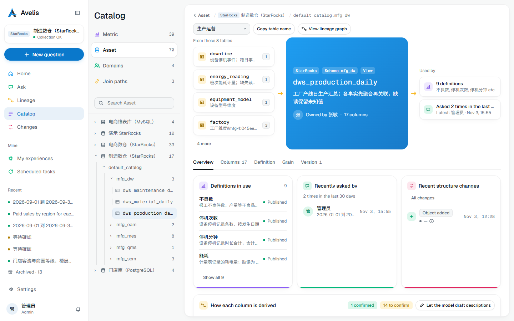
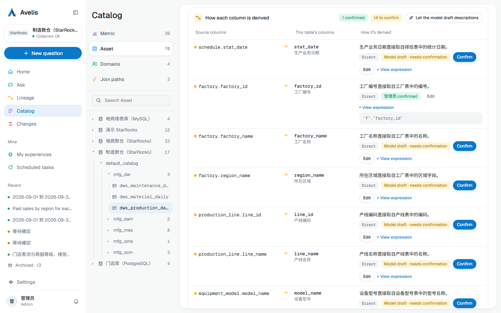

# Product Tour

English | [简体中文](product-tour.md) | [繁體中文](product-tour.zh-TW.md)

This tour walks through the main pages of Avelis with screenshots. They were taken on 2026-11-13 from the v1.0.8 release branch, at a 1440×900 viewport in the default light theme, plus two in the dark theme. The data on the pages is synthetic e-commerce and store demo data, and all names are fictional. The personal experience page keeps its v1.0.7 screenshot (engine tags there still show the old two-letter abbreviations); its entries were saved from this analysis's conclusions at that time.

## Sign-in

The sign-in page shows the product's tagline and an example of a grounded analysis on the left, and the sign-in form on the right. Accounts whose password was created or reset by an administrator must change it on first sign-in.

A dark theme is available (switch it in the app, or follow the system):

## Workbench

The home page after sign-in: overviews of collection, lineage, changes, metric definitions and Ask; to-dos (assigned to me, blocked questions); the metrics I own; and the collection status, schedule and recent changes of each data source.

## Ask and analysis

### Asking a question

Start from **Ask** or **New question**. You can ask for a single number, or ask “why did this change, what is related”. Below the input box you can choose how time is interpreted, how confirmations are handled and which model to use; example questions configured for the business domain are listed underneath.

### Analysis session

An analysis is a conversation in time order:

- the user's question and a collapsible “thought deeply” section (time taken, steps, reasoning segments);
- a conclusion-first report: key conclusions (numbers carry source markers), source verification results, ranked causes (primary cause, direction, contribution and the datasets cited);
- the evidence panel on the right: every dataset produced by this analysis, labelled as governed query, calculation, exploration or context;
- the input box and model bar fixed at the bottom (model name, thinking level, a ring showing context usage), where you can follow up, point out mistakes or add rules.

Further down the report is “Still unresolved · the model can keep investigating”: each unexplained point can be investigated further with one click. Below that are the basis for the conclusions, the basis for the analysis, and the confirmations and corrections that can be saved as experience.

### Export

Reports export to PDF, HTML or Markdown. The default is a brief for decision makers; tick “Include basis” to export the full report with data sources and query details.

### Dataset view

Click a dataset in the evidence panel or a dataset reference in the report (such as D4) to open it in the main area: a chart and the rows, the window and notes. You can rerun it with a different time window or export it as CSV; “Back to report” returns to the conversation.

An analysis session in the dark theme:

## Personal experience

What you confirm or correct during analyses is kept as personal experience (rules, joins and so on) and recalled automatically by metric definition and asset in later analyses. Join experience can be turned into a governed join path.

## Lineage

Table-level and column-level lineage graph: filter by business domain, search for tables, and show join paths or columns. When a table is selected, the inspector on the right shows its grain, upstream tables and parsed column-level edges, join paths with their review status, and influencing conditions.

## Catalog

Metrics, assets, business domains and join paths. The metric detail page shows the metric definition's versions, description, base asset, expression, time column, allowed dimensions, grain and unit, and the pre-publish check (for example, columns without database comments and upstream comments that can be reused).

### Asset dossier

Open a table in the catalog and you land on its dossier. The top is a flow band: where the table comes from → the table → what uses it (metric definitions, questions and downstream tables). The row of cards below shows the metric definitions in use, who asked about it recently, and recent structure changes.

Further down is “How each column is derived”: each column lists its source columns, the kind of processing (direct, aggregate and so on) and a one-sentence description. The model drafts the description and the owner confirms it, so each line is marked either confirmed or “Model draft · needs confirmation”; expressions are collapsed by default and open with “View expression”. A view shows its definition, and a table that scripts were imported for shows the script that writes it and how it writes.

## Settings

Data sources, models, users, business calendar, notifications and MCP access. The data source page shows the connection, endpoint aliases, collection scope and interval, and the result of each collection run.

