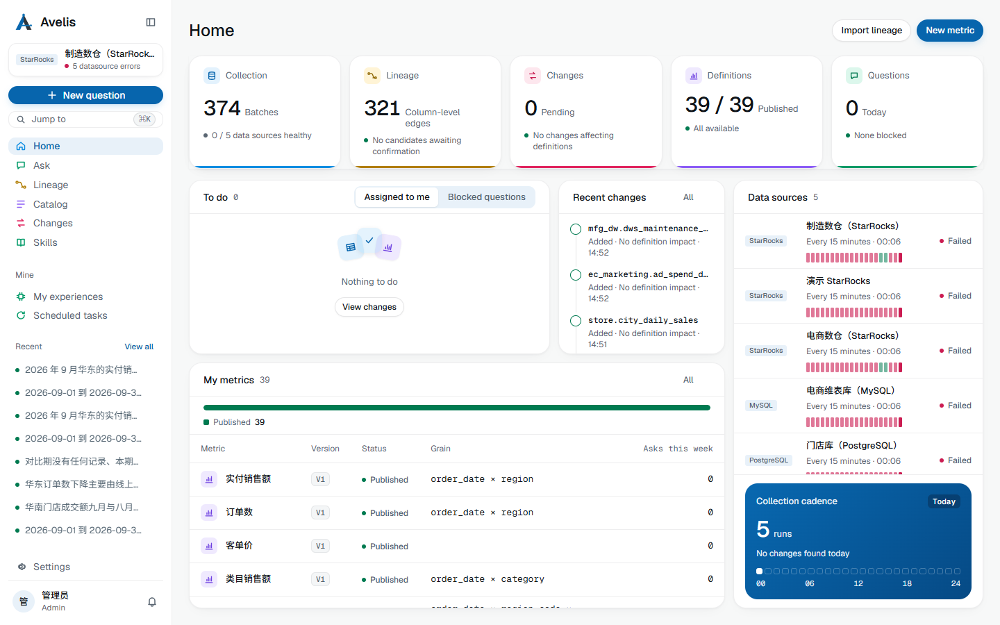
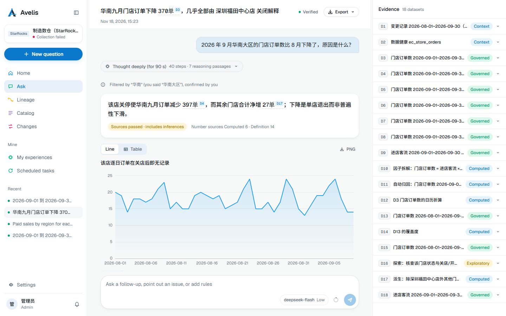
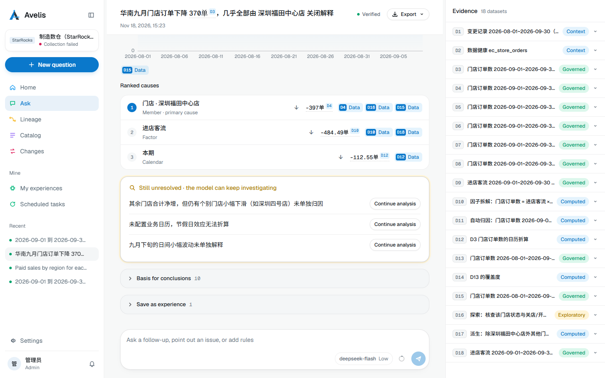
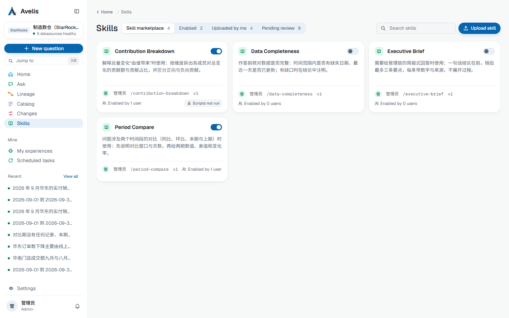
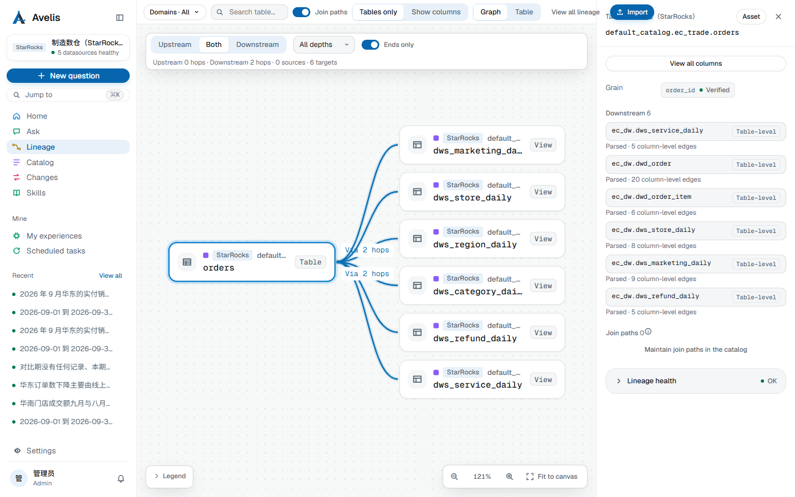
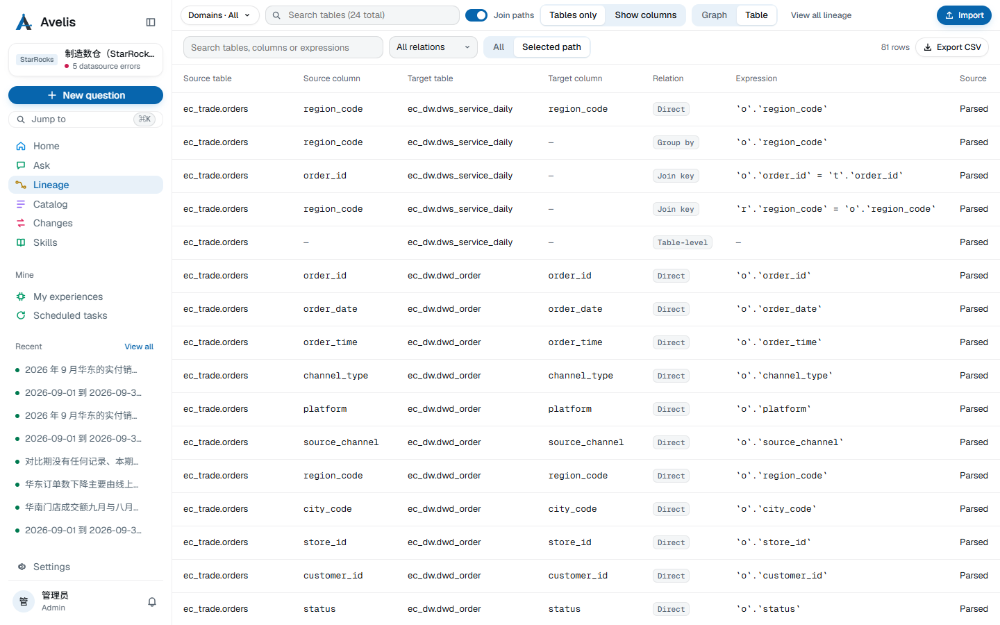
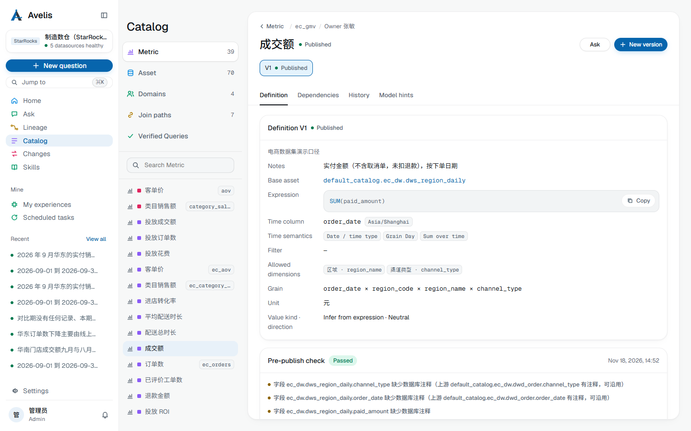
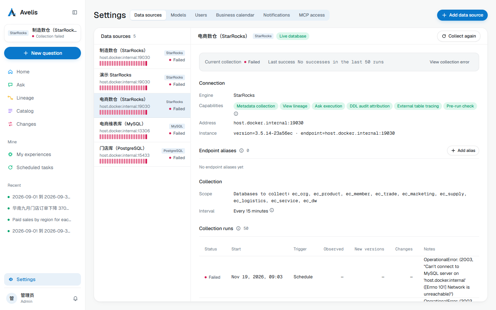

# Product Tour

English | [简体中文](product-tour.md) | [繁體中文](product-tour.zh-TW.md)

This tour walks through the main pages of Avelis with screenshots. They were taken on 2026-11-28 from v1.1.1, at a 1440×900 viewport in the default light theme, plus two in the dark theme. The data on the pages is synthetic e-commerce and store demo data, and all names are fictional. The entries on the personal experience page were saved before the screenshots from what was confirmed in this analysis, and the skills on the skills page are sample packages uploaded beforehand.

## Sign-in

The sign-in page shows the product's tagline and a three-step preview (lineage trace → metric check → grounded insight) on the left, and the sign-in form on the right, with “Remember me (7 days)”; when single sign-on is configured, its sign-in button appears as well. Accounts whose password was created or reset by an administrator must change it on first sign-in.

A dark theme is available (switch it in the app, or follow the system):

## Workbench

The home page after sign-in: overviews of collection, lineage, changes, metric definitions and Ask; to-dos (assigned to me, blocked questions); the metrics I own; and the collection status, schedule and recent changes of each data source.

## Ask and analysis

### Asking a question

Start from **Ask** or **New question**. You can ask for a single number, or ask “why did this change, what is related”. Below the input box you can choose how time is interpreted, how confirmations are handled and which model to use; example questions configured for the business domain are listed underneath.

### Analysis session

An analysis is a conversation in time order:

- the user's question and a collapsible “Thought for N s” section (time taken, reasoning passages, tool calls);
- a conclusion-first report: key conclusions (numbers carry source markers), source verification results, ranked causes (primary cause, direction, contribution and the datasets cited);
- the evidence panel on the right: every dataset produced by this analysis, labelled as governed query, calculation, exploration or context;
- the input box and model bar fixed at the bottom (model name, thinking level, a ring showing context usage), where you can follow up, point out mistakes or add rules.

Further down the report is “Still unresolved · the model can keep investigating”: each unexplained point can be investigated further with one click. Below that are the basis for the conclusions, the basis for the analysis, and the confirmations and corrections that can be saved as experience.

### Thinking and steps

Open “Thought for N s” to see the analysis as a timeline, one row per reasoning passage or tool call. Tool rows show whether the call succeeded or failed, how long it took and the dataset it produced; expand one to see its arguments and a summary of the result. Reasoning rows expand to the full reasoning text. While an analysis runs, the current step shows a spinner and the header shows “Thinking…”, the current step and the time so far; with models whose thinking protocol has been verified, such as DeepSeek, the reasoning text appears live.

### Export

Reports export to PDF, HTML or Markdown. The default is a brief for decision makers; tick “Include basis” to export the full report with data sources and query details.

### Dataset view

Click a dataset in the evidence panel or a dataset reference in the report (such as D4) to open it in the main area: a chart and the rows, the window and notes. You can rerun it with a different time window or export it as CSV; “Back to report” returns to the conversation.

An analysis session in the dark theme:

## Personal experience

What you confirm or correct during analyses is kept as personal experience (rules, joins and so on) and recalled automatically by metric definition and asset in later analyses. Join experience can be turned into a governed join path.

## Skills

“Skills” in the sidebar is a skill marketplace. Packages follow the open [Agent Skills](https://agentskills.io) format: a zip holding one skill folder with a `SKILL.md`, optionally with reference files and scripts. Anyone can upload; an admin reviews a skill before it is listed. Each user enables listed skills for themselves, and none are enabled by default. Scripts in a package are stored and viewable but never executed.

Q&A and analysis pick relevant skills from the ones you have enabled. You can also reference skills explicitly with the “+” at the left of the input box or by typing `/`. The report's analysis basis lists the skills and versions that were used.

## Lineage

### Canvas

Table- and column-level lineage graph: filter by business domain, search for tables, switch between “Tables only” and “Show columns”, and show the join paths maintained in governance. Solid lines carry values from upstream to downstream; dashed lines in the warning color are influencing conditions such as filters, join keys and grouping (they decide which rows take part, but no value is copied to the output); dotted lines link an external table to the real table behind it (“Same table”); dashed placeholder nodes are tables that appear in imported code but have not been collected yet.

**Interaction rule**: clicking a table or column only selects and highlights it; queries such as direction, depth and ends only are started from the trace bar at the top left of the canvas.

### Selection and tracing

Selecting a table or column lights up every upstream and downstream path along the data flow, and the inspector on the right shows its grain, upstream and downstream tables, join paths and influencing conditions. A trace bar appears at the top left of the canvas:

| Control | Effect |
|---|---|
| Upstream / Both / Downstream | Trace direction; “Both” is the union of the two directions |
| Depth | All depths, or only 1, 2, 3 or 5 levels; the bar also shows how many levels can actually be reached |
| Ends only | Keeps only the starting point, the furthest upstream sources and the final destinations; the tables in between collapse into one line labelled with the number of levels |

Tracing follows only the data flow (direct, computed, aggregated, table-level and “Same table”). Filters, join keys and grouping stay visible on the graph but do not take part, so a path contains only real data sources.

### Edge badges

Lines that carry a computation, an aggregation or an influencing condition have a badge in the middle; hover over it to see each column mapping and its expression:

| Badge | Meaning |
|---|---|
| `Σ` Aggregated | Many rows summarised into one value, such as `SUM(x) … GROUP BY …` |
| `ƒ` Computed | A one-to-one computation, such as `price * qty` |
| `⊳` Filter | A column used in a `WHERE` condition |
| `⋈` Join key | A column in a join condition between two tables |
| `▦` Group by | A column in `GROUP BY` |

Lines that pass values through unchanged have no badge. When there are more than 120 lines, badges appear only on the selected path to keep the canvas readable.

### Lineage health

Select a collected table in the inspector, and “Lineage health” lists what looks wrong within one hop of it:

| Finding | Level | Meaning |
|---|---|---|
| Missing column | Severe | A lineage edge references a column the table no longer has, usually because the upstream schema changed without the lineage being updated |
| Uncollected source | Warning | The table depends on a table that appears only in imported code and has never been collected |
| Unparsed definition | Warning | The definition of a view or similar object failed to parse, is unsupported or was only partly parsed, so lineage may be missing |
| Pending candidates / Low confidence | Info | Model-suggested candidate edges not yet confirmed; those below 60% confidence are listed separately |

Click “AI review” and the model gives a verdict (No issues found / Suspected issues / Inconclusive) with a note for each item, based on these findings and the table's structure (no data). It never reports “No issues found” when there are severe findings. The verdict is generated by the model and is for reference only. Review is unavailable when no model is configured or sending code to models is turned off.

### Table view

Switch the toolbar to “Table” to see every column-level relation as a table, one row per relation, with source table, source column, target table, target column, relation, expression and origin. You can search, filter by relation, sort by clicking a header, and page through 100 rows at a time. With a table or column selected you can limit the table to the selected path (for a column, only that column's mappings). “Export CSV” exports all filtered and sorted rows. Clicking a table or column name takes you back to it on the graph.

### Import

“Import” uploads SQL, Python and Shell scripts or zip archives and parses design-time lineage from them; fragments the parser cannot handle become model-suggested candidates that are written to lineage once confirmed.

You can also upload dbt's compiled `target/manifest.json` (run `dbt compile` or `dbt build` first): each model's compiled SQL becomes a `CREATE TABLE / VIEW … AS …` statement before parsing, and each statement in the source view is labelled with the model it came from; ephemeral models are already inlined into their downstream models and do not appear on their own. Single files are limited to 20 MB by default; raise `AVELIS_IMPORT_MAX_BYTES` for larger manifests.

“Unmatched” in the import result lists tables that do not match any collected asset. When a source table's database is outside the data source's collection scope, a maintainer can add it to the scope and collect in one click; re-parse the batch once collection finishes.

### FAQ and known limitations

| Question | Answer |
|---|---|
| Why is a line missing from the traced path? | It carries only filter, join key or grouping relations: it affects which rows take part, but it is not a data source, so it does not take part in tracing |
| What are the dashed placeholder tables? | Tables that appear in imported code but have not been collected from any data source yet; their columns come only from import parsing, and they have no asset dossier |
| Why does an external table link to a table in another database? | An external table (such as a StarRocks JDBC catalog table) and the real table behind it are the “Same table”; tracing continues through the matching column names |
| Can dynamically built SQL be parsed? | SQL assembled at run time cannot be parsed statically; import lists it under “Unrecognized fragments”, and the model can suggest candidates for you to confirm |
| Which databases have lineage? | Only engines supported by SQLGlot; see “Supported databases” in the README for each engine's capabilities. Apache Hive collects metadata and view lineage only |
| Very large lineage | The graph loads the whole connected component of the selected scope at once. With many tables the canvas zooms out only as far as table names stay readable; narrow it down with search, domain filters and “Ends only”. Incremental collection and search for 10k-table catalogs are on the roadmap |

## Catalog

Metrics, assets, business domains and join paths. The metric detail page shows the metric definition's versions, description, base asset, expression, time column, allowed dimensions, grain and unit, and the pre-publish check (for example, columns without database comments and upstream comments that can be reused).

### Asset dossier

Open a table in the catalog and you land on its dossier. The top is a flow band: where the table comes from → the table → what uses it (metric definitions, questions and downstream tables). The row of cards below shows the metric definitions in use, who asked about it recently, and recent structure changes.

Further down is “Column sources”: each column lists its source columns, the kind of processing (direct, aggregate and so on) and a one-sentence description. The model drafts the description and the owner confirms it, so each line is marked either confirmed or “Model draft · needs confirmation”; expressions are collapsed by default and open with “View expression”. A view shows its definition, and a table that scripts were imported for shows the script that writes it and how it writes.

## Settings

Data sources, models, users, business calendar, notifications and MCP access. The data source page shows the connection, endpoint aliases, collection scope and interval, and the result of each collection run.

