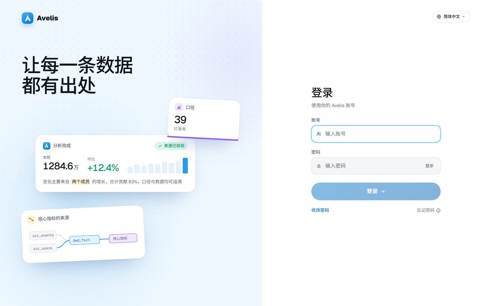
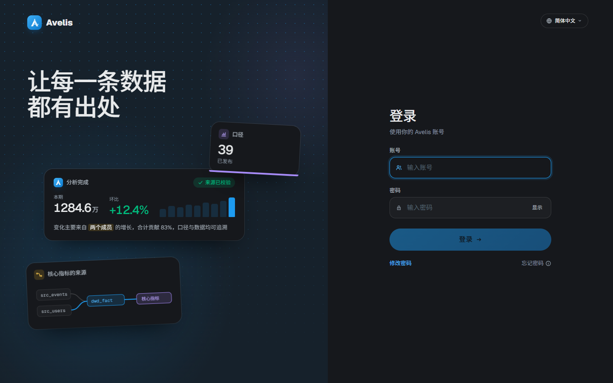
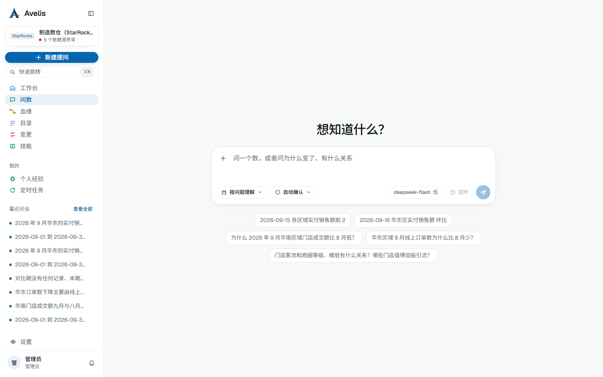
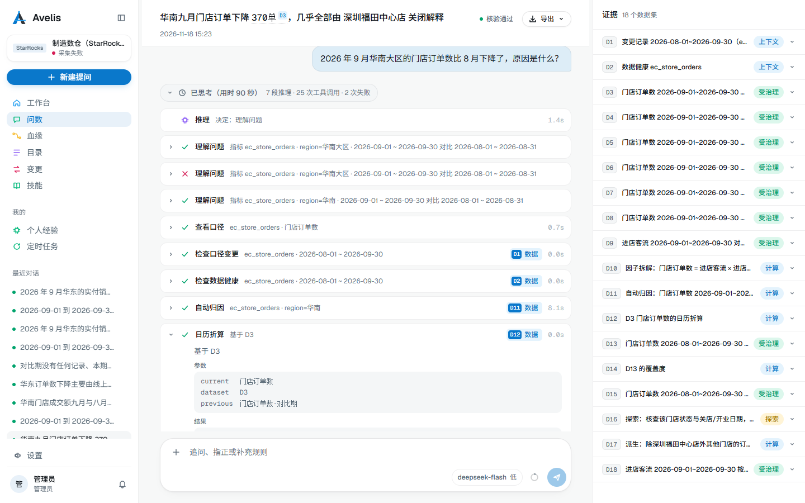
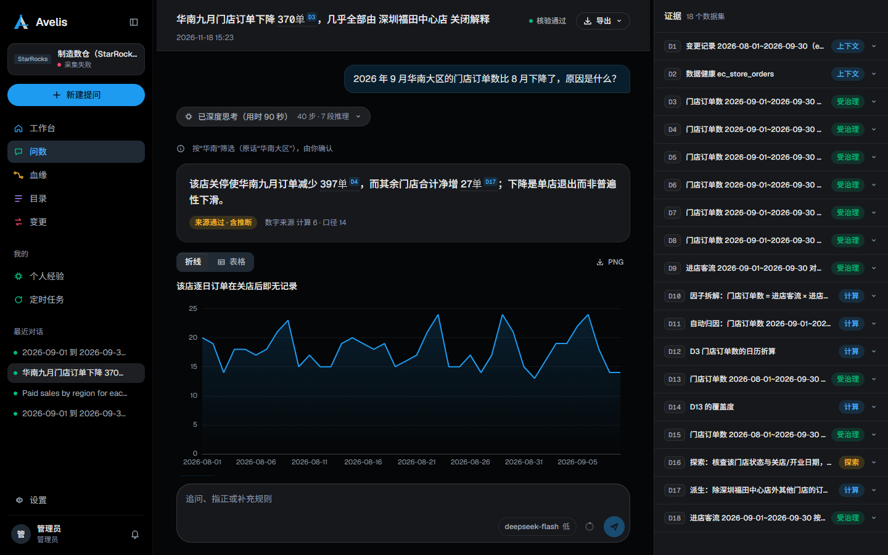
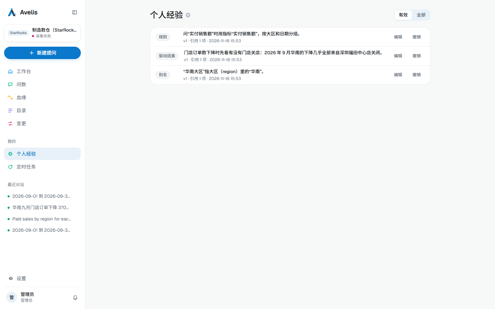
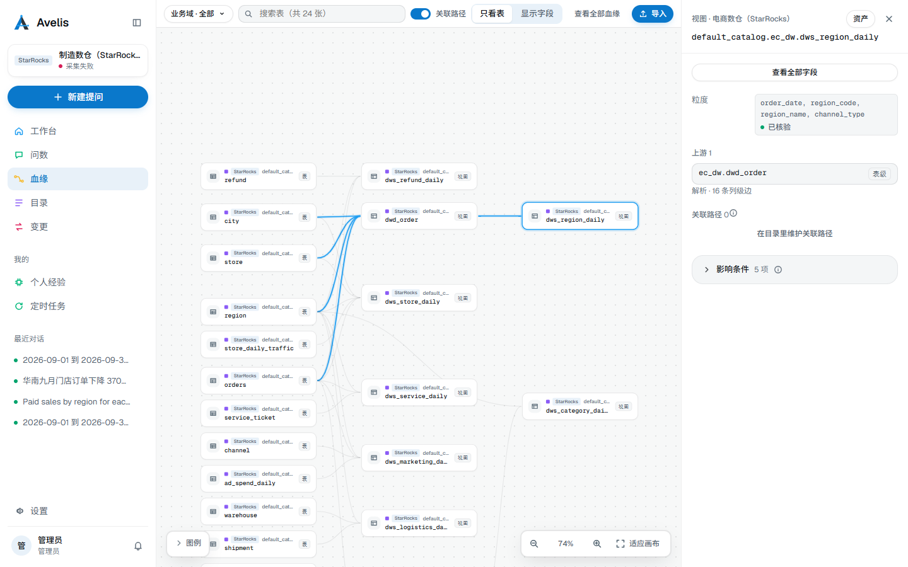
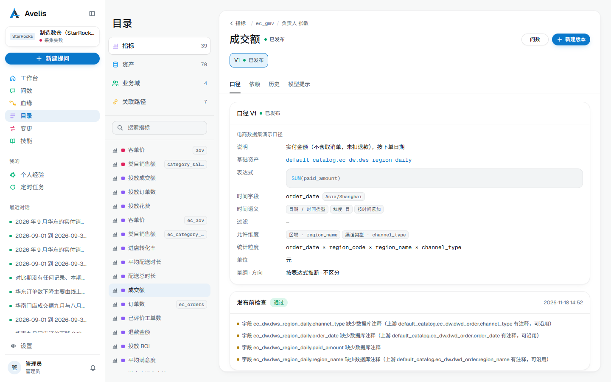
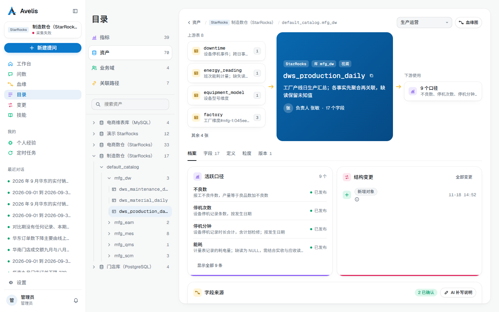
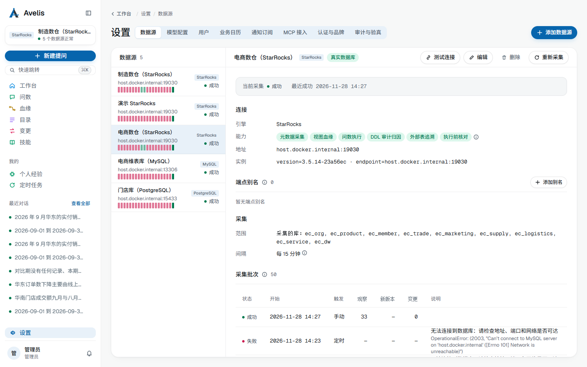

# 界面导览

[English](product-tour.en.md) | 简体中文 | [繁體中文](product-tour.zh-TW.md)

本文用截图介绍 Avelis 的主要页面。截图于 2026-11-19 从 v1.0.11 截取，1440×900 视口、默认浅色主题（另附两张深色）。页面里的数据是合成的电商与门店演示数据，人名均为虚构；个人经验页的几条经验是截图前按这次分析里确认的内容保存的；技能页的几个技能是截图前上传的示例技能包。

## 登录

登录页：左侧是产品标语与一次“有依据的分析”示意，右侧登录。管理员创建或重置口令的账号，首次登录必须修改密码。

支持深色主题（可以在页面里切换，也可以跟随系统）：

## 工作台

登录后的首页：采集、血缘、变更、口径、问数五项概况；待办（待我处理、被拦截的提问）；我负责的指标；各数据源的采集状态、采集节奏与最近变更。

## 问数与分析

### 提问

从“问数”或“新问题”进入。可以直接问一个数，也可以问“为什么变了、有什么关系”；输入框下可选时间理解方式、确认方式与模型，下方列出业务域配置的示例问题。

### 分析会话

一次分析就是一段按时间排列的对话：

- 用户的问题，以及可折叠的“已思考”（用时、推理段数、工具调用次数）；
- 结论优先的报告：核心结论（数字带来源标记）、来源校验结果、原因排序（首要原因、方向、贡献与引用的数据集）；
- 右侧证据栏：本次分析产生的全部数据集，标明受治理查询、计算、探索或上下文；
- 底部固定的输入框与模型栏（模型名、思考档位、上下文用量圆环），可以继续追问、指出不对或补充规则。

报告往下是“待查明 · 可继续分析”：每一条未解释的点都可以一键继续分析；再往下是结论依据、分析依据，以及可保存为经验的确认与纠正。

### 思考与过程

点开“已思考”，可以看到这次分析的逐条时间线：每段推理、每次工具调用各占一行。工具行显示完成或失败、耗时与产生的数据集，展开可查看参数与结果摘要；推理行展开显示完整的推理文字。分析运行中，当前一步显示转圈，标题行显示“思考中…”、当前步数与已用时间；使用 DeepSeek 等已核实思考协议的模型时，推理文字实时显示。

### 导出

报告可导出为 PDF、HTML 或 Markdown；默认是给决策者看的简报，勾选“附带依据”导出完整版（含数据来源与查询明细）。

### 数据集主视图

点击证据栏或报告里的数据集引用（如 D4），在主区域打开数据集：图表与明细、窗口与说明，可以换时间窗口重跑或导出 CSV，“返回报告”回到对话。

分析会话的深色主题：

## 个人经验

分析过程中你确认或纠正过的内容沉淀为个人经验（规则、关联等），分析时按口径与资产自动召回；关联类经验可以转为受治理的关联路径。

## 技能

侧栏的“技能”是一个技能市场。技能包遵循公开的 [Agent Skills](https://agentskills.io) 规范：zip 内一个技能目录，含 `SKILL.md`，可附参考文件与脚本。所有人都可以上传，管理员审核后上架；上架的技能由每个人自行启用，默认不启用，只对本人生效。包里的脚本只保存、可查看，不会执行。

问数与分析会从你已启用的技能中自动选用相关的；也可以点输入框左侧的“+”或输入 `/`，显式引用技能。报告的分析依据列出用到的技能与版本。

## 血缘

表级与字段级血缘图：按业务域筛选、搜索表、显示关联路径或字段。选中一张表后，右侧检查器显示它的粒度、上游与解析出的列级边、关联路径及审核状态、影响条件。

## 目录

指标、资产、业务域与关联路径。指标详情展示口径版本、说明、基础资产、表达式、时间字段、允许维度、统计粒度与单位，以及发布前检查（如缺数据库注释的字段与可沿用的上游注释）。

### 资产档案

在目录里点开一张表，默认看到它的档案。顶部是一条流向带：从哪些表来 → 这张表 → 被哪些口径、提问和下游表用；下面一排卡片是活跃口径、近期提问、结构变更。

再往下是“字段来源”：每个字段列出来源字段、加工类型（直接、聚合等）和一句说明。说明由模型起草，负责人确认后标为已确认，未确认的显示“模型草稿 · 待确认”；表达式默认收起，点“看表达式”展开。视图显示它的定义，导入过脚本的表显示写入它的脚本和写入方式。

## 设置

数据源、模型、用户、业务日历、通知与 MCP 接入。数据源页显示连接、端点别名、采集范围与间隔，以及每次采集批次的结果。

