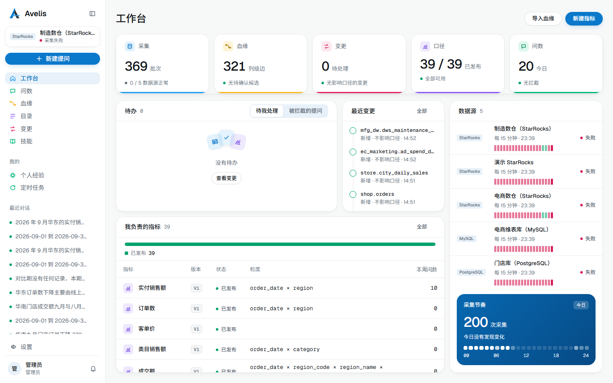
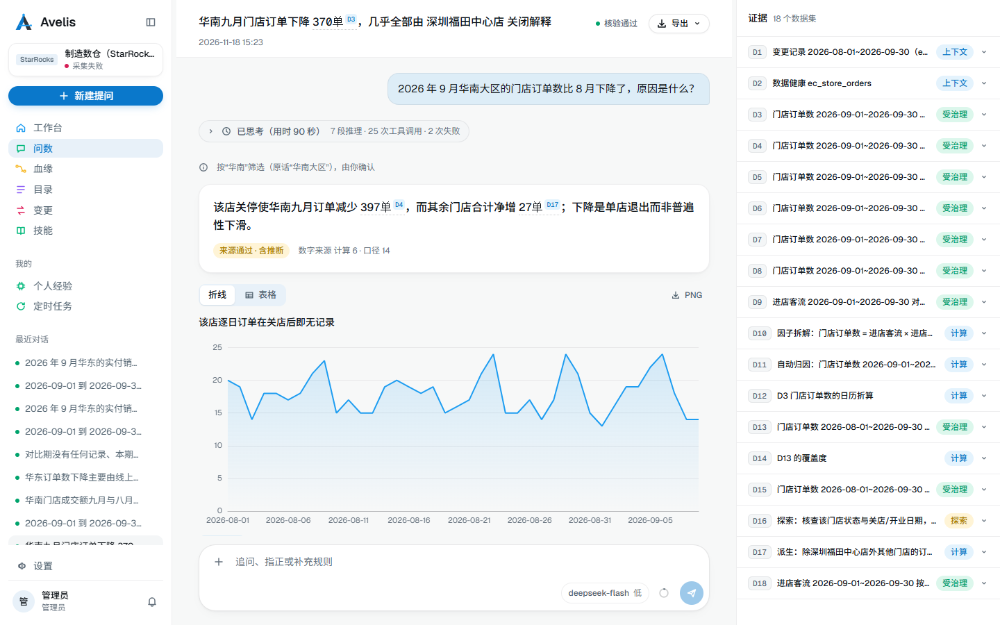
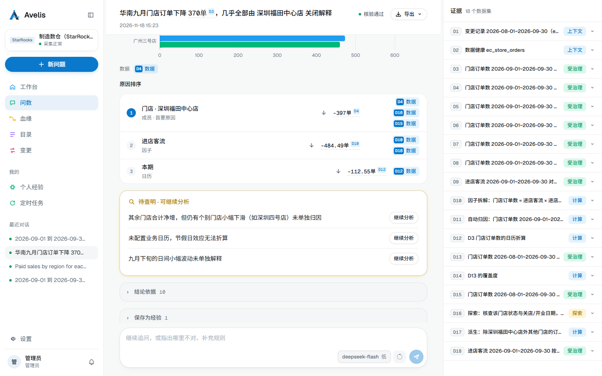
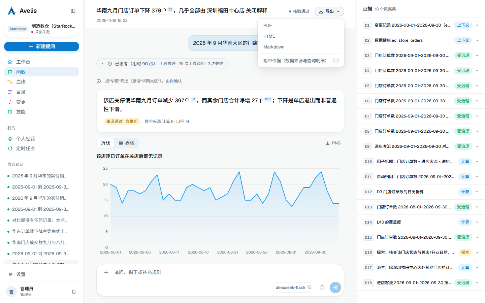
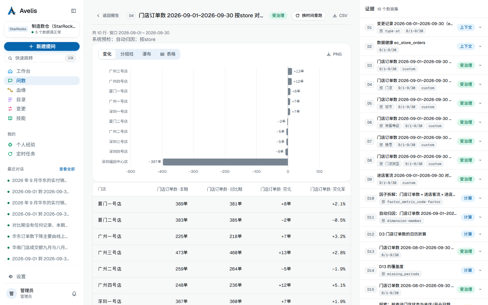
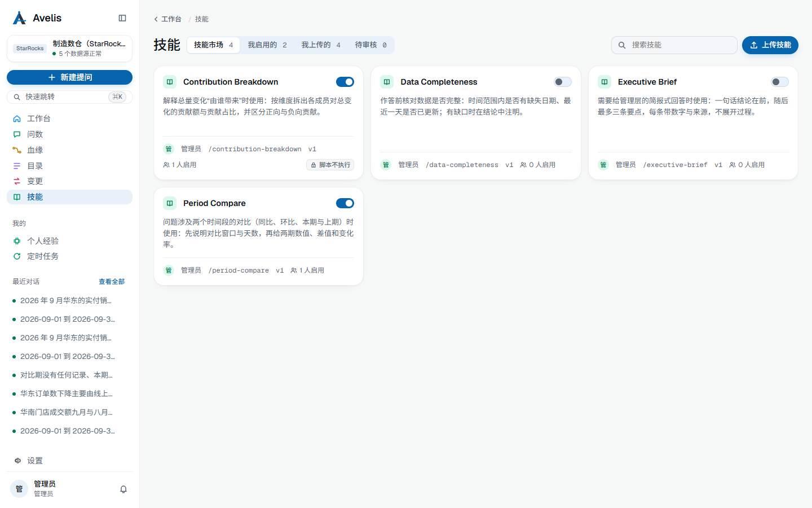
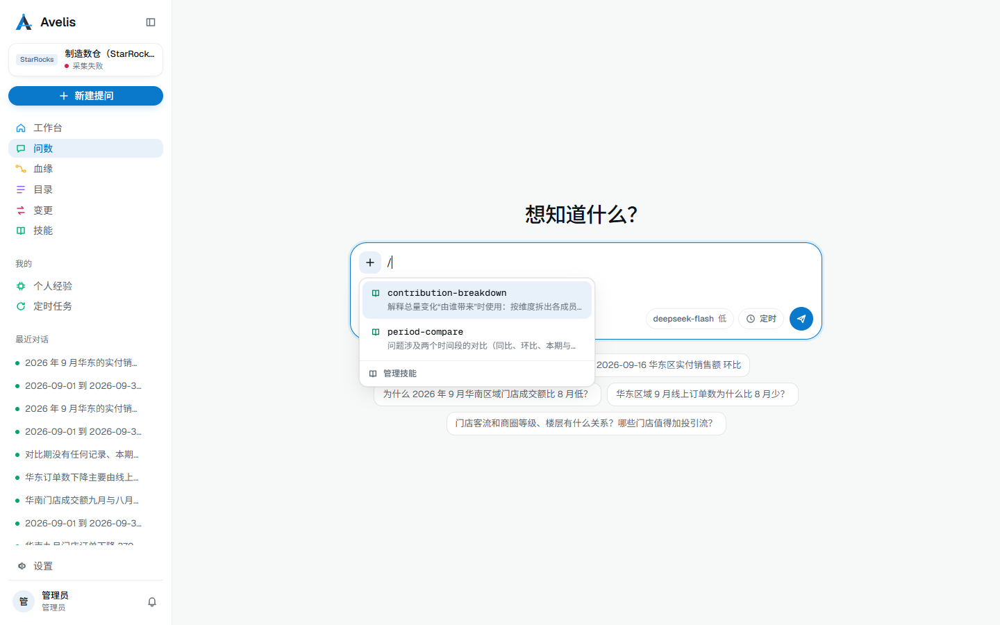
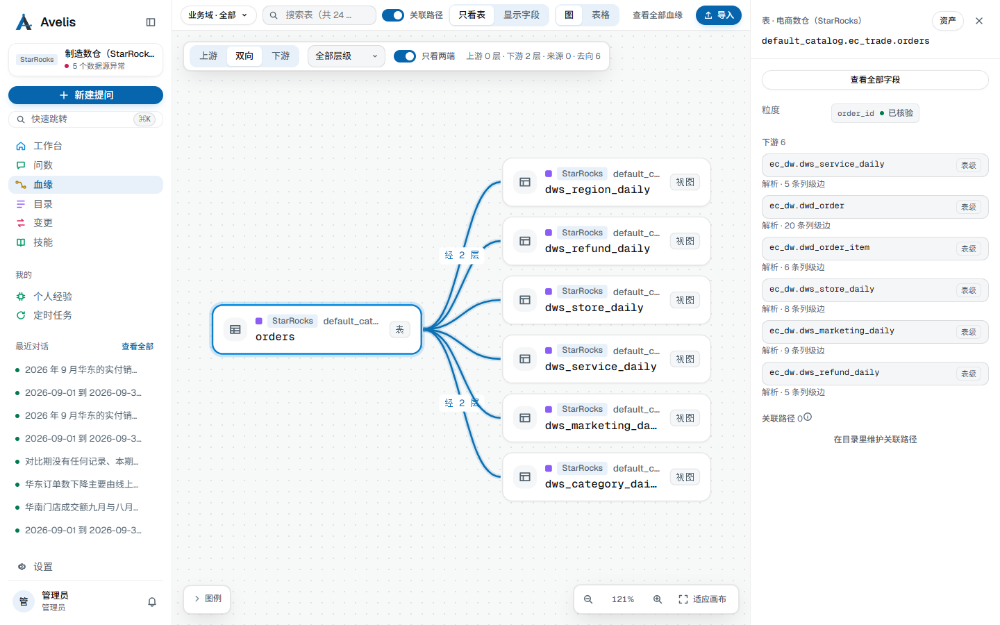
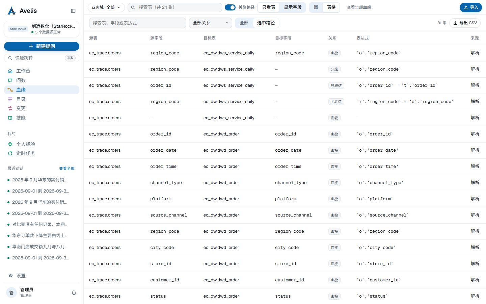
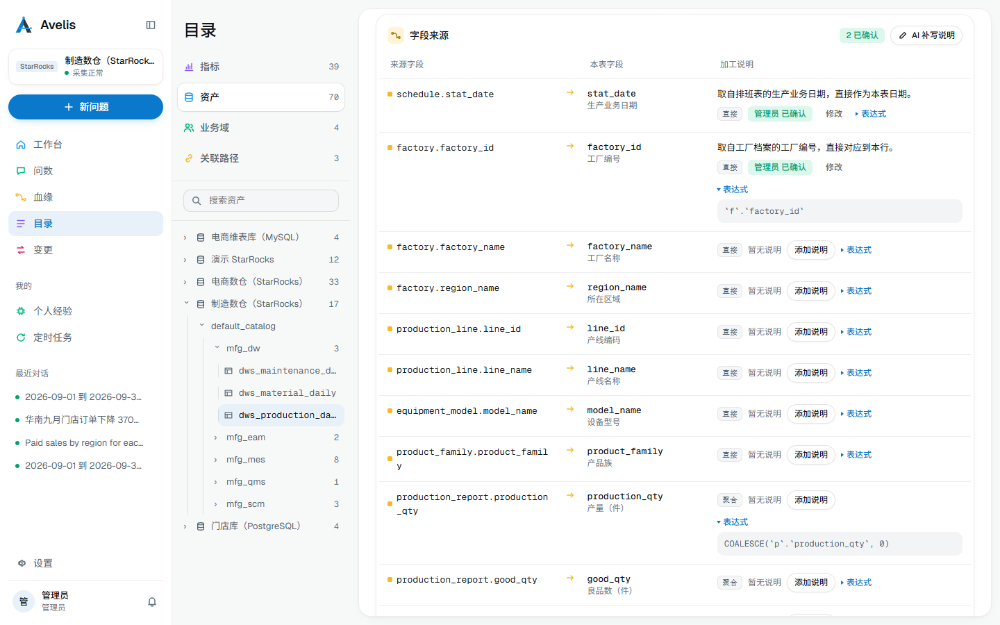

# 界面导览

[English](product-tour.en.md) | 简体中文 | [繁體中文](product-tour.zh-TW.md)

本文用截图介绍 Avelis 的主要页面。截图于 2026-11-27 从 v1.1.0 截取，1440×900 视口、默认浅色主题（另附两张深色）。页面里的数据是合成的电商与门店演示数据，人名均为虚构；个人经验页的几条经验是截图前按这次分析里确认的内容保存的；技能页的几个技能是截图前上传的示例技能包。

## 登录

登录页：左侧是产品标语与“血缘溯源 → 口径校验 → 归因结论”三步示意，右侧登录，可勾选“记住登录（7 天）”；配置了单点登录时会多出对应的登录按钮。管理员创建或重置口令的账号，首次登录必须修改密码。

支持深色主题（可以在页面里切换，也可以跟随系统）：

## 工作台

登录后的首页：采集、血缘、变更、口径、问数五项概况；待办（待我处理、被拦截的提问）；我负责的指标；各数据源的采集状态、采集节奏与最近变更。

## 问数与分析

### 提问

从“问数”或“新问题”进入。可以直接问一个数，也可以问“为什么变了、有什么关系”；输入框下可选时间理解方式、确认方式与模型，下方列出业务域配置的示例问题。

### 分析会话

一次分析就是一段按时间排列的对话：

- 用户的问题，以及可折叠的“已思考”（用时、推理段数、工具调用次数）；
- 结论优先的报告：核心结论（数字带来源标记）、来源校验结果、原因排序（首要原因、方向、贡献与引用的数据集）；
- 右侧证据栏：本次分析产生的全部数据集，标明受治理查询、计算、探索或上下文；
- 底部固定的输入框与模型栏（模型名、思考档位、上下文用量圆环），可以继续追问、指出不对或补充规则。

报告往下是“待查明 · 可继续分析”：每一条未解释的点都可以一键继续分析；再往下是结论依据、分析依据，以及可保存为经验的确认与纠正。

### 思考与过程

点开“已思考”，可以看到这次分析的逐条时间线：每段推理、每次工具调用各占一行。工具行显示完成或失败、耗时与产生的数据集，展开可查看参数与结果摘要；推理行展开显示完整的推理文字。分析运行中，当前一步显示转圈，标题行显示“思考中…”、当前步数与已用时间；使用 DeepSeek 等已核实思考协议的模型时，推理文字实时显示。

### 导出

报告可导出为 PDF、HTML 或 Markdown；默认是给决策者看的简报，勾选“附带依据”导出完整版（含数据来源与查询明细）。

### 数据集主视图

点击证据栏或报告里的数据集引用（如 D4），在主区域打开数据集：图表与明细、窗口与说明，可以换时间窗口重跑或导出 CSV，“返回报告”回到对话。

分析会话的深色主题：

## 个人经验

分析过程中你确认或纠正过的内容沉淀为个人经验（规则、关联等），分析时按口径与资产自动召回；关联类经验可以转为受治理的关联路径。

## 技能

侧栏的“技能”是一个技能市场。技能包遵循公开的 [Agent Skills](https://agentskills.io) 规范：zip 内一个技能目录，含 `SKILL.md`，可附参考文件与脚本。所有人都可以上传，管理员审核后上架；上架的技能由每个人自行启用，默认不启用，只对本人生效。包里的脚本只保存、可查看，不会执行。

问数与分析会从你已启用的技能中自动选用相关的；也可以点输入框左侧的“+”或输入 `/`，显式引用技能。报告的分析依据列出用到的技能与版本。

## 血缘

### 画布

表级与字段级血缘图：按业务域筛选、搜索表，可切换“只看表 / 显示字段”，可显示治理里的关联路径。实线是取值（数据从上游流到下游），警告色虚线是过滤、关联键、分组这类影响条件（决定哪些行参与，但值不复制到输出），点线是外部表与它背后的真实表（“同一张表”），虚线占位节点是导入代码里出现、尚未采集到的表。

**交互约定**：单击表或字段只做选中与高亮，不改变画布；方向、深度、只看两端等查询由画布左上角的追溯工具条发起。

### 选中与追溯

选中一张表或一个字段后，沿数据流把它的上游来路与下游去向全部点亮，右侧检查器显示粒度、上下游、关联路径与影响条件。画布左上角出现追溯工具条：

| 控件 | 作用 |
|---|---|
| 上游 / 双向 / 下游 | 追溯方向；“双向”是上下游各走一遍的并集 |
| 深度 | 全部层级，或只看 1、2、3、5 层；工具条同时显示实际能追到几层 |
| 只看两端 | 只保留起点、最上游来源与最终去向，中间流经的表折叠为一条连线，标明经过的层数 |

追溯只沿数据流走（直接、计算、聚合、表级与“同一张表”）；过滤、关联键、分组仍在图上显示，但不参与追溯，保证路径里只有真实的数据来源。

### 边类型徽章

有计算、聚合或影响条件的连线中点带徽章，悬停查看逐个字段的映射与表达式：

| 徽章 | 含义 |
|---|---|
| `Σ` 聚合 | 多行汇总为一个值，如 `SUM(x) … GROUP BY …` |
| `ƒ` 计算 | 一对一计算，如 `price * qty` |
| `⊳` 过滤 | `WHERE` 条件中用到的字段 |
| `⋈` 关联键 | 两表关联条件中的字段 |
| `▦` 分组 | `GROUP BY` 中的字段 |

直接传值的连线不加徽章。连线超过 120 条时，徽章只在选中路径上显示，避免画布拥挤。

### 表格视图

工具栏切到“表格”，以表格查看全部列级关系：每条关系一行，列出源表、源字段、目标表、目标字段、关系、表达式与来源；可搜索、按关系筛选、点表头排序，每页 100 行。选中表或字段后可以只看选中路径（选中字段时只列这个字段的映射）。“导出 CSV”导出全部筛选与排序结果。点击表名或字段回到图上定位。

### 导入

“导入”上传 SQL、Python、Shell 脚本或 zip 包，解析出设计时血缘；解析不了的片段由模型提出候选，确认后写入血缘。

也可以直接上传 dbt 的编译产物 `target/manifest.json`（需先运行 `dbt compile` 或 `dbt build`）：每个模型按编译后的 SQL 转成一条 `CREATE TABLE / VIEW … AS …` 再解析，原文里每条语句前标明来自哪个模型；ephemeral 模型已内联到下游，不单独出现。单个文件默认上限 20 MB，manifest 更大时可调大 `AVELIS_IMPORT_MAX_BYTES`。

导入结果的“未匹配”列出没对上已采集资产的表；读取来源所在的库不在数据源采集范围内时，维护者可以一键加入范围并采集，采集完成后重新解析即可对上。

### 常见问题与已知限制

| 问题 | 说明 |
|---|---|
| 某条连线为什么没出现在追溯路径里？ | 这条连线只有过滤、关联键或分组关系，它影响哪些行参与计算，但不是数据来源，所以不参与追溯 |
| 虚线占位的表是什么？ | 导入的代码里出现、但还没在任何数据源里采集到的表；字段只来自导入解析，没有资产档案 |
| 外部表为什么连到另一个库的表？ | 外部表（如 StarRocks 的 JDBC Catalog 表）与背后的真实表是“同一张表”，按匹配到的同名字段接续追溯 |
| 动态拼接的 SQL 能解析吗？ | 运行时才拼出的 SQL 无法静态解析，导入时列为“未识别片段”，可由模型提出候选后人工确认 |
| 哪些数据库有血缘？ | 只接入 SQLGlot 支持的引擎，各引擎的能力见首页“支持的数据库”；Apache Hive 只采集元数据与视图血缘 |
| 血缘很大时 | 血缘图一次加载所选范围的整个连通分量，表很多时画布最小缩放到能读出表名，可用搜索、业务域筛选与“只看两端”收窄；万表级的增量与检索优化在路线图中 |

## 目录

指标、资产、业务域与关联路径。指标详情展示口径版本、说明、基础资产、表达式、时间字段、允许维度、统计粒度与单位，以及发布前检查（如缺数据库注释的字段与可沿用的上游注释）。

### 资产档案

在目录里点开一张表，默认看到它的档案。顶部是一条流向带：从哪些表来 → 这张表 → 被哪些口径、提问和下游表用；下面一排卡片是活跃口径、近期提问、结构变更。

再往下是“字段来源”：每个字段列出来源字段、加工类型（直接、聚合等）和一句说明。说明由模型起草，负责人确认后标为已确认，未确认的显示“模型草稿 · 待确认”；表达式默认收起，点“看表达式”展开。视图显示它的定义，导入过脚本的表显示写入它的脚本和写入方式。

## 设置

数据源、模型、用户、业务日历、通知与 MCP 接入。数据源页显示连接、端点别名、采集范围与间隔，以及每次采集批次的结果。

