# 介面導覽

[English](product-tour.en.md) | [简体中文](product-tour.md) | 繁體中文

本文用截圖介紹 Avelis 的主要頁面。截圖來自 main 的 a8dce65 建置（部分頁面含 2026-11-01 截圖時修復的兩處樣式問題），在 1440×900 視口、深色主題下擷取（另附兩張淺色）。頁面裡的資料是合成的電商、門店與製造示範資料，人名均為虛構。

> 截圖為目前的簡體中文介面。介面支援英文與繁體中文後，會按語言補拍對應截圖。

## 登入

科技感的登入頁：左側是產品要點與「有依據的分析」示意，右側登入。管理員建立或重置密碼的帳號，首次登入必須修改密碼。

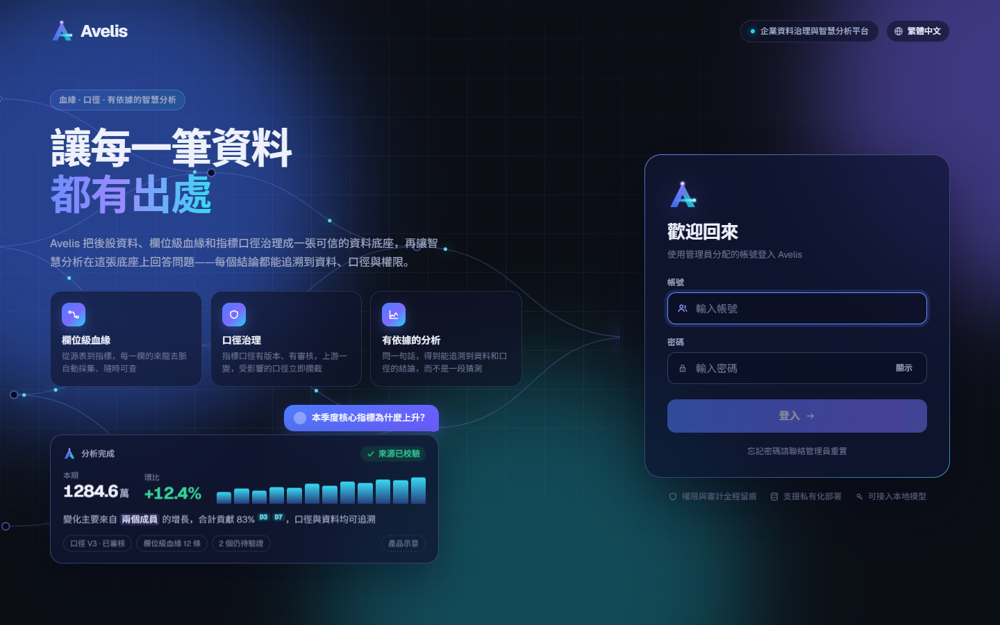

支援淺色主題（跟隨系統，也可以在頁面裡切換）：

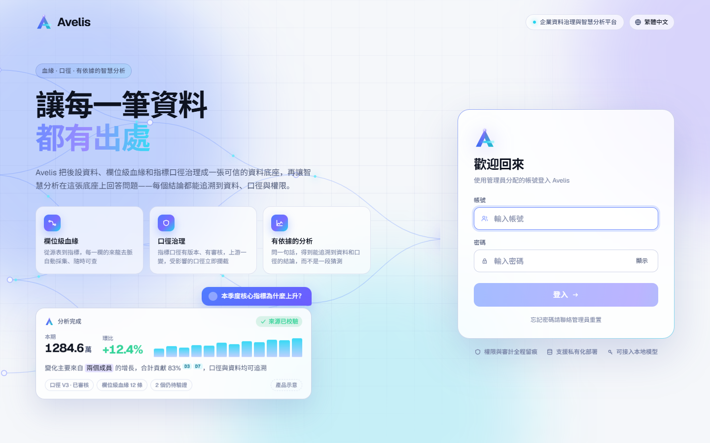

## 工作臺

登入後的首頁：採集、血緣、變更、口徑、問數五項概況；待辦（待我處理、被攔截的提問）；我負責的指標；各資料來源的採集狀態、採集節奏與最近變更。

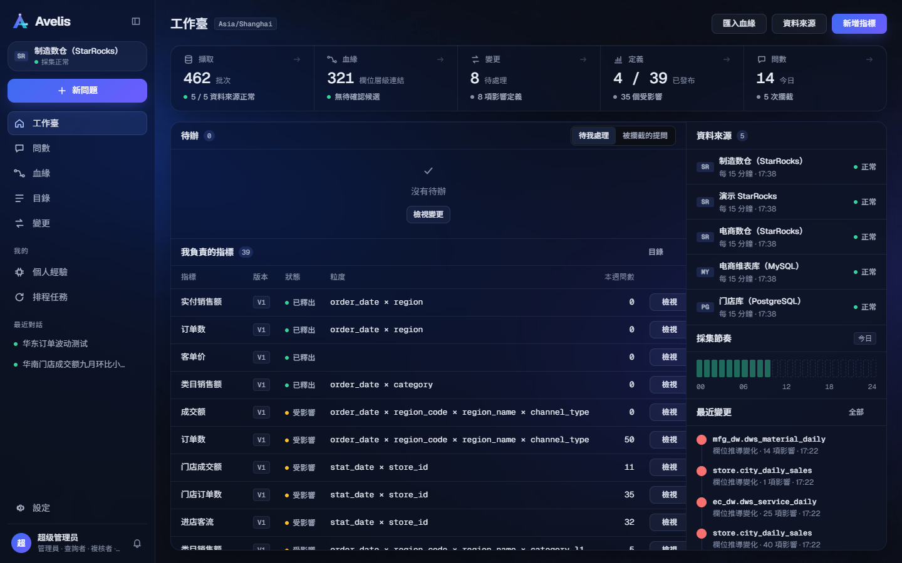

## 問數與分析

### 提問

從「問數」或「新問題」進入。可以直接問一個數，也可以問「為什麼變了、有什麼關係」；輸入框下可選時間理解方式、確認方式與模型，下方列出業務域設定的示例問題。

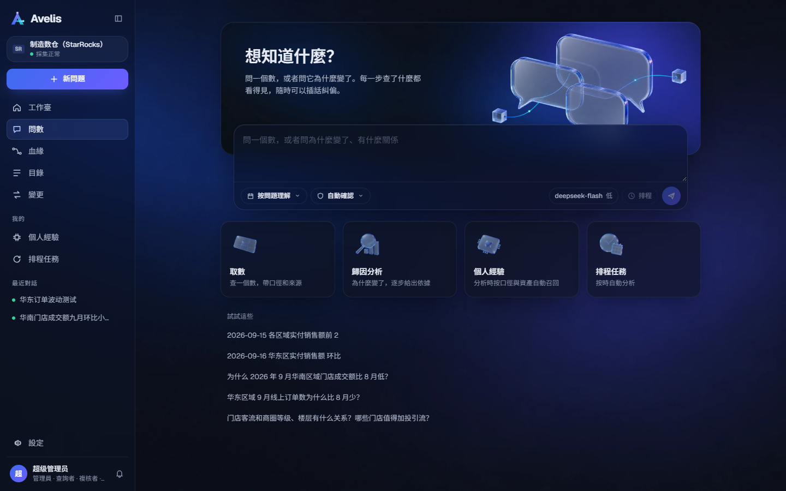

### 分析會話

一次分析就是一段按時間排列的對話：

- 使用者的問題，以及可摺疊的「已深度思考」（用時、步數、推理段數）；
- 結論優先的報告：核心結論（數字帶來源標記）、來源校驗結果、原因排序（首要原因、方向、貢獻與引用的資料集）；
- 右側證據欄：本次分析產生的全部資料集，標明受治理查詢、計算、探索或上下文；
- 底部固定的輸入框與模型欄（模型名、思考檔位、上下文用量圓環），可以繼續追問、指出不對或補充規則。

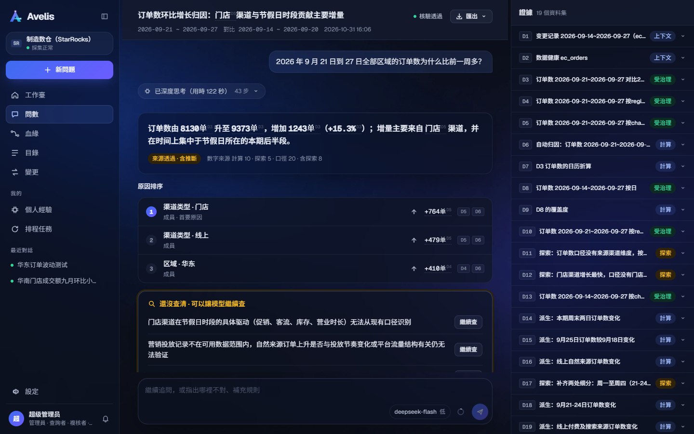

報告往下是「還沒查清 · 可以讓模型繼續查」：每一條未解釋的點都可以一鍵繼續查；再往下是結論依據、分析依據，以及可儲存為經驗的確認與糾正。

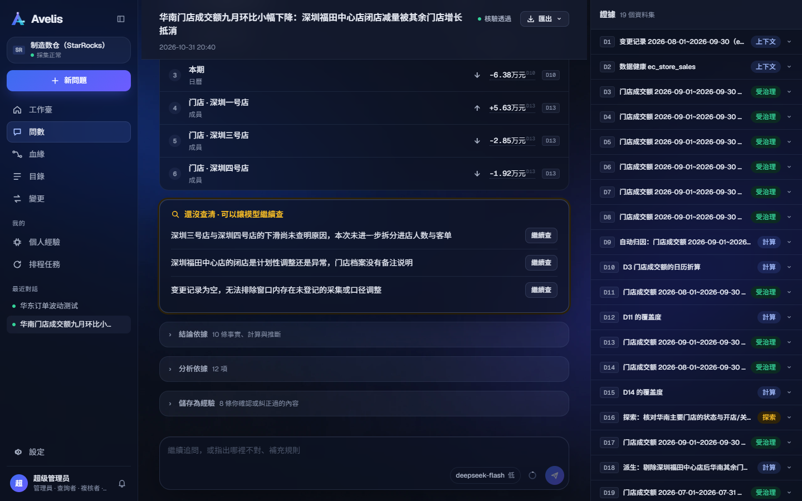

### 匯出

報告可匯出為 PDF、HTML 或 Markdown；預設是給決策者看的簡報，勾選「附帶依據」匯出完整版（含資料來源與查詢明細）。

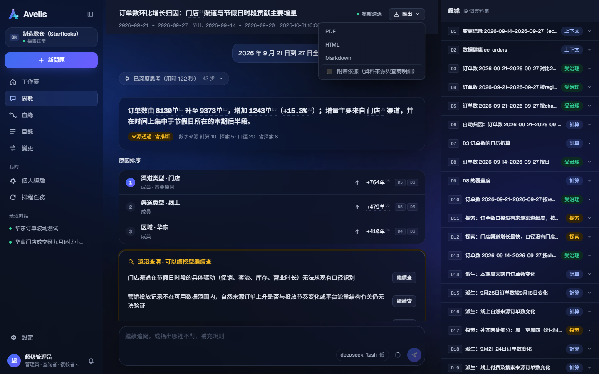

### 資料集主檢視表

點選證據欄或報告裡的資料集引用（如 D13），在主區域開啟資料集：圖表與明細、視窗與說明，可以換時間視窗重跑或匯出 CSV，「返回報告」回到對話。

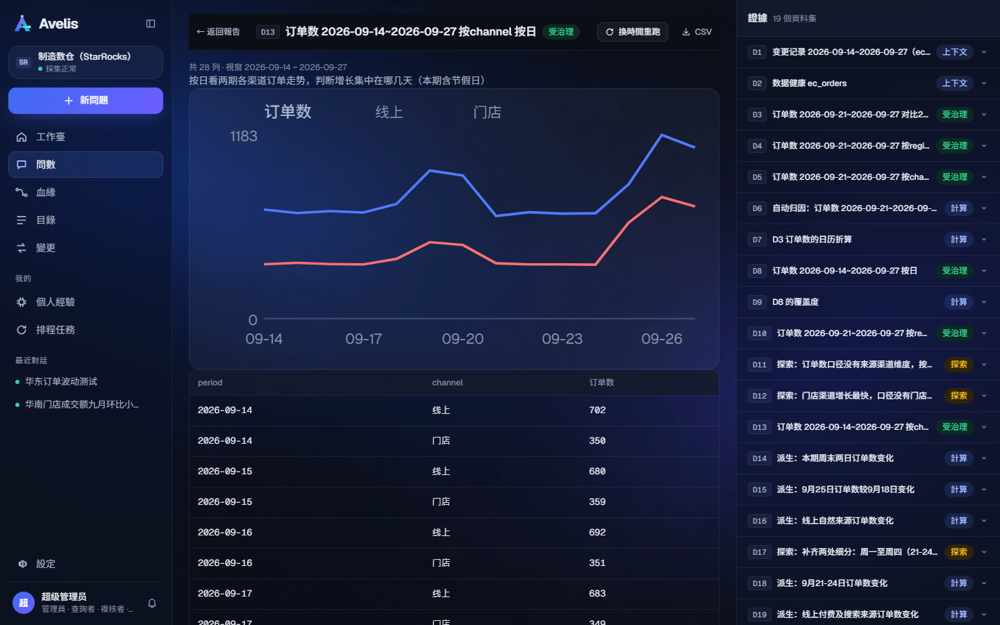

分析會話的淺色主題：

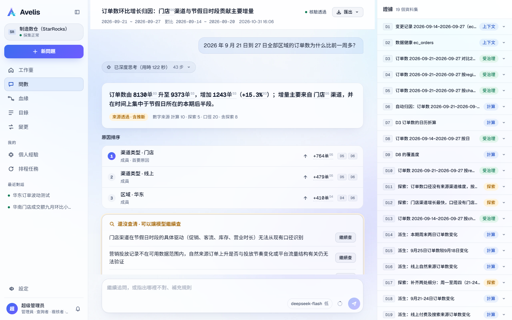

## 個人經驗

分析過程中你確認或糾正過的內容沉澱為個人經驗（規則、關聯等），分析時按口徑與資產自動召回；關聯類經驗可以轉為受治理的關聯路徑。

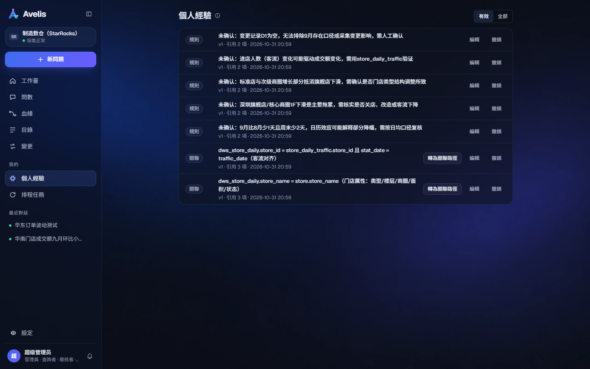

## 血緣

表級與欄位級血緣圖：按業務域篩選、搜尋表、顯示關聯路徑或欄位。選中一張表後，右側檢查器顯示它的粒度、上游與解析出的列級邊、關聯路徑及稽核狀態、影響條件。

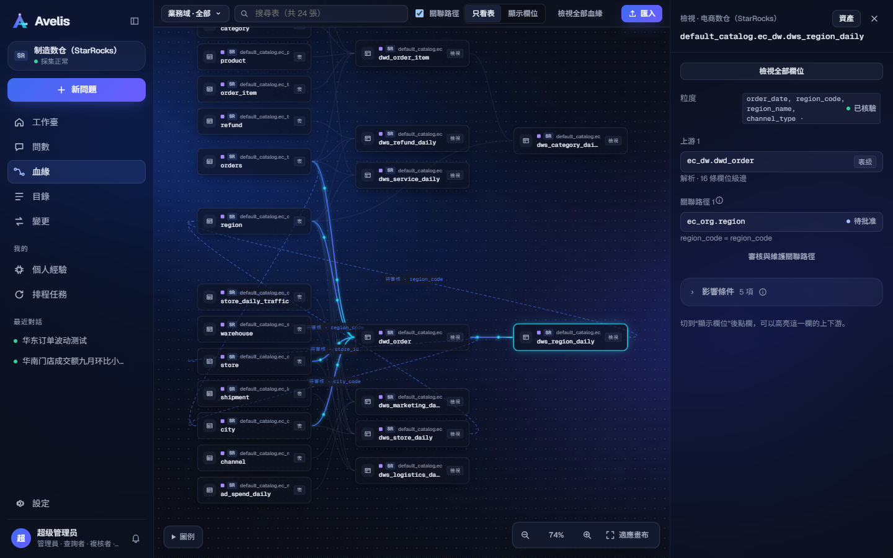

## 目錄

指標、資產、業務域與關聯路徑。指標詳情展示口徑版本、說明、基礎資產、表示式、時間欄位、允許維度、統計粒度與單位，以及發布前檢查（如缺資料庫註釋的欄位與可沿用的上游註釋）。

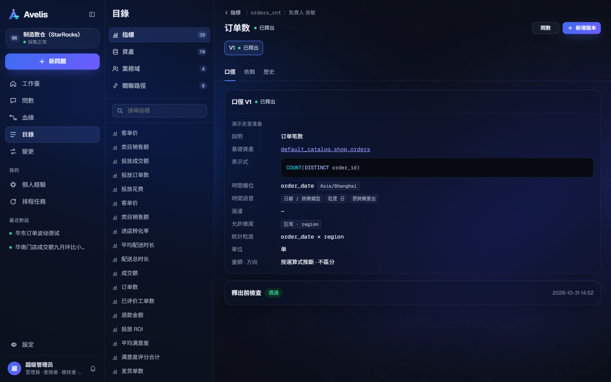

## 設定

資料來源、模型設定與使用者。資料來源頁顯示連線、端點別名、採集範圍與間隔，以及每次採集批次的結果。

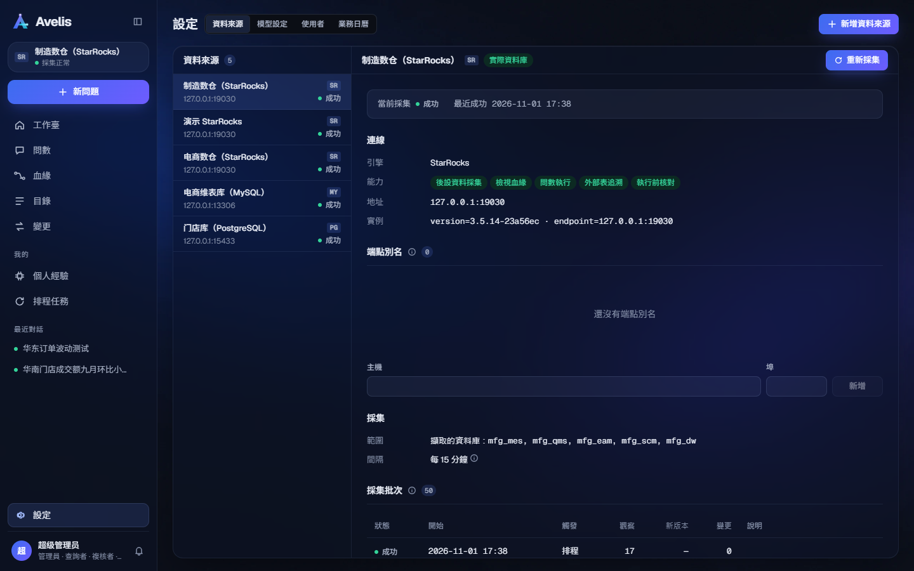
