# 介面導覽

[English](product-tour.en.md) | [简体中文](product-tour.md) | 繁體中文

本文用截圖介紹 Avelis 的主要頁面。截圖於 2026-11-27 從 v1.1.0 擷取，1440×900 視口、預設淺色主題（另附兩張深色）。頁面裡的資料是合成的電商與門店示範資料，人名均為虛構；個人經驗頁的幾條經驗是截圖前按這次分析裡確認的內容儲存的；技能頁的幾個技能是截圖前上傳的示範技能包。

## 登入

登入頁：左側是產品標語與「血緣溯源 → 口徑校驗 → 歸因結論」三步示意，右側登入，可勾選「記住登入（7 天）」；設定了單一登入時會多出對應的登入按鈕。管理員建立或重置密碼的帳號，首次登入必須修改密碼。

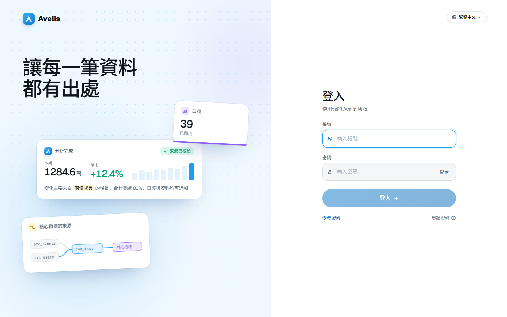

支援深色主題（可以在頁面裡切換，也可以跟隨系統）：

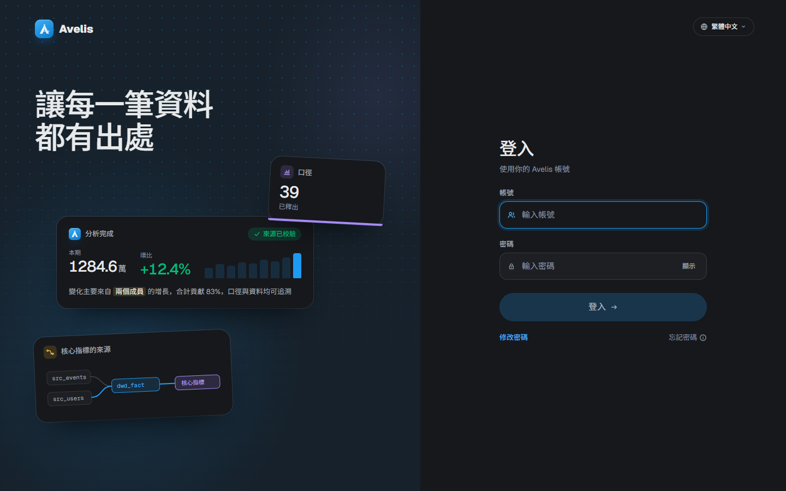

## 工作台

登入後的首頁：採集、血緣、變更、口徑、問數五項概況；待辦（待我處理、被攔截的提問）；我負責的指標；各資料來源的採集狀態、採集節奏與最近變更。

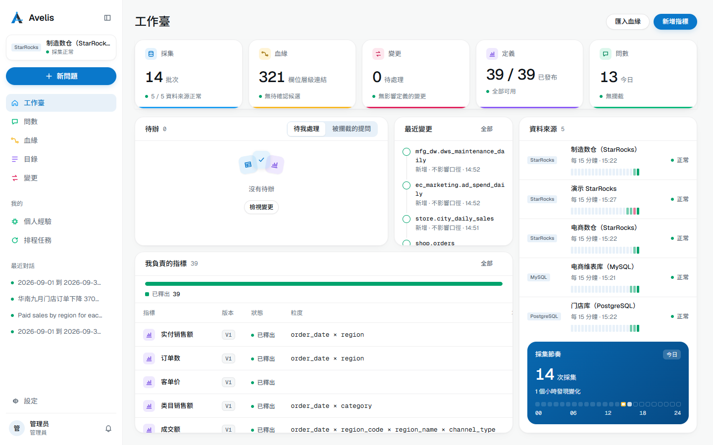

## 問數與分析

### 提問

從「問數」或「新問題」進入。可以直接問一個數，也可以問「為什麼變了、有什麼關係」；輸入框下可選時間理解方式、確認方式與模型，下方列出業務域設定的示例問題。

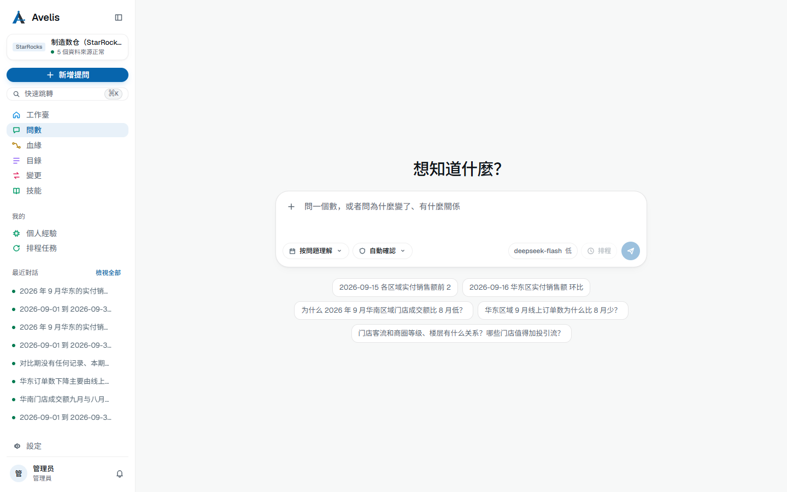

### 分析會話

一次分析就是一段按時間排列的對話：

- 使用者的問題，以及可摺疊的「已思考」（用時、推理段數、工具呼叫次數）；
- 結論優先的報告：核心結論（數字帶來源標記）、來源校驗結果、原因排序（首要原因、方向、貢獻與引用的資料集）；
- 右側證據欄：本次分析產生的全部資料集，標明受治理查詢、計算、探索或上下文；
- 底部固定的輸入框與模型欄（模型名、思考檔位、上下文用量圓環），可以繼續追問、指出不對或補充規則。

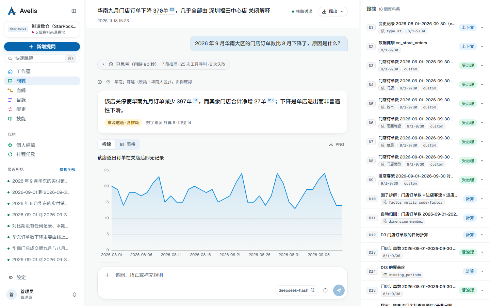

報告往下是「待查明 · 可繼續分析」：每一條未解釋的點都可以一鍵繼續分析；再往下是結論依據、分析依據，以及可儲存為經驗的確認與糾正。

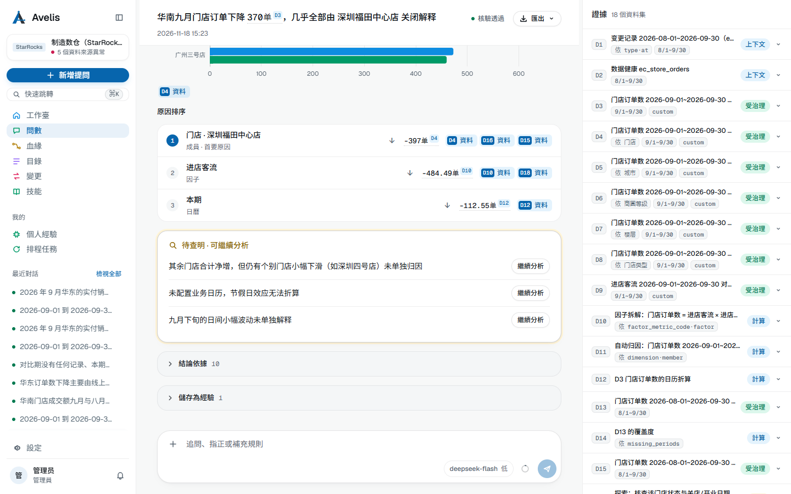

### 思考與過程

點開「已思考」，可以看到這次分析的逐條時間線：每段推理、每次工具呼叫各佔一行。工具列顯示完成或失敗、耗時與產生的資料集，展開可查看參數與結果摘要；推理列展開顯示完整的推理文字。分析執行中，目前這一步顯示轉圈，標題列顯示「思考中…」、目前步數與已用時間；使用 DeepSeek 等已核實思考協議的模型時，推理文字即時顯示。

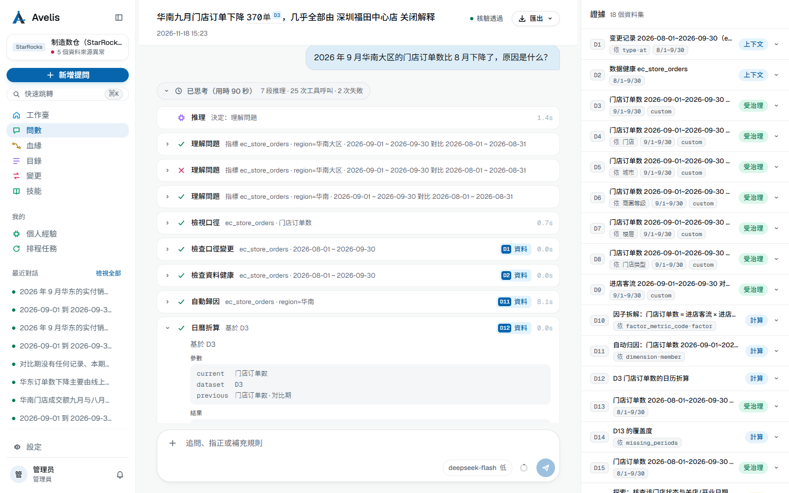

### 匯出

報告可匯出為 PDF、HTML 或 Markdown；預設是給決策者看的簡報，勾選「附帶依據」匯出完整版（含資料來源與查詢明細）。

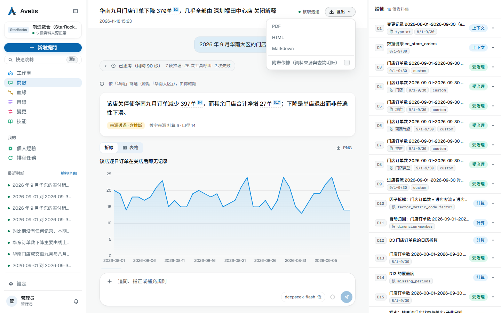

### 資料集主檢視表

點選證據欄或報告裡的資料集引用（如 D4），在主區域開啟資料集：圖表與明細、視窗與說明，可以換時間視窗重跑或匯出 CSV，「返回報告」回到對話。

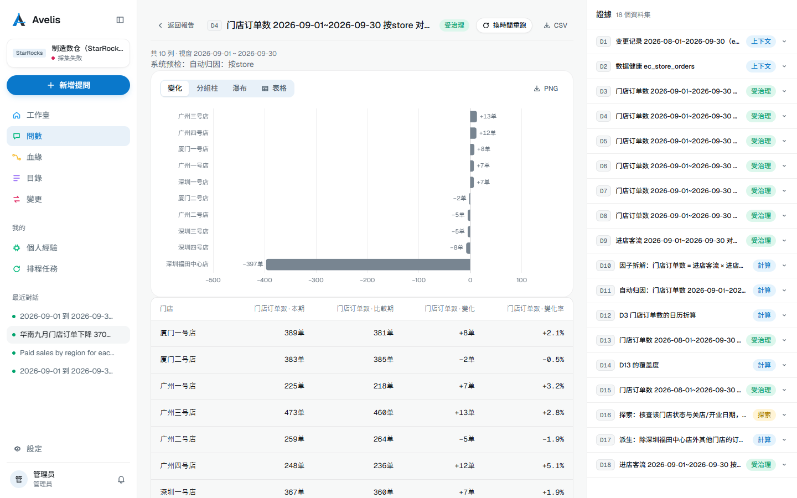

分析會話的深色主題：

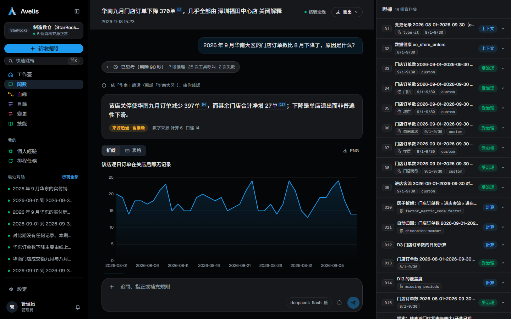

## 個人經驗

分析過程中你確認或糾正過的內容沉澱為個人經驗（規則、關聯等），分析時按口徑與資產自動召回；關聯類經驗可以轉為受治理的關聯路徑。

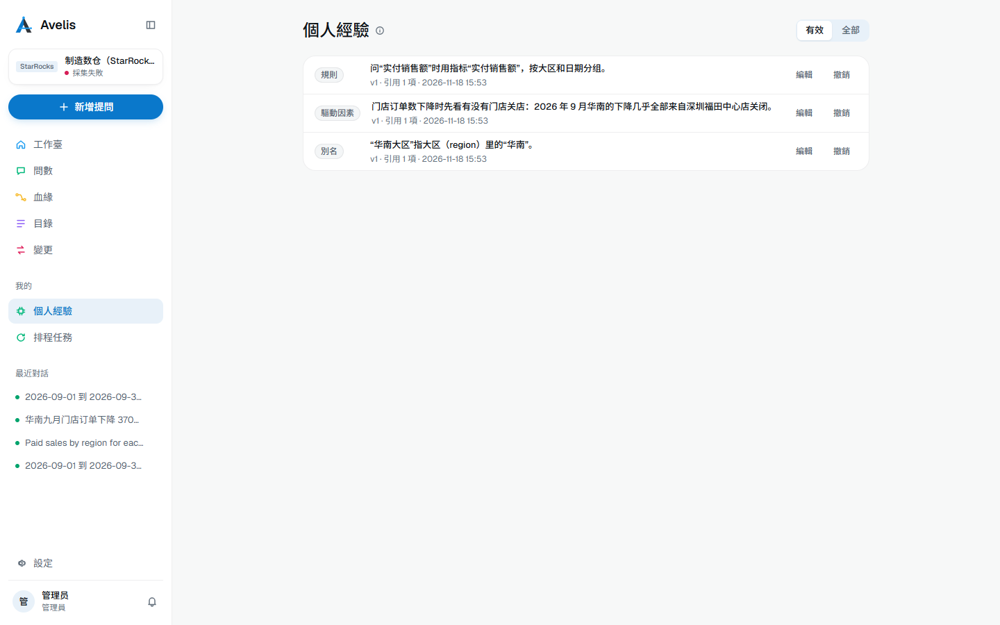

## 技能

側欄的「技能」是一個技能市場。技能包遵循公開的 [Agent Skills](https://agentskills.io) 規範：zip 內一個技能目錄，含 `SKILL.md`，可附參考檔案與腳本。所有人都可以上傳，管理員審核後上架；上架的技能由每個人自行啟用，預設不啟用，只對本人生效。包裡的腳本只儲存、可查看，不會執行。

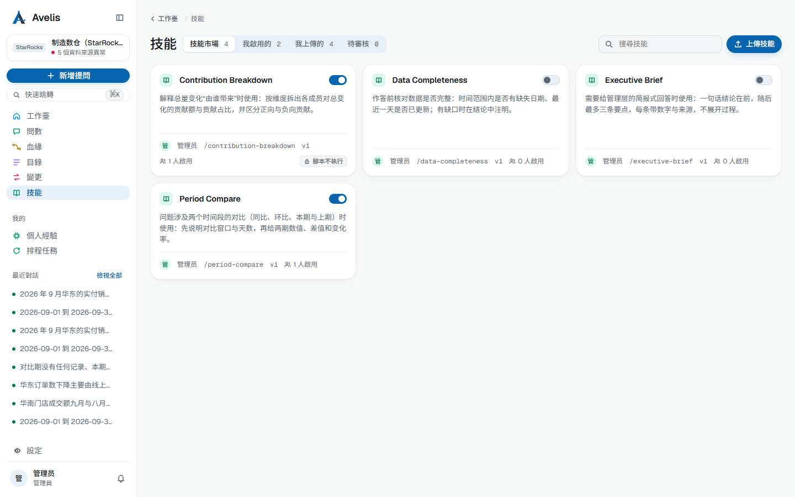

問數與分析會從你已啟用的技能中自動選用相關的；也可以點輸入框左側的「+」或輸入 `/`，明確引用技能。報告的分析依據列出用到的技能與版本。

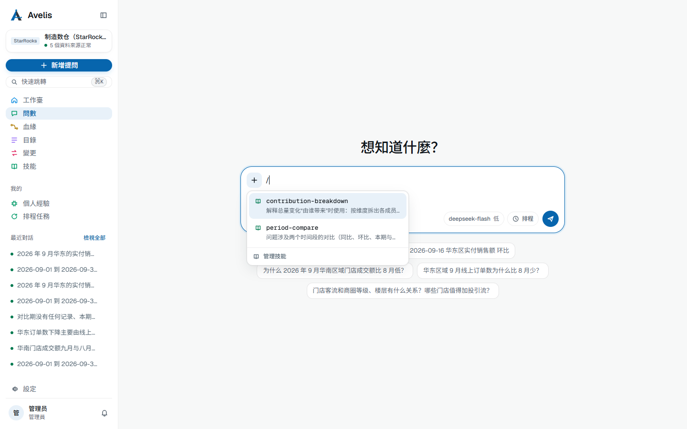

## 血緣

### 畫布

表級與欄位級血緣圖：依業務域篩選、搜尋表，可切換「只看表 / 顯示欄位」，可顯示治理裡的關聯路徑。實線是取值（資料從上游流到下游），警告色虛線是過濾、關聯鍵、分組這類影響條件（決定哪些列參與，但值不複製到輸出），點線是外部表與它背後的真實表（「同一張表」），虛線佔位節點是匯入程式碼裡出現、尚未採集到的表。

**互動約定**：單擊表或欄位只做選取與醒目提示，不改變畫布；方向、深度、只看兩端等查詢由畫布左上角的追溯工具列發起。

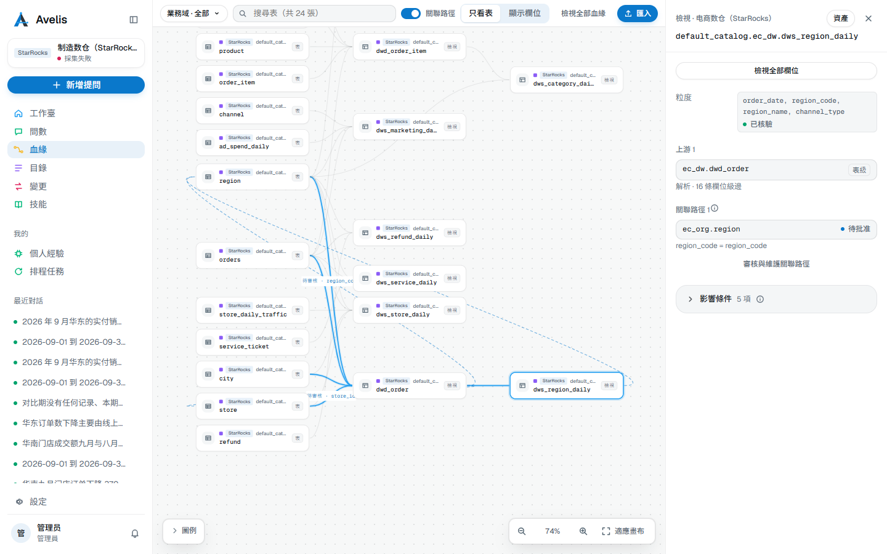

### 選取與追溯

選取一張表或一個欄位後，沿資料流把它的上游來路與下游去向全部點亮，右側檢查器顯示粒度、上下游、關聯路徑與影響條件。畫布左上角出現追溯工具列：

| 控制項 | 作用 |
|---|---|
| 上游 / 雙向 / 下游 | 追溯方向；「雙向」是上下游各走一遍的聯集 |
| 深度 | 全部層級，或只看 1、2、3、5 層；工具列同時顯示實際能追到幾層 |
| 只看兩端 | 只保留起點、最上游來源與最終去向，中間流經的表摺疊為一條連線，標明經過的層數 |

追溯只沿資料流走（直接、計算、聚合、表級與「同一張表」）；過濾、關聯鍵、分組仍在圖上顯示，但不參與追溯，確保路徑裡只有真實的資料來源。

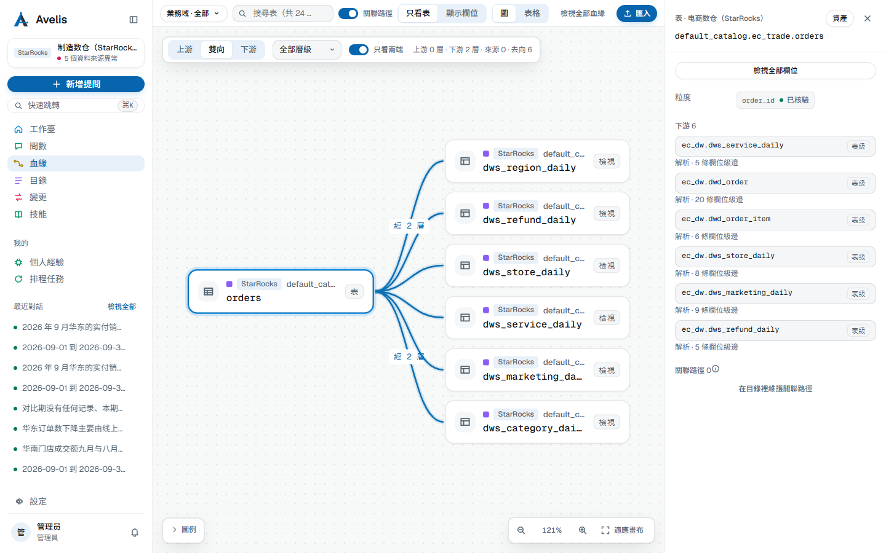

### 邊類型徽章

有計算、聚合或影響條件的連線中點帶徽章，滑鼠停留可檢視逐個欄位的對應與運算式：

| 徽章 | 含義 |
|---|---|
| `Σ` 聚合 | 多列彙總為一個值，如 `SUM(x) … GROUP BY …` |
| `ƒ` 計算 | 一對一計算，如 `price * qty` |
| `⊳` 過濾 | `WHERE` 條件中用到的欄位 |
| `⋈` 關聯鍵 | 兩表關聯條件中的欄位 |
| `▦` 分組 | `GROUP BY` 中的欄位 |

直接傳值的連線不加徽章。連線超過 120 條時，徽章只在選取路徑上顯示，避免畫布擁擠。

### 血緣體檢

在檢查器裡選取一張已採集的表，「血緣體檢」列出它一跳範圍內的可疑之處：

| 發現 | 級別 | 含義 |
|---|---|---|
| 欄位已不存在 | 嚴重 | 血緣邊引用的欄位在這張表的目前欄位裡找不到了，通常是上游改了表結構而血緣沒有更新 |
| 來源未採集 | 警告 | 這張表依賴一張只在匯入程式碼裡出現、從未採集到的表 |
| 定義未解析 | 警告 | 檢視表等物件的定義解析失敗、不支援或只解析了一部分，血緣可能缺失 |
| 待確認候選 / 低信心候選 | 提示 | 模型提出、尚未確認的候選邊；信心度低於 60% 的單獨列出 |

點「AI 複核」，模型會根據這些發現與表結構（不含資料）給出「未發現問題 / 發現疑似問題 / 無法判定」的結論與逐條說明；有嚴重級發現時不會給出「未發現問題」。結論由模型產生，僅供參考。未設定模型或關閉了向模型傳送程式碼時無法複核。

### 表格檢視

工具列切到「表格」，以表格檢視全部欄位級關係：每條關係一列，列出來源表、來源欄位、目標表、目標欄位、關係、運算式與來源；可搜尋、依關係篩選、點表頭排序，每頁 100 列。選取表或欄位後可以只看選中路徑（選取欄位時只列這個欄位的對應）。「匯出 CSV」匯出全部篩選與排序結果。點擊表名或欄位回到圖上定位。

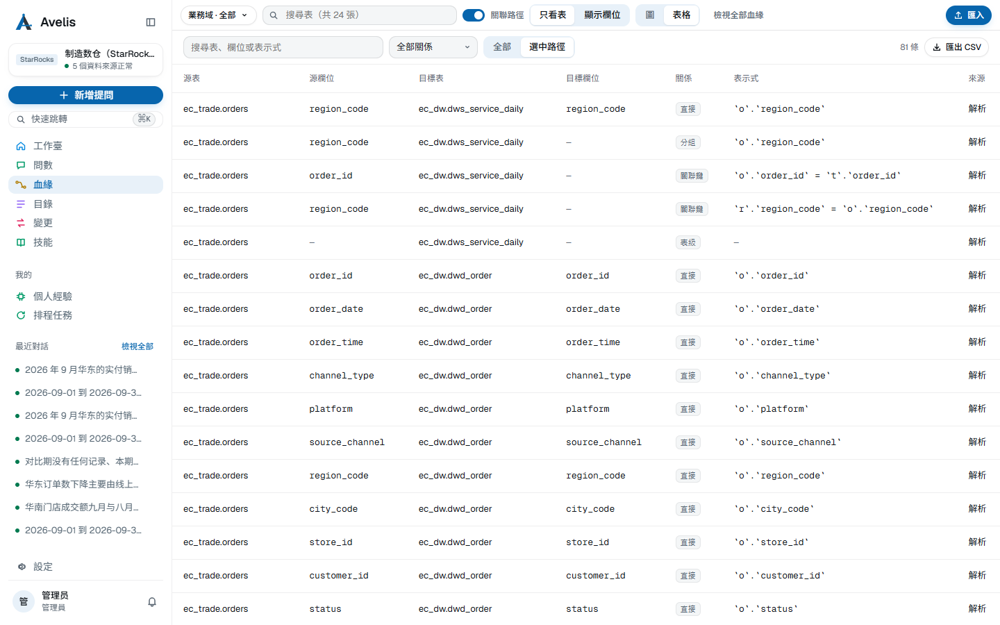

### 匯入

「匯入」上傳 SQL、Python、Shell 腳本或 zip 壓縮檔，解析出設計時血緣；解析不了的片段由模型提出候選，確認後寫入血緣。

也可以直接上傳 dbt 的編譯產物 `target/manifest.json`（需先執行 `dbt compile` 或 `dbt build`）：每個模型依編譯後的 SQL 轉成一條 `CREATE TABLE / VIEW … AS …` 再解析，原文裡每條語句前標明來自哪個模型；ephemeral 模型已內聯到下游，不單獨出現。單一檔案預設上限 20 MB，manifest 更大時可調大 `AVELIS_IMPORT_MAX_BYTES`。

匯入結果的「未匹配」列出沒對上已採集資產的表；讀取來源所在的庫不在資料來源採集範圍內時，維護者可以一鍵加入範圍並採集，採集完成後重新解析即可對上。

### 常見問題與已知限制

| 問題 | 說明 |
|---|---|
| 某條連線為什麼沒出現在追溯路徑裡？ | 這條連線只有過濾、關聯鍵或分組關係，它影響哪些列參與計算，但不是資料來源，所以不參與追溯 |
| 虛線佔位的表是什麼？ | 匯入的程式碼裡出現、但還沒在任何資料來源裡採集到的表；欄位只來自匯入解析，沒有資產檔案 |
| 外部表為什麼連到另一個庫的表？ | 外部表（如 StarRocks 的 JDBC Catalog 表）與背後的真實表是「同一張表」，依對應到的同名欄位接續追溯 |
| 動態拼接的 SQL 能解析嗎？ | 執行時才拼出的 SQL 無法靜態解析，匯入時列為「未識別片段」，可由模型提出候選後人工確認 |
| 哪些資料庫有血緣？ | 只接入 SQLGlot 支援的引擎，各引擎的能力見首頁「支援的資料庫」；Apache Hive 只採集中繼資料與檢視表血緣 |
| 血緣很大時 | 血緣圖一次載入所選範圍的整個連通分量，表很多時畫布最小縮放到能讀出表名，可用搜尋、業務域篩選與「只看兩端」收窄；萬表級的增量與檢索最佳化在路線圖中 |

## 目錄

指標、資產、業務域與關聯路徑。指標詳情展示口徑版本、說明、基礎資產、表示式、時間欄位、允許維度、統計粒度與單位，以及發布前檢查（如缺資料庫註釋的欄位與可沿用的上游註釋）。

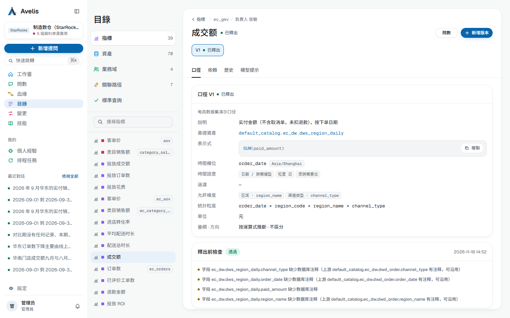

### 資產檔案

在目錄裡點開一張表，預設看到它的檔案。頂部是一條流向帶：從哪些表來 → 這張表 → 被哪些口徑、提問和下游表使用；下面一排卡片是活躍口徑、近期提問、結構變更。

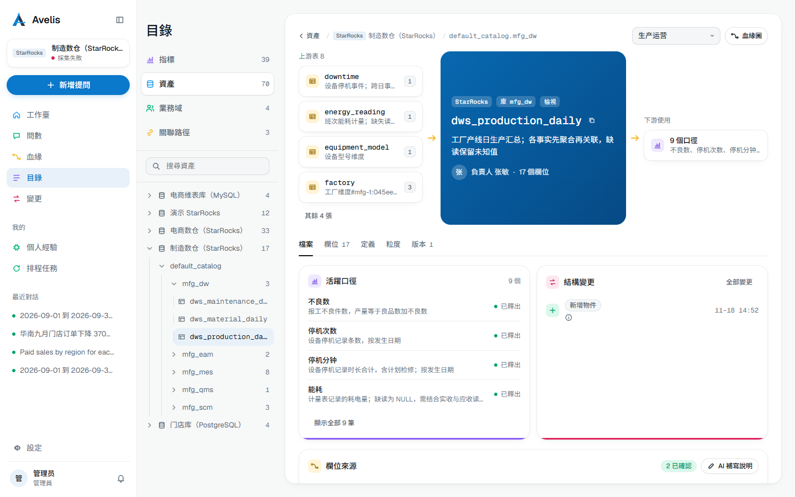

再往下是「欄位來源」：每個欄位列出來源欄位、加工類型（直接、聚合等）和一句說明。說明由模型起草，負責人確認後標為已確認，未確認的顯示「模型草稿 · 待確認」；表示式預設收起，點「看表示式」展開。檢視表顯示它的定義，匯入過腳本的表顯示寫入它的腳本和寫入方式。

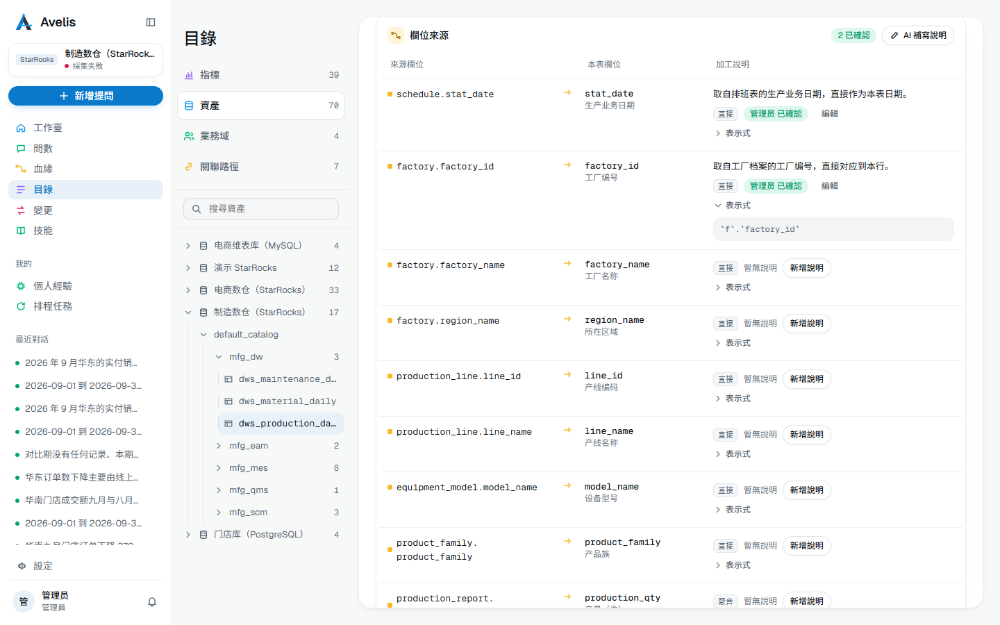

## 設定

資料來源、模型、使用者、業務日曆、通知與 MCP 接入。資料來源頁顯示連線、端點別名、採集範圍與間隔，以及每次採集批次的結果。

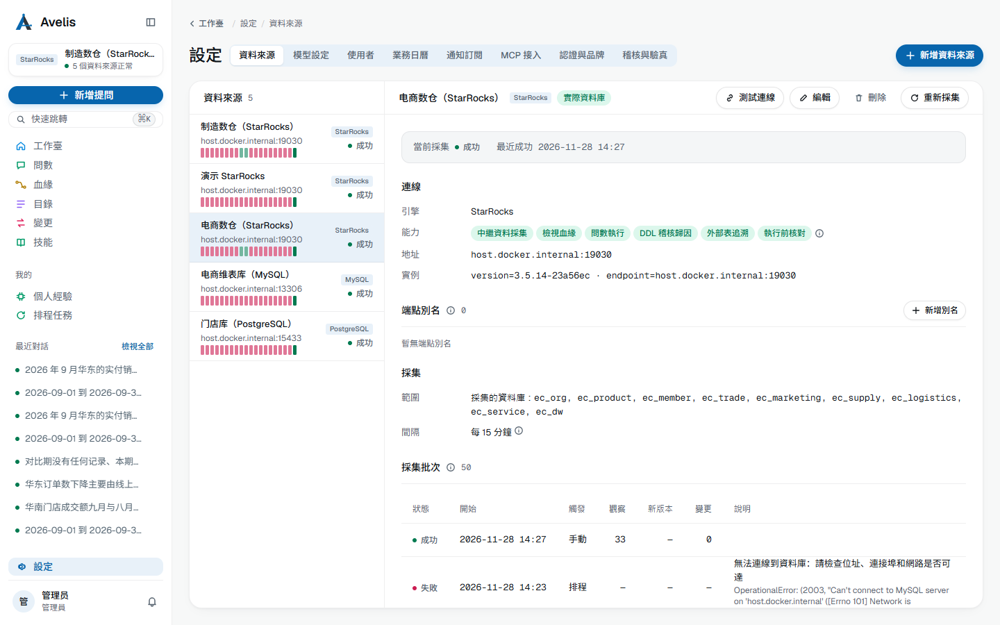
